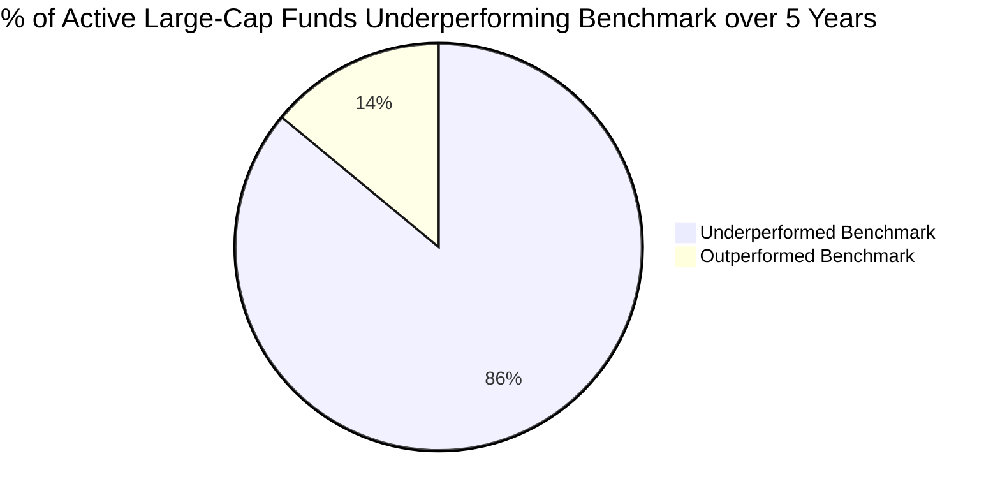

## 1. The SPIVA India Scorecard Reality

For decades, the Indian asset management industry argued that passive investing was suited only for efficient Western markets like the United States, while the developing Indian market offered abundant alpha for active stock-picking fund managers.

The empirical data compiled by **S&P Dow Jones Indices (SPIVA India Scorecard)** over the past decade systematically dismantles this assertion:

### SPIVA India Long-Term Underperformance Rates:

| Mutual Fund Category | 1-Year Underperformance | 3-Year Underperformance | 5-Year Underperformance | 10-Year Underperformance |
| :--- | :--- | :--- | :--- | :--- |
| **Indian Large-Cap Equity** | $58.3\%$ | $82.5\%$ | **$86.4\%$** | **$71.8\%$** |
| **Indian ELSS (Tax Saving)** | $42.0\%$ | $64.8\%$ | $68.2\%$ | $62.5\%$ |
| **Indian Mid / Small-Cap** | $48.2\%$ | $52.0\%$ | $58.1\%$ | $44.6\%$ |

In the large-cap segment, **nearly 9 out of 10 active fund managers fail to beat a simple, low-cost Nifty 50 or BSE 100 index fund**!

---

## 2. The Arithmetic of Active Management Decay

Why has large-cap alpha vanished in India? Nobel Laureate William Sharpe demonstrated that active management failure is a mathematical certainty, not bad luck:

$$
Gross Market Return = \sum All Investors
$$

Before costs, the average active rupee must earn the average market return. Therefore, **after costs, the active investor must mathematically underperform the passive investor**:

$$
Net Active Return = Index Return - Active TER - Trading Churn Friction - Cash Drag
$$

### The Three Structural Drags on Indian Active Funds:
1. **Total Expense Ratio (TER) Drag:** A typical active direct plan charges $0.80\% - 1.20\%$ annually (regular plans charge $1.80\% - 2.20\%$), whereas a passive Nifty 50 index fund charges **$0.05\% - 0.15\%$**.
2. **Mandatory SEBI Categorization (2017):** Pre-2017, active large-cap managers generated "alpha" by quietly buying volatile mid-caps. SEBI's 2017 circular strictly mandated that large-cap funds must hold at least **$80\%$ of their assets in top 100 stocks**, eliminating this hidden beta cheat.
3. **Institutional Cash Drag:** Active funds maintain $3\% - 7\%$ in liquid cash to handle daily redemption spikes. In a secular bull market, this uninvested cash severely drags performance behind a $100\%$ fully invested index fund.

---

## 3. The 25-Year ₹1 Crore Fee Demonstration

Consider a monthly SIP of ₹25,000 growing over **25 years** with an underlying gross market return of **$12.5\%$**:

- **Passive Index Fund (TER $0.10\%$):**
  - Net Return: $12.40\%$
  - Final Terminal Wealth: **₹4,42,85,000 (₹4.43 Crores)**
- **Active Mutual Fund Direct (TER $0.95\%$):**
  - Net Return: $11.55\%$
  - Final Terminal Wealth: **₹3,72,10,000 (₹3.72 Crores)**
  - **Frictional Loss to AMC Fees:** $-\mathbf{₹70,75,000}$
- **Active Mutual Fund Regular via Agent (TER $1.90\%$):**
  - Net Return: $10.60\%$
  - Final Terminal Wealth: **₹3,07,45,000 (₹3.07 Crores)**
  - **Frictional Loss to Distributor Commissions:** $-\mathbf{₹1,35,40,000 (₹1.35 Crores Lost!)}$

Choosing an active regular fund over a low-cost direct index fund costs the investor **more than ₹1.35 Crores in lost compounding wealth** over a career!
