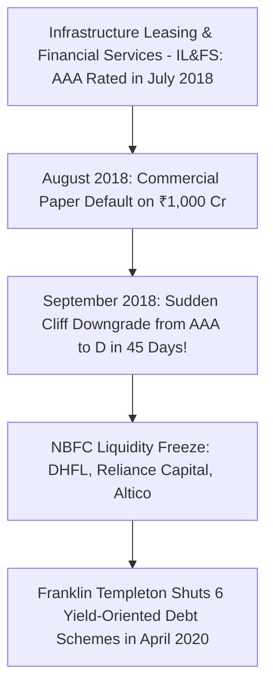

## 1. The Fiction of the Flawless 'AAA' Credit Rating

In retail debt investing, credit ratings assigned by agencies such as CRISIL, ICRA, CARE, and India Ratings are often treated as guarantees of absolute safety:
- **AAA:** Highest safety; lowest credit risk.
- **AA:** High safety.
- **A / BBB:** Adequate to moderate credit risk.
- **BB / B / C:** Speculative to high risk.
- **D:** Default on scheduled interest or principal.

However, the Indian corporate credit crisis of 2018–2020 revealed a structural flaw known as the **Cliff-Edge Downgrade Phenomenon**:

---

## 2. Why Credit Rating Agencies (CRAs) Fail to Warn Investors

The failure of CRAs prior to catastrophic defaults is driven by three institutional realities:
1. **The Issuer-Pays Business Model:** The corporate borrower paying the rating agency millions of Rupees in fees is the very entity being evaluated. This creates an inherent structural conflict of interest.
2. **Backward-Looking Audited Accounting:** Ratings rely on historical audited financial statements that are often 6 to 9 months old, completely missing high-frequency cash burns and short-term asset-liability mismatches.
3. **Rating Inaction Until Formal Default:** Agencies are legally hesitant to downgrade an issuer proactively because a downgrade triggers immediate loan acceleration covenants from commercial banks, precipitating the very bankruptcy the rating predicted.

---

## 3. The Franklin Templeton Crisis: Anatomy of a Liquidity Run

In April 2020, Franklin Templeton India took the unprecedented step of abruptly winding up **six open-ended debt mutual fund schemes** managing over ₹25,000 Crores:

### How a Debt Mutual Fund Freezes:
1. The fund manager invested heavily in lower-rated (AA and A), illiquid, structured corporate debt to deliver an attractive 9.0% - 10.5% yield to retail investors.
2. When the Covid pandemic struck, institutional investors anticipated credit distress and began submitting massive daily redemption requests.
3. Under SEBI rules, a mutual fund must honor redemptions within $T+1$ to $T+2$ business days.
4. To meet redemption calls, the fund sold off its most liquid, high-quality AAA paper first.
5. As liquid assets were depleted, the proportion of illiquid, unrated, and distressed debt in the remaining portfolio soared.
6. The secondary market for Indian corporate bonds froze; there were **zero bids** for the lower-rated papers.
7. Faced with mounting redemption obligations it could not fund without catastrophic fire-sale losses, the fund manager exercised the nuclear option: **suspending all redemptions and freezing investor capital**.

---

## 4. SEBI Regulatory Reforms: Segregated Portfolios (Side-Pocketing)

Following the crisis, SEBI instituted mandatory **Side-Pocketing Regulations**:
- If a debt instrument in a mutual fund scheme is downgraded to below investment grade ($BBB-$ or below), the AMC can immediately separate that toxic asset into a **Segregated Portfolio**.
- Existing investors receive proportionate units in the segregated portfolio.
- Redemptions from the main fund continue normally without being dragged down by the illiquid bad asset.
- If the defaulting company later recovers cash via the Insolvency and Bankruptcy Code (IBC) or asset sales, that money is disbursed to the holders of the segregated units.
