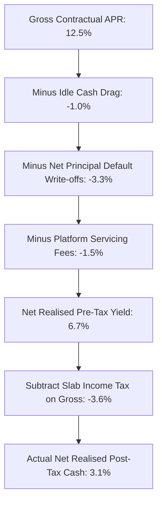
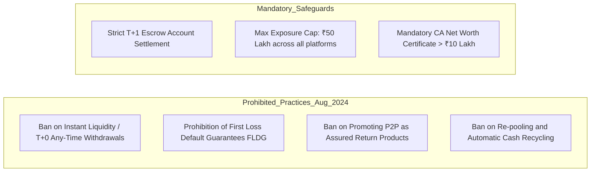

## 1. The P2P Marketing Narrative vs Quantitative Reality

Peer-to-peer (P2P) alternative credit platforms have aggressively targeted retail depositors in India, positioning unsecured personal loans as high-yield substitutes for bank fixed deposits:

> *"Earn 12% to 14% p.a. with regular monthly interest deposited directly into your bank account."*

To a retail saver facing 7.0% bank deposit rates, a 13.0% yield appears mathematically irresistible. However, headline figures represent **Gross Contractual Coupon Interest**. They reflect the hypothetical yield achieved only if 100% of borrowers service their debt on time with zero defaults, zero platform servicing charges, and zero idle cash drag.

The net realized return delivered to an investor's bank account is governed by the **Net Realized Yield Equation**:

$$
Y_{\text{realized}} = (1 - c_{\text{idle}}) \cdot r_{\text{contractual}} - D_{\text{gross}} \cdot (1 - R_{\text{recovery}}) - F_{\text{platform}}
$$

Where:
- $c_{\text{idle}}$ is the uninvested cash drag (escrow balances awaiting borrower matching).
- $r_{\text{contractual}}$ is the weighted average borrower annual percentage rate (APR).
- $D_{\text{gross}}$ is the annual gross loan default rate (principal 90+ days past due).
- $R_{\text{recovery}}$ is the recovery rate on written-off unsecured debt after agency collection fees.
- $F_{\text{platform}}$ is the platform management, servicing, and withdrawal fee.

---

## 2. The Asymmetric Tax Trap: Why Bad Debts Cannot Offset Interest

The single most destructive feature of Indian P2P lending is statutory tax asymmetry under the **Income Tax Act, 1961**:

1. **Gross Interest is Taxed Fully (Section 56(2)):** P2P interest is categorized under *Income from Other Sources* and taxed at the investor's marginal income slab rate ($31.2\%$ for the 30% slab, and up to $39.0\%$ with high-income surcharges).
2. **Bad Debts Cannot Be Deducted (Section 36(1)(vii)):** Under Indian tax law, bad debt deductions against taxable income are restricted strictly to entities carrying on the **business of money lending or banking**. 
3. Individual retail investors lending their personal savings are not recognized as money lenders. Consequently, **defaulted loan principal cannot be set off against interest income, capital gains, or salary**!

### The Devastating Numerical Proof: A ₹10 Lakh P2P Portfolio Audit

Consider a standard ₹10,00,000 retail portfolio deployed across prime and near-prime personal loans:

- **Portfolio Capital:** ₹10,00,000
- **Contractual Average APR ($r$):** $12.5\%$
- **Idle Cash Drag ($c_{\text{idle}}$):** $8.0\%$ (funds idle in escrow between loan amortizations)
- **Gross 90+ DPD Default Rate ($D_{\text{gross}}$):** $4.5\%$
- **Post-Default Net Recovery ($R_{\text{recovery}}$):** $20.0\%$ (after 25% collection agency commission)
- **Platform Management Fee ($F$):** $1.5\%$ of AUM
- **Investor Tax Bracket:** $30\%$ slab ($31.2\%$ with $4\%$ cess)

#### Step 1: Cashflow Decomposition
1. **Actively Deployed Earning Capital:**
   $$ \text{Deployed Capital} = ₹10,00,000 \times (1 - 0.08) = ₹9,20,000 $$
2. **Gross Contractual Interest Earned:**
   $$ \text{Gross Interest} = ₹9,20,000 \times 0.125 = ₹1,15,000 $$
3. **Gross Principal Defaulted (90+ DPD):**
   $$ \text{Defaulted Capital} = ₹9,20,000 \times 0.045 = ₹41,400 $$
4. **Net Principal Written Off After 20% Recovery:**
   $$ \text{Net Capital Loss} = ₹41,400 \times (1 - 0.20) = ₹33,120 $$
5. **Platform Annual Servicing Fee:**
   $$ \text{Platform Fee} = ₹10,00,000 \times 0.015 = ₹15,000 $$
6. **Pre-Tax Net Cashflow Realized:**
   $$ \text{Pre-Tax Realized Cash} = ₹1,15,000 - ₹33,120 - ₹15,000 = ₹66,880 \implies \mathbf{6.688\%} $$

#### Step 2: The Phantom Tax Hit
Because the tax department assesses tax on the **Gross Interest of ₹1,15,000** without allowing any deduction for the ₹33,120 lost principal:

$$
\text{Income Tax Payable} = ₹1,15,000 \times 0.312 = \mathbf{₹35,880}
$$

#### Step 3: Final Net in-Hand Return
$$
\text{Net Post-Tax Realized Cash} = ₹66,880 - ₹35,880 = \mathbf{₹31,000}
$$

$$
\text{Net Post-Tax Return} = \frac{₹31,000}{₹10,00,000} = \mathbf{3.10\%}
$$

**The Takeaway:** While the platform marketed a glowing **12.5%** return, the investor actually took on 100% unsecured credit risk to pocket a measly **3.10% net return**—underperforming a risk-free, DICGC-insured savings bank account!

---

## 3. The August 2024 RBI Regulatory Directives (RBI/2024-25/60)

On 16 August 2024, the Reserve Bank of India issued sweeping amendments to the NBFC-P2P Master Directions to stamp out aggressive and deceptive practices:

### Key Regulatory Enforcements:
1. **Ban on Instant Liquidity / Any-Time Exit:** Platforms are strictly barred from offering instant withdrawal options. An investor's funds can only be returned as and when the underlying borrowers actually pay their monthly EMIs.
2. **Prohibition of Credit Enhancement & FLDG:** Platforms cannot provide balance sheet guarantees, reserve funds, or first-loss protection to absorb borrower defaults. All credit risk must be borne 100% by the retail lender.
3. **Ban on Fund Re-Pooling:** Monies collected from borrower repayments cannot be automatically re-lent without explicit, manual investor re-commitment.
4. **Aggregate Exposure Ceiling:** Total deployment by an individual across all P2P platforms combined is capped at **₹50 Lakhs**, with mandatory submission of a Chartered Accountant Net Worth Certificate verifying a minimum net worth of ₹50 Lakhs for investments exceeding ₹10 Lakhs.

---

## 4. Structural Asymmetry: P2P vs Public Equities vs Sovereign Debt

| Risk Dimension | Peer-to-Peer Unsecured Credit | Listed Equities (Nifty 50) | Sovereign G-Secs / T-Bills |
| :--- | :--- | :--- | :--- |
| **Upside Potential** | Capped strictly at contractual interest ($12\% - 14\%$) | **Uncapped** corporate earnings growth & capital appreciation | Capped at sovereign coupon ($7.0\% - 7.3\%$) |
| **Downside Risk** | **$-100\%$ loss of principal** on defaulted loans | Market volatility (liquid, recovery with economic growth) | Near zero credit risk (backed by sovereign taxation) |
| **Secondary Market Liquidity** | **Zero** (no active secondary resale mechanism) | **Instant T+1 settlement** on NSE/BSE | High liquidity via RBI Retail Direct / NDS-OM |
| **Income Tax Treatment** | Slab rates (up to $39\%$) under Other Sources | Concessional: $12.5\%$ LTCG / $20\%$ STCG | Slab rate (or sovereign exemption on SGB) |
| **Capital Loss Offset in ITR** | **Forbidden** (Bad debts cannot offset other income) | **Allowed** (Capital losses offset capital gains for 8 years) | Allowed on secondary market sales |
| **Underlying Collateral** | None (Unsecured personal consumption loans) | Ownership of tangible corporate productive capacity | Full sovereign faith and credit |

---

## 5. Quantitative Decision Rules for Alternative Credit

If you choose to participate in P2P lending despite these structural headwinds, enforce these institutional constraints:

1. **Portfolio Cap:** Never allocate more than **$2\% - 3\%$ of total liquid net worth** to alternative credit.
2. **Maximum Loan Granularity:** Never allocate more than **₹500 to ₹1,000 per individual borrower**. A ₹5 Lakh portfolio must be spread across at least 500 to 1,000 distinct borrowers to eliminate single-borrower insolvency shocks.
3. **Model the After-Tax Cashflow First:** Use the ArthaAtlas P2P Default Waterfall Calculator before deploying capital to verify whether net post-tax returns exceed risk-free treasury bills.
4. **Zero Tolerance for Unregulated Platforms:** Never lend through entities lacking an active NBFC-P2P license registered on the official RBI registry.
