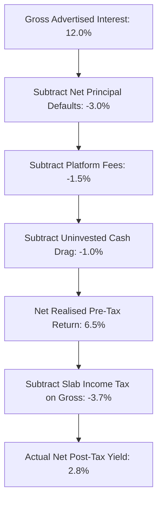

## 1. The P2P Marketing Narrative vs Mathematical Reality

In recent years, Indian peer-to-peer (P2P) lending platforms have aggressively marketed their products to retail investors as high-yielding alternatives to fixed deposits. Promotional campaigns frequently promise:

> *"Earn 12% to 14% p.a. with regular monthly interest directly in your bank account."*

To a retail investor accustomed to $7\%$ bank fixed deposits, a $12\%$ to $14\%$ return appears exceptionally attractive. However, this headline rate is **Gross Contractual Coupon Interest**. It represents what borrowers promise to pay if every single borrower repays their loan on time without a single delinquency or default.

In reality, the net realized return of a P2P portfolio is governed by the **Net Realized Yield Equation**:

$$
Y_{realized} = \left(1 - c_{idle}\right) \cdot r_{contractual} - D_{gross} \cdot (1 - R_{recovery}) - F_{platform}
$$

Where:
- $c_{idle}$ is the idle cash fraction (cash drag awaiting loan disbursement).
- $r_{contractual}$ is the weighted average borrower interest rate.
- $D_{gross}$ is the annual gross loan default rate (principal written off).
- $R_{recovery}$ is the percentage of defaulted principal successfully recovered.
- $F_{platform}$ is the platform servicing and withdrawal fee.

---

## 2. A Rigorous Numerical Case Study: The ₹10 Lakh P2P Portfolio

Let us trace the real-world performance of a ₹10,00,000 portfolio deployed across an Indian P2P platform with the following realistic operational parameters:

- **Capital Deployed:** ₹10,00,000
- **Contractual Average Interest Rate ($r$):** $12.5\%$
- **Idle Cash Drag ($c_{idle}$):** $8.0\%$ (funds sitting in escrow awaiting borrower matching)
- **Gross Principal Default Rate ($D_{gross}$):** $4.5\%$
- **Post-Default Recovery Rate ($R_{recovery}$):** $20.0\%$ (unsecured consumer recovery)
- **Platform Management Fee ($F$):** $1.5\%$ of AUM
- **Investor Tax Bracket:** $30\%$ slab ($31.2\%$ with cess)

### Step-by-Step Mathematical Calculation:

1. **Actively Deployed Earning Capital:**
   $$ Deployed Capital = ₹10,00,000 \times (1 - 0.08) = ₹9,20,000 $$
2. **Gross Contractual Interest Earned:**
   $$ Gross Interest = ₹9,20,000 \times 0.125 = ₹1,15,000 $$
3. **Gross Principal Defaulted:**
   $$ Defaulted Capital = ₹9,20,000 \times 0.045 = ₹41,400 $$
4. **Net Principal Lost After $20\%$ Recovery:**
   $$ Net Capital Loss = ₹41,400 \times (1 - 0.20) = ₹33,120 $$
5. **Platform Annual Management Fees:**
   $$ Platform Fee = ₹10,00,000 \times 0.015 = ₹15,000 $$
6. **Pre-Tax Net Cashflow Realized by Investor:**
   $$ \text{Pre-Tax Income} = ₹1,15,000 - ₹33,120 - ₹15,000 = ₹66,880 $$
   $$ \text{Net Pre-Tax Return} = \frac{₹66,880}{₹10,00,000} = \mathbf{6.688\%} $$

Notice that **before tax**, the advertised $12.5\%$ headline rate has already collapsed to **$6.69\%$**—lower than a safe, DICGC-insured Small Finance Bank FD yielding $8.5\%$!

---

## 3. The Structural Asymmetry of Unsecured P2P Credit

In equities, an investor takes high risk for potentially unlimited upside ($+50\%, +100\%, +500\%$). In P2P lending, the risk-return payoff is inverted:

| Dimension | P2P Lending Reality | Equity Investment Reality |
| :--- | :--- | :--- |
| **Maximum Upside** | Capped strictly at contractual interest ($12\%$) | Uncapped business growth & earnings expansion |
| **Maximum Downside** | **$-100\%$ loss of principal** on defaulted loans | Share price volatility with corporate liquid assets |
| **Secondary Liquidity** | **Zero** (locked until loan amortizes) | Instant T+1 market exit on stock exchanges |
| **Tax Loss Offset** | **Forbidden** (Bad debts cannot offset interest in ITR) | Fully allowed (Capital losses offset capital gains) |
| **Underlying Collateral** | None (Unsecured personal consumption loans) | Ownership of productive plant, machinery & cash |
