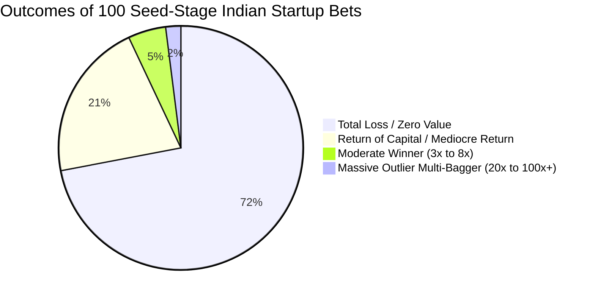

## 1. The Mathematics of Venture: The Power Law Curve

In traditional equity investing (the Nifty 50 or broad market), returns follow an approximately normal, bell-shaped Gaussian distribution: most stocks return between $-10\%$ and $+25\%$, with rare outliers.

In early-stage angel investing, **returns follow an extreme Power Law (Pareto) distribution**:

$$
P(X > x) \sim x^{-\alpha}
$$

Where $\alpha \approx 1.5 - 2.0$.

### The Statistical Implication:
1. **The Median Return is ZERO:** For an angel investor who backs only 3 to 5 startups, the most statistically probable outcome is a **$100\%$ total loss of invested capital**.
2. **Portfolio Sizing Rule:** To have an $85\%+$ statistical probability of capturing at least one massive outlier winner that pays for all the failed bets, an angel investor **must build a diversified portfolio of at least 25 to 40 distinct startup investments**.

---

## 2. The Dilution Trap: Why a '10x' Company Yields Only '4x' to Angels

Novice angel investors often celebrate when a portfolio company achieves a higher valuation in a subsequent Series A, B, or C round:
> *"I invested at a ₹10 Crore valuation, and they just raised Series B at ₹100 Crores—my money grew 10x!"*

This fails to account for **Equity Dilution Across Funding Rounds**:

### Dilution Mathematical Equation:
If a startup issues new shares in round $i$ representing a dilution fraction $d_i$:

$$
\text{Final Ownership \%} = \text{Initial Ownership \%} \times \prod_{i=1}^{k} (1 - d_i)
$$

After Series A ($20\%$), an expanded ESOP pool ($10\%$), Series B ($20\%$), and Series C ($18\%$):

$$
Final Ownership = 5.0\% \times 0.80 \times 0.90 \times 0.80 \times 0.82 = \mathbf{1.889\%}
$$

When the company is acquired for ₹100 Crores:
- The angel's $1.889\%$ share is worth **₹1.89 Crores**.
- The headline company valuation grew **10x**, but the angel investor's realized return was only **7.5x** before management fees and taxes.

---

## 3. Practical Guardrails for Indian Angel Investors

1. **Strict Net Worth Allocation:** Never allocate more than **5% to 10% of total liquid net worth** to angel investing.
2. **Syndicate Model:** Invest via licensed Category I Angel Funds or AngelList syndicates where minimum ticket sizes are ₹2 Lakhs to ₹5 Lakhs, allowing you to spread ₹50 Lakhs across 15 to 20 deals instead of sinking it into a single startup.
3. **Information Rights & Liquidity:** Always demand quarterly audited financials, cap-table updates, and tag-along rights in the shareholder agreement.
