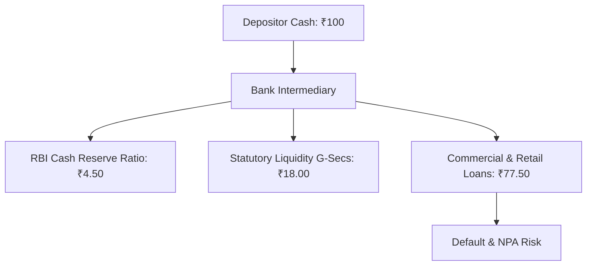

## 1. The Myth of the Risk-Free Bank Deposit

In Indian financial culture, the bank fixed deposit has historically been treated as a surrogate for absolute risk-free money. However, history demonstrates that banks are leveraged financial intermediaries whose survival depends on asset quality, liquidity matching, and regulatory oversight.

When a depositor places ₹10 Lakhs into a bank, the bank does not lock that cash in a vault. It maintains a **Cash Reserve Ratio (CRR)** of approximately $4.5\%$ with the RBI, invests $\approx 18\%$ in sovereign bonds under the **Statutory Liquidity Ratio (SLR)**, and lends out the remaining $\approx 77\%$ as retail, corporate, and real estate loans.

---

## 2. Quantitative Solvency Metrics for Indian Banks

Investors allocating significant capital to bank fixed deposits should inspect three foundational ratios published in the bank's quarterly audited financial statements:

### A. Net Non-Performing Assets (Net NPA)
$$
Net NPA = \frac{Gross NPAs - Provisions}{Total Customer Advances}
$$
- **Healthy:** Below $1.0\%$
- **Caution:** $1.0\% - 2.5\%$
- **Dangerous:** Above $3.0\%$ (indicates provisioning shortfall)

### B. Capital to Risk-Weighted Assets Ratio (CRAR)
$$
CRAR = \frac{\text{Tier 1 Capital} + \text{Tier 2 Capital}}{\text{Risk-Weighted Assets}}
$$
- **Statutory RBI Minimum:** $9.0\%$ for scheduled commercial banks ($15.0\%$ for Small Finance Banks).
- **Prudent Safety Cushion:** Above $16.0\%$.

### C. Provision Coverage Ratio (PCR)
The percentage of bad loans backed by capital provisions. A ratio above $75\%$ ensures that bad debt write-offs will not impair depositor balances.

---

## 3. Small Finance Banks (SFBs) vs Scheduled Commercial Banks

Small Finance Banks (such as AU Small Finance Bank, Equitas, Ujjivan, Suryoday) routinely offer fixed deposit interest rates of $8.0\% - 9.0\%$, compared to $6.8\% - 7.2\%$ from large public and private sector banks.

### Are SFBs Safe for Retail Capital?

1. **Statutory Status:** Every RBI-licensed SFB is an officially classified *Scheduled Bank* included in the Second Schedule of the Reserve Bank of India Act, 1934.
2. **DICGC Inclusion:** Depositors in an SFB enjoy exactly the same statutory ₹5,00,000 DICGC insurance protection as depositors in State Bank of India or HDFC Bank.
3. **The Multi-Bank Optimization Strategy:** By splitting ₹20 Lakhs across four distinct SFBs (e.g. ₹4.8 Lakhs principal + ₹20k accrued interest buffer each), an investor earns $8.5\%$ gross yield with $100\%$ statutory DICGC protection across the entire corpus.
