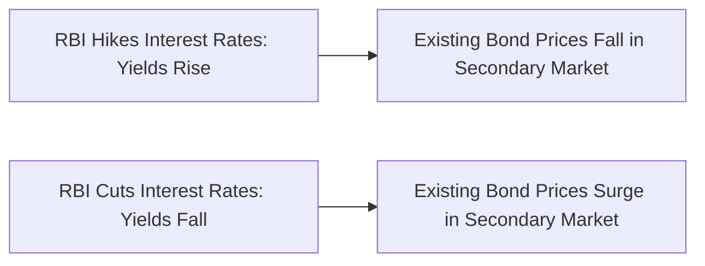
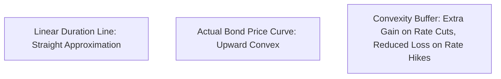

## 1. The Fundamental Law of Fixed Income Pricing

The price of any fixed-coupon bond is the present discounted value of its future scheduled cash flows (semi-annual coupon payments and terminal face value repayment):

$$
P = \sum_{t=1}^{2n} \frac{C / 2}{\left(1 + \frac{y}{2}\right)^t} + \frac{M}{\left(1 + \frac{y}{2}\right)^{2n}}
$$

Where:
- $C$ is the annual coupon payment in Rupees.
- $M$ is the bond face value (typically ₹1,000 or ₹10,000).
- $y$ is the market Yield to Maturity (YTM).
- $n$ is years to maturity.

Because $y$ sits in the denominator of every single term, **bond prices and market interest yields have an immutable inverse relationship**:
- When the RBI cuts interest rates (yields fall) $\implies$ Bond prices **rise** (capital appreciation).
- When the RBI raises interest rates (yields surge) $\implies$ Bond prices **plunge** (capital loss).

---

## 2. Macaulay Duration and Modified Duration Formulas

### A. Macaulay Duration ($D_{mac}$)
The weighted average time until all bond cash flows are received, where the weights are the present value of each cash flow:

$$
D_{mac} = \frac{1}{P} \sum_{t=1}^{2n} \frac{t}{2} \cdot \frac{C / 2}{\left(1 + \frac{y}{2}\right)^t} + \frac{n \cdot M}{\left(1 + \frac{y}{2}\right)^{2n}}
$$

### B. Modified Duration ($D_{mod}$)
Modified duration provides the direct sensitivity of the bond price to changes in yield:

$$
D_{mod} = \frac{D_{mac}}{1 + \frac{y}{m}}
$$

### The Linear Price Sensitivity Approximation:
$$
\frac{\Delta P}{P} \approx -D_{mod} \cdot \Delta y
$$

### Numerical Proof:
Consider a **10-Year Government of India Benchmark G-Sec** trading at par with a **$7.10\%$ coupon** and a **Modified Duration of $6.85$ years**:
- If the RBI unexpectedly hikes rates and market yields rise by **50 basis points (+0.0050)**:
  $$ \frac{\Delta P}{P} \approx -6.85 \times (+0.0050) = -0.03425 \implies \mathbf{-3.43\%} $$
- In a long-duration gilt fund with modified duration of 9.0 years, a 100 bps rate spike inflicts an immediate **-9.0% loss**, wiping out more than a full year of accrued coupon interest!

---

## 3. The Curvature Advantage: Convexity

Because the price-yield curve of a plain-vanilla bond is convex (curved like a bowl), the linear duration formula underestimates price increases when yields fall and overestimates price decreases when yields rise.

Incorporating the **Convexity ($C_x$)** term using Taylor series expansion:

$$
\frac{\Delta P}{P} \approx -D_{mod} \cdot \Delta y + \frac{1}{2} C_x \cdot (\Delta y)^2
$$

Because $(\Delta y)^2$ is always positive:
- When yields drop by $1\%$, price rises by: $-D_{mod}(-0.01) + \frac{1}{2} C_x (0.01)^2$ $\implies$ **Bigger Gain**.
- When yields rise by $1\%$, price falls by: $-D_{mod}(+0.01) + \frac{1}{2} C_x (0.01)^2$ $\implies$ **Smaller Loss**.

Positive convexity is the ultimate mathematical gift to long-term fixed income investors.
