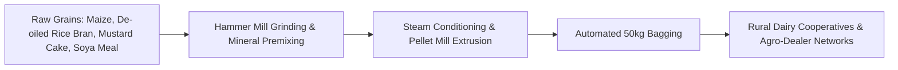

## 1. The Economics of the Indian Livestock Feed Industry

India possesses the world's largest bovine population (over 300 million cattle and buffaloes) and is the world's leading milk producer. 

However, over $65\%$ of Indian dairy animals suffer from nutritional deficits, relying on unformulated crop residues (wheat straw, paddy straw). The transition toward scientific, high-density **Compounded Cattle Feed (Mesh and Pellet form)** represents a massive, non-cyclical, recession-proof domestic industry.

---

## 2. The Raw Material Seasonality Cycle: Where Margins Are Won

In cattle feed manufacturing, raw material ingredients account for **78% to 84% of total cost of goods sold (COGS)**:
- **Energy Sources:** Maize (Corn), Broken Wheat, Pearl Millet (Bajra).
- **Protein Meals:** Mustard Oil Cake (DOC), Cottonseed Cake, De-oiled Rice Bran (DORB), Soybean Meal.
- **Minerals & Additives:** Calcium Carbonate, Dicalcium Phosphate, Vitamin-Mineral Premixes, Toxin Binders.

### The Seasonal Procurement Window:
- **Maize & Soybean (October to December):** Peak Kharif harvest arrival in agricultural mandis. Grain prices trade at a **15% to 25% seasonal discount** to mid-year prices.
- **The Capital Allocation Edge:** An agro-processor with adequate working capital credit limits (Cash Credit / Overdraft lines) who purchases and stores 3 to 4 months of grain inventory during the harvest window locks in a **400 to 600 basis point margin expansion** over competitors who buy spot grain month-to-month.

---

## 3. Controlling Moisture Shrinkage and Finished Goods Quality

Agro-processing units face an invisible profit leak: **Moisture Shrinkage**.
- Raw maize is purchased at $14\% - 15\%$ moisture content.
- During grinding, hammer milling, and drying, moisture drops to $11.5\%$.
- **The $3\%$ Weight Shrinkage:** 100 tonnes of purchased grain yields only 97 tonnes of finished feed! Unless this physical shrinkage factor is explicitly calculated in product pricing formulas, the business will suffer an invisible margin leakage.

### The Formulation Advantage: Least-Cost Linear Programming
Professional feed manufacturers do not use static recipes. They utilize linear programming software (such as Format Solutions or Bestmix):
- As mustard cake prices spike due to export demand, the algorithm automatically recalculates the optimal blend, substituting affordable cotton meal or corn gluten while maintaining exact **BIS:2052 Type-I standards ($22\%$ Crude Protein, $3\%$ Crude Fat)**.
- This formulation agility guarantees constant operating profit margins across volatile agricultural commodity cycles.
