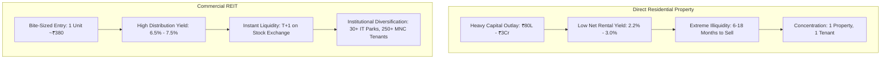

## 1. The Cultural Obsession with Physical Bricks and Mortar

For generations of Indian families, owning physical real estate—specifically a residential flat or independent plot—has been viewed as the pinnacle of financial stability and social prestige. 

However, when analyzed strictly as an institutional capital asset, **direct residential real estate is one of the most operationally burdensome, illiquid, and low-yielding asset classes in urban India**.

The introduction of **Real Estate Investment Trusts (REITs)** by SEBI in 2019 provided retail investors with institutional access to Grade-A commercial office parks, life-sciences campuses, and IT corridors leased to global Fortune 500 multinationals (Microsoft, Google, Goldman Sachs, J.P. Morgan, Amazon).

---

## 2. Quantitative Head-to-Head Comparison

| Analytical Dimension | Direct Residential Rental Flat | Listed Indian REIT (e.g. Embassy, Mindspace) |
| :--- | :--- | :--- |
| **Minimum Capital Required** | ₹60,00,000 to ₹3,00,00,000 | **₹350 to ₹450 (1 Unit)** |
| **Gross Rental Yield** | $2.8\% - 3.8\%$ | **$6.8\% - 7.8\%$ (NDCF Distribution)** |
| **Annual Operating Deductions** | Property tax, society maintenance, vacancy, repairs | Built into fund NAV (Zero maintenance hassle for investor) |
| **Net Realized Cashflow Yield** | **$2.0\% - 2.8\%$** | **$6.2\% - 7.2\%$** |
| **Liquidity & Exit Timeline** | 6 to 18 months (subject to finding buyer) | **T+1 Settlement on NSE / BSE** |
| **Transaction Friction (Entry + Exit)** | **$8.0\% - 12.0\%$** (Stamp duty, registration, brokerage) | **$< 0.15\%$** (Standard equity brokerage & STT) |
| **Tenant Credit Quality** | Individual tenants (risk of delayed rent/litigation) | Global Fortune 500 MNCs with 5–9 year locked leases |
| **Transparency & Valuations** | Opaque micro-market pricing; unrecorded cash component | Quarterly audited NAVs by independent global valuers |

---

## 3. The 10-Year Numerical Cashflow Simulation

Assume two investors, **Investor A** and **Investor B**, each deploy **₹1,00,00,000 (₹1 Crore)**:

### Investor A: Buys 2BHK Residential Flat in Bengaluru / Gurgaon
- Purchase Cost: ₹92,00,000 + ₹8,00,000 (Stamp duty, registration, basic woodwork) $= ₹1,00,00,000$.
- Initial Rent: ₹28,000/month ($3.36\%$ gross yield).
- Annual vacancy (1 month every 2 years): $-₹14,000$/yr.
- Society Maintenance & Property Tax: $-₹35,000$/yr.
- **Net Annual Cash Flow:** ₹2,87,000 (**2.87% net yield**).
- After $30\%$ slab tax on net income: **₹2,24,000/yr**.

### Investor B: Buys Units Across Diversified REITs
- Purchase: ₹1,00,00,000 invested evenly across Embassy, Mindspace, and Brookfield.
- **Annual Distribution Yield:** $7.1\%$ p.a. paid quarterly.
- **Gross Annual Cash Flow:** ₹7,10,000 (**7.10% yield**).
- Payout composition: Interest ($40\%$), Tax-Free Dividends ($35\%$), Repayment of Debt ($25\%$).
- Effective tax rate on distribution: $\approx 18.5\%$.
- **Net Post-Tax Annual Cash Flow:** **₹5,78,650/yr**.

### The 10-Year Result:
Over 10 years, Investor B collects **₹35,46,500 MORE in direct post-tax cash into their bank account** than Investor A, while enjoying instant daily liquidity and zero landlord operational headaches.
