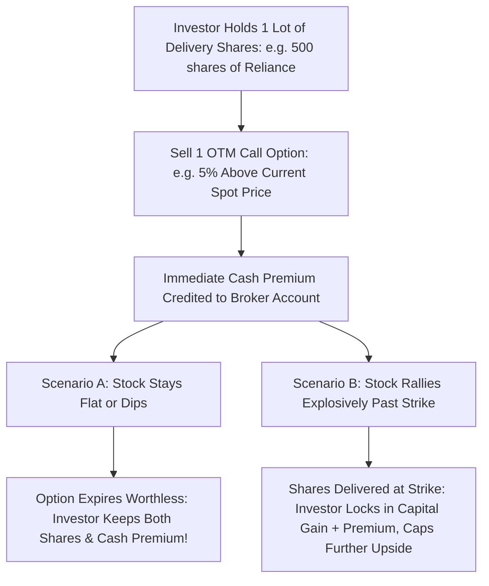

## 1. What Is a Covered Call Strategy?

For an investor holding a substantial long-term delivery position in a blue-chip Indian corporation (such as Reliance Industries, TCS, ITC, or HDFC Bank), shares often sit dormant in the demat account for months during sideways consolidation phases.

A **Covered Call** strategy monetizes this dormant volatility by selling someone else the right to buy your shares at a predetermined, higher price in exchange for **immediate, non-refundable cash upfront**:

---

## 2. Quantitative Step-by-Step Mechanics on the NSE

Let us analyze a live execution framework on **Reliance Industries**:

- **Current Spot Market Price:** ₹3,000 per share.
- **NSE Derivatives Lot Size:** 250 shares (Total stock value in demat = ₹7,50,000).
- **Execution:** Sell the **₹3,150 Strike Call Option ($+5.0\%$ Out-of-the-Money)** expiring in 30 days for a premium of **₹32.00 per share**.

### Cashflow Analysis:
1. **Immediate Cash Inflow:**
   $$ Gross Cash Premium Collected = 250  shares \times ₹32.00 = \mathbf{₹8,000} $$
   - This represents an immediate **$1.06\%$ cash yield on capital** for a 30-day period.

### Outcome Regimes at Month-End Expiry:

| Expiry Market Price of Reliance | Demat Share Value | Option Settlement | Net Realized Outcome |
| :--- | :--- | :--- | :--- |
| **₹2,900 (Dips -3.3%)** | ₹7,25,000 | Call expires worthless (₹0) | Investor keeps shares + ₹8,000 cash (cushions the dip by $+1.06\%$) |
| **₹3,050 (Modest +1.6% Rise)** | ₹7,62,500 | Call expires worthless (₹0) | Investor keeps shares + ₹8,000 cash (**Total Gain = ₹20,500**) |
| **₹3,300 (Massive +10% Surge)** | Sold at ₹3,150 strike | Physically delivered | **Max Profit:** $(₹3,150 - ₹3,000) \times 250 + ₹8,000 = \mathbf{₹45,500}$ |

---

## 3. The Physical Delivery Mandate on the NSE

Since 2019, SEBI mandated **Physical Settlement** for all stock derivatives on the NSE:
- If your short call option finishes **In-the-Money (ITM)** at expiry, you are **statutorily required to deliver the actual physical shares** from your demat account to the clearing corporation!
- Because you already own the underlying shares in your demat account, **you are fully covered**. You will never face an unexpected short-squeeze or auction penalty.
- However, you will be forced to sell your long-term shares at the strike price, triggering capital gains tax in that financial year.
