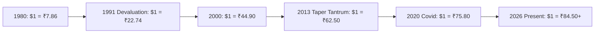

## 1. 40 Years of Monetary Reality: The USD/INR Trajectory

A foundational principle of international macroeconomics is that currencies reflect the long-term relative purchasing power of their issuing nations.

In 1980, one US Dollar bought approximately **₹7.86**. In 1990, it traded at **₹17.50**. By 2000, it crossed **₹44.90**. By 2010, it hovered at **₹45.70**. By 2020, it breached **₹75.00**, and in 2026 it trades around **₹84.00 - ₹86.00**.

### The 40-Year Annualized Rate of Rupee Depreciation:
$$
CAGR = \left(\frac{84.50}{7.86}\right)^{\frac{1}{46}} - 1 = (10.75)^{0.02174} - 1 = \mathbf{3.75\%  per annum}
$$

Over nearly half a century, the Indian Rupee has steadily surrendered purchasing power to the US Dollar at an average rate of **$3.75\%$ every single year**.

---

## 2. Why the Rupee Depreciates: Purchasing Power Parity (PPP)

In international finance, the **Relative Purchasing Power Parity (RPPP)** theorem dictates that the exchange rate between two currencies will adjust to offset the inflation rate differential between the two nations:

$$
\frac{E_t - E_0}{E_0} \approx \pi_{domestic} - \pi_{foreign}
$$

Where:
- $\pi_{domestic}$ is Indian CPI inflation (historically averaging $6.0\% - 7.5\%$).
- $\pi_{foreign}$ is US CPI inflation (historically averaging $2.0\% - 2.5\%$).
- The structural inflation spread:
  $$ \Delta \pi = 6.5\% - 2.5\% = \mathbf{4.0\%} $$

Because India is an emerging, rapidly industrializing economy running fiscal and current account deficits, domestic price levels rise faster than in developed economies. For Indian export goods to remain globally competitive, the nominal exchange rate **must depreciate over time** to maintain trade balance parity.

---

## 3. Portfolio Allocation Takeaway

Indian investors who hold $100\%$ of their net worth exclusively in Rupee-denominated paper instruments (bank deposits, LIC policies, domestic bonds) bear severe, unhedged **Single-Currency Risk**:
- International travel, foreign university education for children, imported medical equipment, and consumer electronics are priced in global hard currencies (USD).
- Allocating **10% to 20% of an investment portfolio to US Equities** (via LRS or global index funds) acts as an essential monetary ballast, converting currency depreciation from an insidious family expense into a source of compound portfolio returns.
