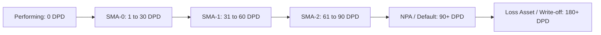
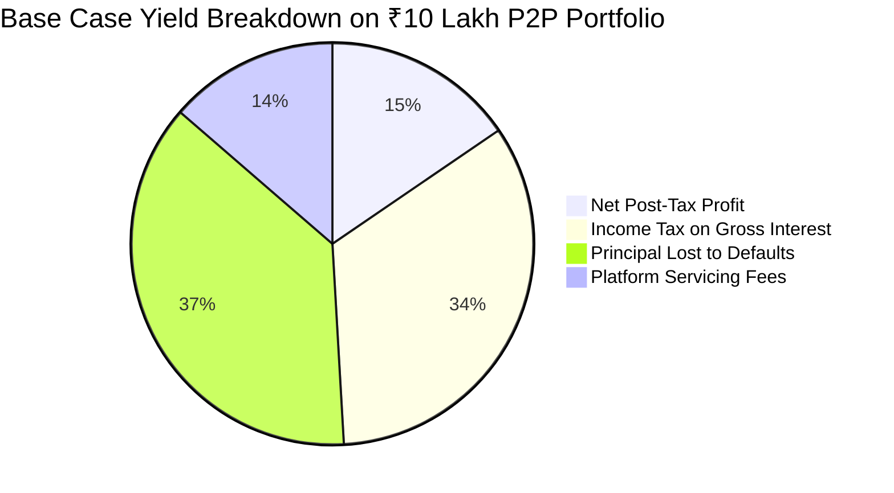

## 1. The Delinquency Aging Curve (DPD Buckets)

In credit risk quantitative modeling, retail loans do not transition from performing to defaulted overnight. They progress through standardized **Days Past Due (DPD)** buckets:

### Empirical Recovery Probabilities by Bucket:

| DPD Stage | Classification | Historical Resolution Probability | Expected Loss on Principal |
| :--- | :--- | :--- | :--- |
| **1 – 30 Days** | Soft Delinquency (Technical delay/salary timing) | $82.0\%$ recovers to current | $2.5\%$ |
| **31 – 60 Days** | Moderate Delinquency (Cashflow shortfall) | $45.0\%$ recovers | $15.0\%$ |
| **61 – 90 Days** | Severe Delinquency | $18.0\%$ recovers | $45.0\%$ |
| **90+ Days** | Gross Non-Performing Asset (GNPA) | $< 12.0\%$ recovery rate | **$88.0\% - 95.0\%$ Loss** |

---

## 2. Sensitivity Analysis: Optimistic, Base, and Stressed Scenarios

To illustrate the fragility of P2P yields, we model a ₹10,00,000 portfolio across three economic regimes:

$$
Net Yield = (1 - c_{idle}) \cdot r - D \cdot (1 - R) - F_{fee}
$$

| Variable | Optimistic Scenario | Base Case Scenario | Stressed Recession Scenario |
| :--- | :--- | :--- | :--- |
| **Contractual Headline Rate ($r$)** | $13.0\%$ | $12.0\%$ | $11.0\%$ |
| **Uninvested Cash Drag ($c_{idle}$)** | $4.0\%$ | $8.0\%$ | $15.0\%$ (borrower demand drops) |
| **Gross Default Rate ($D$)** | $2.5\%$ | $5.0\%$ | **$11.5\%$** (job losses/downturn) |
| **Principal Recovery Rate ($R$)** | $30.0\%$ | $18.0\%$ | **$8.0\%$** |
| **Platform Servicing Fee ($F$)** | $1.25\%$ | $1.50\%$ | $1.75\%$ (escalated legal costs) |
| **Net Realized Pre-Tax Return** | **$9.48\%$** | **$5.44\%$** | **$-3.06\%$ (CAPITAL LOSS)** |
| **Post-Tax Return (30% slab)** | **$5.42\%$** | **$1.70\%$** | **$-6.80\%$** |

---

## 3. The Uninvested Cash Drag Formula

When a borrower repays an installment, that cash arrives in the lender's escrow wallet. Until the algorithm redeploys that money into another verified borrower, it earns **0.0% interest**.

The effective annual drag on total portfolio yield is given by:

$$
\Delta Y_{drag} = r_{contractual} \times c_{idle}
$$

For a portfolio yielding $12\%$ with an average $10\%$ idle cash allocation throughout the year, the investor automatically loses:

$$
\Delta Y_{drag} = 0.12 \times 0.10 = 0.012 \implies \mathbf{1.20\%  annual yield drag}
$$

Over a 5-year tenure, this silent drag erodes ₹60,000 in compound wealth that never appears on promotional brochures.
