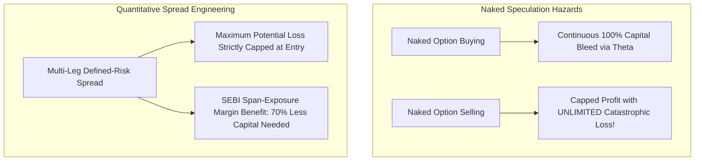

## 1. The False Dichotomy of Retail Options Trading

Retail traders in India typically operate at two suicidal extremes:
1. **Naked Option Buying:** Buying cheap out-of-the-money options hoping for an explosive directional move. Result: Consistent, daily capital erosion via **Theta time decay**.
2. **Naked Option Selling:** Selling far out-of-the-money options to collect a small premium. Result: High win rate ($85\%$) that lulls the trader into false confidence until a Black Swan gap-up or gap-down (such as election result days or geopolitical crises) completely **wipes out the trader's entire account in 15 minutes**.

In quantitative derivatives engineering, professional systematic traders strictly utilize **Defined-Risk Option Spreads**:

---

## 2. Core Defined-Risk Spread Architectures

### A. The Bull Call Spread (Defined-Risk Debit)
Designed for moderate bullish market views without suffering from naked theta decay:
- **Buy 1 In-the-Money (ITM) Call:** Strike $K_1$ (Paying premium $C_1$).
- **Sell 1 Out-of-the-Money (OTM) Call:** Strike $K_2$ (Collecting premium $C_2$, where $K_2 > K_1$).
- **Net Debit Paid:** $C_1 - C_2$.
- **Maximum Profit:** $(K_2 - K_1) - (C_1 - C_2)$.
- **Maximum Loss:** Capped strictly at the **Net Debit Paid**, regardless of how severely Dalal Street crashes!

### B. The Iron Condor (Delta-Neutral Volatility Harvest)
Designed to profit from a consolidating, range-bound index (such as Nifty 50 during earnings lulls):
1. **Sell OTM Call** at $K_3$ and **Buy OTM Call (Protection Wing)** at $K_4$ ($K_4 > K_3$).
2. **Sell OTM Put** at $K_2$ and **Buy OTM Put (Protection Wing)** at $K_1$ ($K_1 < K_2$).
3. **Net Credit Collected:** Credit from short strikes minus debit for long protective wings.
4. If Nifty finishes expiration between $K_2$ and $K_3$, the trader retains the **full net credit**.
5. If the market undergoes a violent breakout in either direction, the long wings immediately trigger, **capping maximum loss to a predetermined fraction of capital**.

---

## 3. SEBI Margin Relief: The SPAN-Exposure Benefit

Under NSE Clearing rules, selling a naked Nifty 50 option requires approximately **₹1,20,000 to ₹1,40,000 in margin capital**.

However, when you execute a defined-risk hedge (such as an Iron Condor or Credit Spread) where the protective wing is bought first:
- The clearing corporation's **SPAN risk algorithm** recognizes that your maximum loss is strictly limited.
- Total required margin capital plunges from ₹1.4 Lakhs down to **₹25,000 – ₹35,000** per spread!
- This structural margin relief dramatically expands Return on Capital ($ROC$) while providing 100% defense against catastrophic account liquidation.
