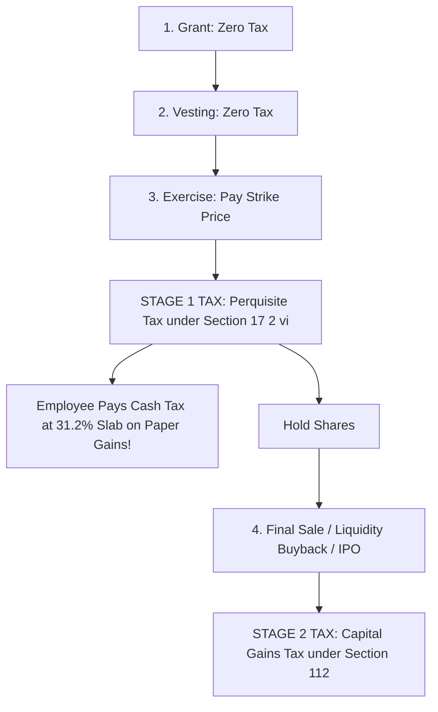

## 1. The Two-Stage Indian ESOP Taxation Architecture

Employee Stock Option Plans (ESOPs) have created thousands of crorepatis across India's technology ecosystem (Flipkart, Infosys, Zomato, Swiggy). 

However, many startup employees suffer financial distress because they do not understand the **Two-Stage Statutory Tax Architecture** codified under the Income Tax Act, 1961:

---

## 2. Stage 1: The Perquisite Tax Trap (At Exercise)

Under **Section 17(2)(vi)**, when an employee exercises their vested options:
1. The **Fair Market Value (FMV)** of the unlisted share on the date of exercise is calculated by a SEBI-registered Category-I Merchant Banker under Rule 11UA.
2. The perquisite value is defined as:
   $$ Perquisite Value = (FMV on Exercise Date - Exercise Strike Price) \times Number of Shares $$
3. This perquisite value is added directly to your **gross salary** and taxed at your **highest marginal slab rate ($31.2\%  to  39\%$)**!

### The Nightmare Scenario:
- You exercise 10,000 options at a strike price of ₹10 per share (Total cost = ₹1,00,000).
- The startup's latest funding valuation sets FMV at ₹510 per share.
- **Perquisite Value:** $(₹510 - ₹10) \times 10,000 = \mathbf{₹50,00,000}$.
- **Income Tax Payable at $31.2\%$:** **₹15,60,000**.
- The employee must write a cheque of **₹15.6 Lakhs in real cash** to the tax department, while holding unlisted paper shares that cannot be sold in the market! If the startup subsequently struggles or valuation plunges, that ₹15.6 Lakhs cash is **lost forever**.

---

## 3. Stage 2: Capital Gains Tax (At Final Sale / Liquidity)

When the company executes a share buyback, secondary sale, or goes public on the NSE/BSE:
- The **Cost of Acquisition** under Section 49(2AA) is deemed to be the **FMV on the date of exercise** (the price on which you already paid perquisite tax).
- **Capital Gain:**
  $$ Capital Gain = Final Sale Consideration - Exercise FMV $$
- **Holding Period:** Measured from the **date of exercise** to the date of sale.
  - If unlisted: Holding $>24$ months $\implies$ **$12.5\%$ LTCG**; $<24$ months $\implies$ Slab rate.
  - If listed: Holding $>12$ months $\implies$ **$12.5\%$ LTCG** above ₹1.25 Lakh; $<12$ months $\implies$ $20\%$ STCG.

---

## 4. Section 140A Deferral for Eligible Startups

To mitigate the Stage 1 cash trap, Parliament introduced **Section 192(1C)**:
If you work for a **DPIIT-recognized startup possessing an Inter-Ministerial Board (IMB) certificate under Section 80-IAC**, the Stage 1 perquisite tax is deferred until the earliest of:
1. Expiry of **48 months (4 years)** from the end of the relevant assessment year.
2. The date on which the employee sells or transfers the shares.
3. The date on which the employee leaves or resigns from the company.
