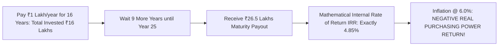

## 1. The Marketing Deception of 'Guaranteed Bonuses'

Traditional participating endowment policies (exemplified by popular LIC schemes like *Jeevan Labh*, *Jeevan Anand*, or private insurer *Guaranteed Income Plans*) represent the single largest product category sold to middle-class Indian families.

The marketing pitch relies heavily on financial confusion:
> *"Pay ₹1,00,000 every year for 16 years. Get ₹10 Lakhs life cover plus guaranteed Simple Reversionary Bonuses of ₹48 per thousand, plus a Final Additional Bonus of ₹450 per thousand at maturity in Year 25. You receive ₹26,50,000 completely tax-free!"*

To an investor untrained in discounted cashflow mathematics, receiving **₹26.5 Lakhs** after paying **₹16 Lakhs** sounds like an impressive return.

In reality, the internal rate of return ($IRR$) of this cashflow stream is a **disappointing $4.85\%$ per annum**—failing even to match average consumer price inflation!

---

## 2. Hand-Calculating the Policy IRR

To calculate the exact rate of return, we set up the **Net Present Value (NPV)** equation:

$$
NPV = \sum_{t=0}^{15} \frac{-1,00,000}{(1 + r)^t} + \frac{26,50,000}{(1 + r)^{25}} = 0
$$

Using the Newton-Raphson numerical solver or standard spreadsheet `=IRR()`:

$$
\mathbf{r = 0.0485 \implies 4.85\%  per annum}
$$

### The Bonus Illusion Explained:
1. **Simple, Not Compound:** When the insurer declares a bonus of ₹48 per thousand sum assured ($4.8\%$), that ₹48,000 is credited to your policy ledger. However, **that ₹48,000 earns zero interest for the next 20 years**. It is simply locked in the insurer's vault and paid out as a flat lump sum at maturity!
2. **Delayed Payout:** You finish paying premiums in Year 16, but your money remains trapped for an additional **9 years earning near-zero returns** before final maturity at Year 25.

---

## 3. Comparison with the Sovereign Public Provident Fund (PPF)

What happens if an investor bypasses the insurance agent and puts that identical ₹1,00,000 per year into a government **Public Provident Fund (PPF)** account at $7.1\%$ (along with buying a ₹1 Crore term plan for ₹12,000/yr)?

| Financial Outcome | Traditional Endowment Policy | PPF + Pure Term Insurance |
| :--- | :--- | :--- |
| **Total Cash Outflow** | ₹16,00,000 | ₹17,92,000 (PPF + ₹1Cr Term Cover) |
| **Life Insurance Protection** | **₹10,00,000 (Pauper cover)** | **₹1,00,00,000 (10x HIGHER)** |
| **Maturity Corpus at Year 25** | **₹26,50,000** | **₹44,80,000** |
| **Extra Net Wealth Generated** | Baseline | **$+\mathbf{₹18,30,000}$** |
| **Liquidity & Loan Flexibility** | Terrible surrender values | Partial withdrawals & low-interest sovereign loans |

Traditional endowment and money-back policies are wealth destroyers. They enrich only the insurance company and the commission agent who collects a $25\% - 35\%$ first-year commission on your hard-earned savings.
