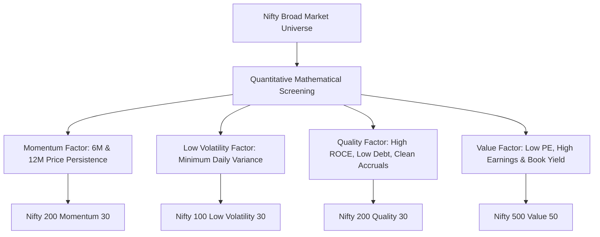

## 1. What Is Factor Investing (Smart Beta)?

In traditional market-capitalization-weighted indices (like the Nifty 50 or Nifty 500), a company's portfolio weight is determined strictly by its free-float market valuation. The larger a stock becomes, the more an index fund must buy—regardless of whether its valuation is euphoric or its underlying fundamentals are deteriorating.

**Factor Investing (Smart-Beta)** replaces arbitrary market-cap weighting with systematic, rules-based mathematical attributes that have been empirically demonstrated to deliver long-term risk-adjusted excess returns (alpha):

---

## 2. 15-Year Empirical Factor Performance on the NSE

Analyzing total return index (TRI) datasets from NSE Indices across a 15-year period reveals stark divergences in risk-adjusted performance:

| Index / Strategy | 15-Year Nominal CAGR | Annualized Volatility ($\sigma$) | Maximum Drawdown | Sharpe Ratio ($R_f = 6.5\%$) | Sortino Ratio |
| :--- | :--- | :--- | :--- | :--- | :--- |
| **Nifty 50 TRI (Benchmark)** | $12.8\%$ | $16.4\%$ | $-38.4\%$ | $0.38$ | $0.54$ |
| **Nifty 200 Momentum 30 TRI** | **$17.6\%$** | $19.2\%$ | $-44.2\%$ | **$0.58$** | **$0.86$** |
| **Nifty 100 Low Volatility 30 TRI** | $14.9\%$ | **$12.8\%$** | **$-28.2\%$** | **$0.66$** | **$0.98$** |
| **Nifty 200 Quality 30 TRI** | $14.4\%$ | $15.1\%$ | $-32.5\%$ | $0.52$ | $0.74$ |
| **Nifty 500 Value 50 TRI** | $13.5\%$ | $18.5\%$ | $-48.5\%$ | $0.38$ | $0.52$ |

---

## 3. Dissecting the Top Two Winning Factors

### A. The Momentum Anomaly (Nifty 200 Momentum 30)
- **Mathematical Formula:** Ranks stocks from the Nifty 200 universe based on their **Normalized Momentum Score**:
  $$ Score = 0.50 \times \left(\frac{R_{6M}}{\sigma_{6M}}\right) + 0.50 \times \left(\frac{R_{12M}}{\sigma_{12M}}\right) $$
- **Why It Works:** Driven by deep behavioral human biases—investors anchor to past prices, underreact to initial positive corporate earnings surprises, and then herd into trending stocks.
- **The Core Risk:** **Momentum Crashes**. When market leadership violently rotates (such as during a sudden economic crisis or interest rate shock), momentum portfolios experience sharp, painful drawdowns before semi-annual rebalancing can purge lagging stocks.

### B. The Low-Volatility Anomaly (Nifty 100 Low Volatility 30)
- **The Paradox:** Classical Capital Asset Pricing Model (CAPM) dictates that higher risk is required to achieve higher return. The Low-Volatility anomaly completely disproves this: **boring, low-beta stocks deliver higher risk-adjusted compounding than volatile speculative stocks**.
- **The Mechanism:** By losing significantly less capital during bear markets ($-28\%$ vs $-38\%$), the low-volatility portfolio starts compounding from a much higher asset base during the subsequent recovery.
- A $-28\%$ loss requires a **$+38.9\%$ gain** to break even; a $-38\%$ loss requires a **$+61.3\%$ gain** just to get back to zero!
