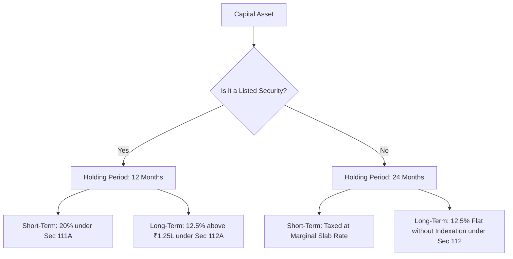

## 1. Executive Summary of the July 23, 2024 Tax Reform

Presented in Union Budget 2024 and formally enacted as the **Finance (No. 2) Act, 2024**, this legislation introduced the most comprehensive structural overhaul of India's capital gains tax architecture in over three decades.

The primary objectives declared by the Ministry of Finance were:
1. **Simplification of Holding Periods:** Eliminating multiple overlapping holding thresholds ($12, 24,  and  36  months$) into two standard classifications.
2. **Harmonisation of Tax Rates:** Moving toward unified rates of $20\%$ for short-term and $12.5\%$ for long-term capital assets.
3. **Elimination of Indexation:** Phasing out inflation indexation across debt instruments, unlisted securities, gold, and real estate.

---

## 2. Complete Asset-by-Asset Capital Gains Master Table

| Asset Category | Pre-July 23, 2024 Rules | Post-July 23, 2024 Enacted Law | Governing Statutory Section |
| :--- | :--- | :--- | :--- |
| **Listed Equity Shares & Equity Mutual Funds** | STCG: $15\%$; LTCG: $10\%$ above ₹1 Lakh (Holding $>12m$) | **STCG: 20%; LTCG: 12.5% above ₹1.25 Lakh** | Section 111A, Section 112A |
| **Specified Debt Mutual Funds ($\le 35\%$ equity)** | Taxed at slab rate as deemed STCG | **Unchanged: Taxed at slab rate** | Section 50AA |
| **Hybrid Mutual Funds ($35\% - 65\%$ equity)** | Holding $>36m$; $20\%$ with indexation | **Holding $>24m$; 12.5% without indexation** | Section 112 |
| **Physical Gold, Silver & Precious Metals** | Holding $>36m$; $20\%$ with indexation | **Holding $>24m$; 12.5% without indexation** | Section 112 |
| **Gold ETFs & Silver ETFs** | Taxed at slab rate (post-April 2023) | **Holding $>24m$; 12.5% without indexation** | Section 112 |
| **Real Estate (Land & Buildings)** | Holding $>24m$; $20\%$ with indexation | **12.5% without indexation** *(or 20% with indexation if acquired pre-23 July 2024)* | Section 48, Section 112 |
| **Unlisted Shares & Pre-IPO Equity** | Holding $>24m$; $20\%$ with indexation | **Holding $>24m$; 12.5% without indexation** | Section 112 |
| **REITs & InvIT Units** | STCG: $15\%$; LTCG: $10\%$ above ₹1 Lakh | **STCG: 20%; LTCG: 12.5% above ₹1.25 Lakh** | Section 111A, Section 112A |
| **Foreign Equities (US Stocks via LRS)** | Holding $>24m$; $20\%$ with indexation | **Holding $>24m$; 12.5% without indexation** | Section 112 |

---

## 3. Working Example: Listed Equity Portfolio LTCG

Consider an investor who redeems listed equity mutual fund units on 15 September 2025:
- **Cost of Acquisition:** ₹4,00,000 (purchased October 2023)
- **Sale Value:** ₹6,50,000
- **Gross Capital Gain:** ₹2,50,000
- **Holding Period:** 23 Months ($>12$ months $\implies$ Long-Term Capital Asset under Section 112A)

### Statutory Tax Computation:
1. **Total Realized LTCG:** ₹2,50,000
2. **Statutory Exemption Limit under Section 112A(2)(a):** ₹1,25,000
3. **Net Taxable Long-Term Capital Gain:**
   $$ Taxable Gain = ₹2,50,000 - ₹1,25,000 = ₹1,25,000 $$
4. **Base Tax at $12.5\%$:**
   $$ Base Tax = ₹1,25,000 \times 0.125 = ₹15,625 $$
5. **Health and Education Cess ($4\%$ on tax):**
   $$ Cess = ₹15,625 \times 0.04 = ₹625 $$
6. **Total Tax Payable:**
   $$ Total Statutory Tax = ₹15,625 + ₹625 = \mathbf{₹16,250} $$
7. **Effective Tax Rate on Total Gain:**
   $$ Effective Tax = \frac{₹16,250}{₹2,50,000} = \mathbf{6.50\%} $$

Notice that due to the enhanced ₹1.25 Lakh exemption, the investor's effective tax rate is only **$6.50\%$**, despite the nominal tax rate being $12.5\%$.
