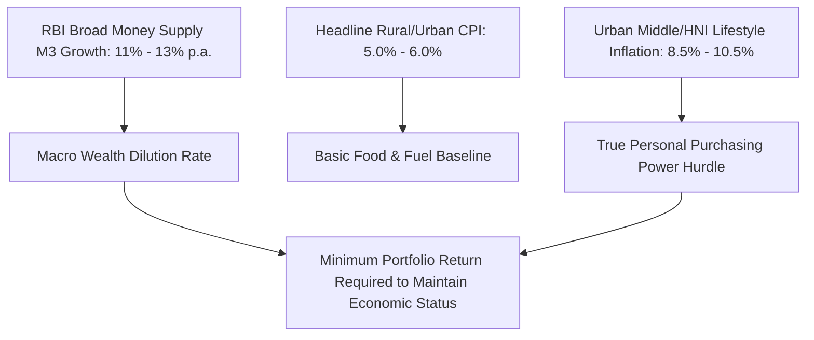
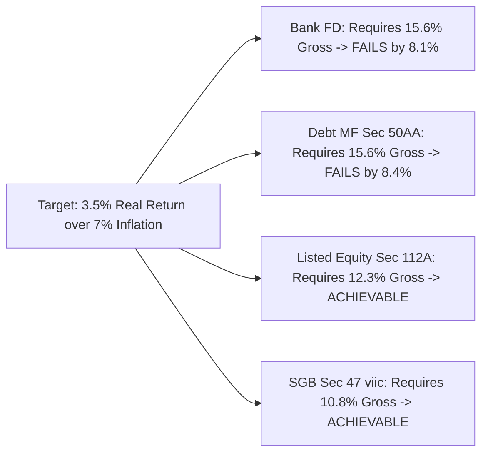
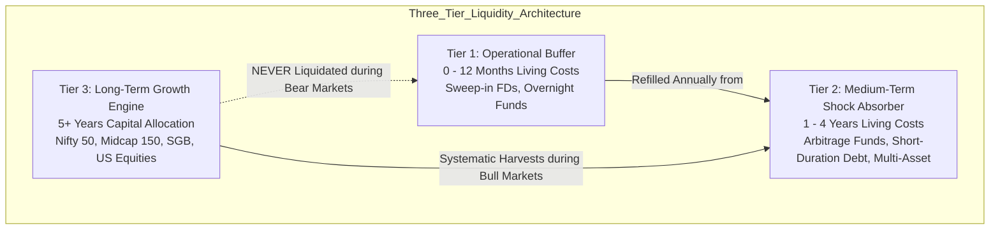

## 1. The Macroeconomic Reality: M3 Expansion vs Headline Inflation

Wealth creation is fundamentally the accumulation of claims on real future economic goods, services, and productive capacity. In emerging market economies like India, evaluating investments through nominal Rupee growth creates a severe mathematical distortion.

Two macroeconomic forces continually dilute the real purchasing power of the Indian Rupee:



### A. The Monetary Supply Anchor (M3 Growth)
According to the Reserve Bank of India (RBI) Database on the Indian Economy, India's **Broad Money Supply (M3)** has historically expanded at an annual rate of **11.0% to 13.5%** over the past three decades. 

This expansion reflects:
1. Real GDP growth ($\approx 6.5\% - 7.5\%$).
2. Reserve bank monetization and banking credit creation.
3. Systemic inflation.

If an investor's liquid net worth compounds at only $7.5\%$ in a bank fixed deposit while aggregate nominal monetary claims in the economy grow at $12.0\%$, the investor's relative share of national economic purchasing power shrinks by approximately **4.5% every single year**.

### B. The Headline CPI vs. Real Lifestyle Inflation Divergence
Official Consumer Price Inflation (CPI) published by the Ministry of Statistics and Programme Implementation (MOSPI) weights food and beverages at approximately $45.86\%$ of the overall consumption basket. 

While accurate for rural and subsistence consumption tracking, it drastically underweights the non-discretionary inflation drivers of urban middle-class and affluent households:
- **Tertiary Higher Education:** Expanding at **$10.5\% - 12.0\%$ annually** (private engineering, medical, and overseas university tuition).
- **Private Healthcare & Insurance Premiums:** Compounding at **$11.0\% - 14.0\%$ annually** (hospital day-care procedures, surgical costs, specialized pharmaceuticals).
- **Urban Housing & Land:** Prime urban residential square-footage prices compound at **$8.0\% - 11.0\%$ annually** in Tier-1 metropolitan agglomerations.

**The Urban Household Inflation Equation:**
For an urban household with school-going children and private medical dependency, the true empirical inflation hurdle ($\pi_{\text{lifestyle}}$) averages **$8.0\% - 9.0\%$**, far exceeding the official $5.5\%$ headline figure.

---

## 2. The Fisher Equation and Post-Tax Hurdle Rates

The true expansion of capital is governed by the **Fisher Equation**, which mathematically links nominal return ($r_{\text{nom}}$), inflation ($\pi$), and real wealth growth ($r_{\text{real}}$):

$$
r_{\text{real}} = \frac{1 + r_{\text{nom}}}{1 + \pi} - 1
$$

In the presence of statutory taxation, nominal return is reduced by the effective tax rate $T$:

$$
r_{\text{real, post-tax}} = \frac{1 + r_{\text{nom}} \cdot (1 - T)}{1 + \pi} - 1
$$

### Comparative Required Gross Yield Under Finance (No. 2) Act 2024
To deliver a modest **3.5% net real purchasing power expansion** against an empirical lifestyle inflation rate of **$\pi = 7.0\%$**, the required post-tax return is:

$$
r_{\text{post-tax, required}} = (1 + 0.035) \times (1 + 0.070) - 1 = 1.035 \times 1.070 - 1 = \mathbf{10.745\%}
$$

The gross return ($r_{\text{gross}}$) necessary to achieve this across different asset classes reveals the massive friction of statutory taxation:

| Investment Instrument | Governing Tax Section | Statutory Tax Treatment | Effective Tax Drag ($T$) | Required Gross Return to Achieve 3.5% Real Return | Practical Feasibility |
| :--- | :--- | :--- | :--- | :--- | :--- |
| **Bank Fixed Deposit** | Section 56(2) | Taxed at marginal slab rate | $31.2\%$ (for 30% slab) | **$15.62\%$** | **Mathematically Impossible** (Max FD yield is $\approx 7.5\%$) |
| **Specified Debt Mutual Fund** | Section 50AA | Deemed STCG; taxed at slab rate | $31.2\%$ (for 30% slab) | **$15.62\%$** | **Mathematically Impossible** (G-Sec/AAA yields are $\approx 7.2\%$) |
| **Direct Listed Equities / Equity MFs** | Section 112A | 12.5% LTCG above ₹1.25L exemption | $12.5\%$ (ignoring cess/surcharge) | **$12.28\%$** | **Feasible** (Historical Nifty 50/500 CAGR is $12.5\% - 14.5\%$) |
| **Sovereign Gold Bonds (SGB)** | Section 47(viic) | 100% Tax-Exempt on RBI maturity | $0.0\%$ on redemption capital gains | **$10.75\%$** | **Feasible** (Gold historical INR CAGR is $10.5\% - 11.5\%$) |
| **Operating MSME Business** | Section 115BAA | 22% corporate tax (+10% surcharge + 4% cess = 25.17%) | $25.17\%$ corporate rate | **$14.36\%$** | **Feasible** (High-performing MSMEs target $20\% - 30\%$ ROIC) |



---

## 3. The Four Capital Engines: Return, Volatility & Failure Modes

To build long-term wealth that systematically defeats inflation and tax friction, an investor must allocate across four structural engines:

```mermaid
quadrantChart
    title Risk-Adjusted Capital Allocation Matrix
    x-axis Low Liquidity --> High Liquidity
    y-axis Low Real Return --> High Real Return
    quadrant-1 Liquid Wealth Builders
    quadrant-2 Illiquid Alpha Generators
    quadrant-3 Wealth Destroyers (Post-Tax)
    quadrant-4 Capital Preservation
    "Bank FDs / Liquid MFs": [0.90, 0.15]
    "Arbitrage Funds": [0.85, 0.28]
    "Sovereign Gold Bonds": [0.45, 0.65]
    "Commercial REITs": [0.80, 0.60]
    "Nifty 50 Index": [0.92, 0.72]
    "Nifty Midcap 150": [0.75, 0.82]
    "Direct Operating MSME": [0.15, 0.95]
    "Traditional Endowment LIC": [0.20, 0.10]
    "Unlisted / Pre-IPO Shares": [0.25, 0.70]

```

### 1. Productive Corporate Equity (Listed Equities & Index Funds)
- **Economic Driver:** Corporate profit growth, return on equity (ROE > 15%), and dividend reinvestment.
- **Empirical Drawdown Realities (NSE Nifty 50 History):**
  - **1992 Harshad Mehta Scam:** $-54.0\%$ peak-to-trough drawdown; took 28 months to recover.
  - **2000-2001 Dot-Com Collapse:** $-56.2\%$ drawdown; took 44 months to recover.
  - **2008 Global Financial Crisis:** $-55.1\%$ drawdown; took 23 months to recover.
  - **2020 Covid Liquidity Shock:** $-38.4\%$ drawdown; recovered in 7 months due to global fiscal stimulus.
- **Key Insight:** Equity outperformance is not a smooth trajectory. It is compensation for enduring multi-year drawdowns where nominal capital appears temporarily impaired.

### 2. Productive Operating Assets (MSME & Private Enterprises)
- **Economic Driver:** Customer pricing power, operating leverage, and Return on Invested Capital (ROIC).
- **Return Characteristics:** $18.0\% - 35.0\%$ annual pre-tax return on tangible equity.
- **Frictional Costs:** Illiquid, high promoter dependence, working capital lockups, and 90-day debtor credit cycles.

### 3. Commercial Real Estate & Infrastructure Trusts (REITs & InvITs)
- **Economic Driver:** Long-term contractual triple-net leases with Tier-1 multinational tenants, typically featuring $12\% - 15\%$ contractual rent escalations every 3 years.
- **Yield Structure:** $6.5\% - 7.5\%$ gross distribution yield + $4.0\% - 5.0\%$ long-term capital appreciation.
- **Tax Advantage:** Distributions often include interest, tax-exempt dividends, and repayment of debt (Section 115UA).

### 4. Sovereign Paper & Capital Preservation Assets
- **Economic Driver:** Sovereign taxation power and central bank liquidity management.
- **Role in Portfolio:** Zero wealth creation. Its sole purpose is **downside liquidity immunization**—providing cash flow so the investor is never forced to liquidate equities during market panics.

---

## 4. Sequence of Returns Risk and The Liquidity Bucketing Framework

The greatest destroyer of compound wealth is not a bear market in isolation; it is **Sequence of Returns Risk**—being forced to redeem growth assets at the bottom of a market crash to fund living expenses or debt service.

### The Mathematics of Forced Liquidation
Consider an investor with a ₹1 Crore equity portfolio who requires ₹10 Lakhs annual cash flow:

| Scenario | Year 1 Market Return | Portfolio Value Before Withdrawal | Annual Withdrawal | Ending Portfolio Year 1 | Required Return in Year 2 to Regain Starting ₹1 Cr |
| :--- | :--- | :--- | :--- | :--- | :--- |
| **Normal Cycle** | $+12.0\%$ | ₹1,12,00,000 | ₹10,00,000 | ₹1,02,00,000 | **$-1.96\%$** (Capital intact) |
| **Market Crisis (e.g. 2008)** | $-35.0\%$ | ₹65,00,000 | ₹10,00,000 | **₹55,00,000** | **$+81.82\%$** (Compounding permanently broken!) |

In the crisis scenario, selling equities after a $35\%$ crash to fund living costs locks in permanent capital destruction. The portfolio requires an extraordinary **81.8% rebound** just to return to its initial principal!



### The Three-Tier Implementation Rule
1. **Tier 1 (Immediate Runway - 0 to 12 Months):** Held in scheduled commercial bank sweep-in deposits or overnight mutual funds. Yield is secondary; immediate T+0 liquidity and DICGC safety are the sole criteria.
2. **Tier 2 (Defensive Buffer - 1 to 4 Years):** Held in arbitrage mutual funds (taxed at concessional equity rates: 20% STCG / 12.5% LTCG) and high-quality target maturity debt funds. This immunizes the investor against 4-year equity bear cycles.
3. **Tier 3 (Compound Engine - 5+ Years):** $100\%$ allocated to diversified equities, Sovereign Gold Bonds, and productive commercial real estate. Zero redemptions are permitted during market drawdowns.

---

## 5. Non-Negotiable Investor Due-Diligence Checklist

Before committing any capital to an Indian financial instrument, apply this quantitative filter:

1. **Calculate the Post-Tax, Post-Inflation Hurdle:** Does the advertised return exceed $\pi_{\text{lifestyle}} = 7.5\%$ after accounting for your marginal slab rate ($31.2\%$ or $39\%$) or capital gains rate ($12.5\%$ or $20\%$)?
2. **Audit Total Expense Ratio Drag:** Are you investing via a **Direct Plan**? In equity mutual funds, an embedded $0.75\%$ distributor commission in regular plans destroys approximately **₹1.62 Crores over a 25-year compounding cycle on a ₹50,000/month SIP**.
3. **Trace Counterparty Risk & Regulation:**
   - Equities/MFs: Custodied with SEBI-registered depositories (NSDL/CDSL).
   - Bank Deposits: Insured up to ₹5 Lakh per depositor per bank by the DICGC.
   - P2P/Alternative Credit: Regulated under RBI NBFC-P2P directions, but defaults carry zero statutory insurance and zero tax offset.
4. **Stress Test Drawdown Tolerances:** Can you hold this instrument through an unrealized $50\%$ decline over 24 consecutive months without panicking? If not, reduce position sizing immediately.
