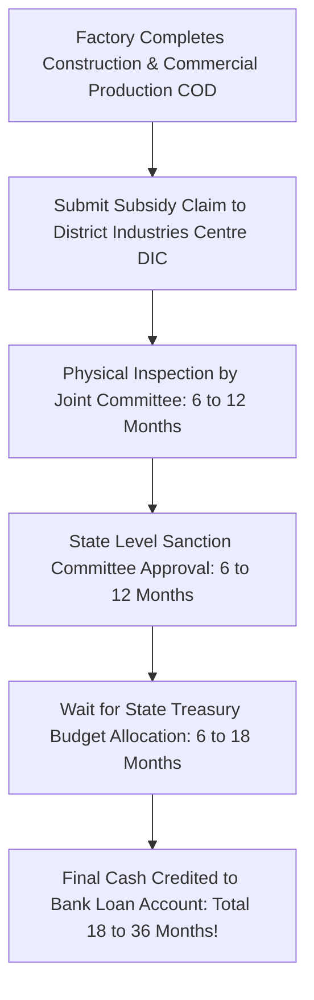

## 1. The Golden Rule of Business Subsidies

In Indian enterprise consulting, experienced chartered accountants repeat a foundational truth:

> *"A business that requires a government subsidy to survive should never be started. A business that is highly profitable on its own unit economics should accept government subsidies as unexpected bonus equity."*

Entrepreneurs who structure their capital plans assuming subsidy money will arrive within 90 days of machinery installation frequently face **severe liquidity insolvency**, as commercial banks demand scheduled loan EMIs regardless of government disbursement delays.

---

## 2. The Premier Central & State Schemes Worth Pursuing

When leveraged with realistic working capital buffers, several flagship schemes provide genuine institutional financial acceleration:

### A. CGTMSE (Collateral-Free Credit Guarantee)
- **Objective:** Solves the #1 barrier for first-generation entrepreneurs: lack of ancestral property to mortgage to commercial banks.
- **Coverage:** Provides a statutory central government credit guarantee up to **₹5,00,00,000 (₹5 Crores)** for manufacturing and service MSMEs.
- **Annual Guarantee Fee:** Typically $0.37\% - 1.35\%$ p.a., shared between borrower and bank.

### B. PMFME (PM Formalisation of Micro Food Processing Enterprises)
- **Eligibility:** Micro food processing units, dairy plants, spice grinding, bakery, cattle-feed, cold-press oil extraction.
- **Capital Subsidy:** **$35\%$ credit-linked capital subsidy** on eligible project costs (maximum ceiling of **₹10,00,000 per enterprise**).
- **Disbursement:** Credited directly into a dedicated 'Back-Ended Subsidy Reserve Account' with your lending bank.

### C. State Industrial Development Policies (SIP)
Every state government (e.g. Maharashtra Package Scheme of Incentives, Gujarat Industrial Policy, Uttar Pradesh Industrial Policy, Tamil Nadu MSME Policy) offers state-specific packages:
1. **Capital Investment Subsidy:** $15\% - 30\%$ reimbursement on eligible fixed capital investment in backward/developing talukas.
2. **Interest Subvention:** $5\% - 7\%$ annual interest reimbursement on term loans for 5 to 7 years.
3. **Electricity Duty Exemption:** $100\%$ exemption from state electricity duty for the first 5 to 10 years of commercial production.
4. **SGST Net Tax Reimbursement:** $50\% - 100\%$ reimbursement of the net State Goods and Services Tax (SGST) paid on intra-state sales.

---

## 3. Subsidy Clawback Conditions: Avoiding Legal Hazards

Government subsidies are not gifts; they are conditional incentives governed by strict statutory agreements:
- **Mandatory Operating Period:** Most state schemes require the factory to **remain in continuous commercial operation for minimum 5 to 7 years** post-disbursement.
- If the owner shuts the factory, shifts machinery to another state, or changes the line of business within the lock-in window, the District Industries Centre (DIC) has the statutory power to **initiate land revenue recovery proceedings, demanding immediate refund of the entire subsidy amount with 18% penal interest**!
- Always maintain pristine audited books, statutory GST filings, and employment attendance registers to ensure flawless audit defense.
