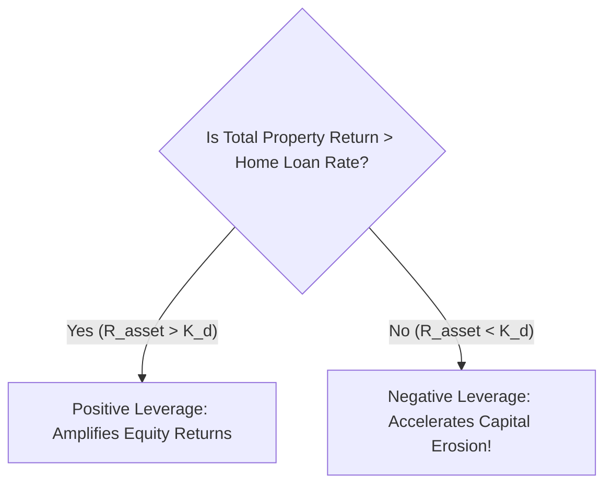

## 1. The Fundamental Law of Financial Leverage

Leverage is a double-edged sword. In corporate finance, the return on equity ($ROE$) under debt financing is governed by the **Spread Equation**:

$$
ROE = R_{asset} + \frac{D}{E} \cdot \left(R_{asset} - K_d\right)
$$

Where:
- $R_{asset}$ is the total return of the underlying property ($Rental Yield + Annual Capital Appreciation$).
- $\frac{D}{E}$ is the Debt-to-Equity ratio.
- $K_d$ is the effective after-tax cost of mortgage debt.

---

## 2. The Negative Carry Trap in Indian Residential Property

In developed economies (such as the US or Europe), mortgage rates have historically hovered around $3\% - 6\%$, while residential cap rates sat at $5\% - 7\%$. In that environment, rental income comfortably covered the mortgage payment, producing **positive cashflow from Day 1**.

In India, the structural numbers are inverted:
- **Prevailing Home Loan Interest Rate ($K_d$):** $8.50\% - 9.00\%$
- **Prevailing Residential Rental Yield ($Y_{net}$):** $2.20\% - 3.00\%$
- **The Negative Carry Spread:**
  $$ Spread = 2.50\% - 8.50\% = -\mathbf{6.00\%} $$

Every single month, the property owner must inject substantial surplus cash out of their salary to bridge the gap between tenant rent and the bank EMI!

---

## 3. The 15-Year Numerical Reality: ₹80 Lakh Home Loan

Consider a property purchased for ₹1,00,00,000 (₹1 Crore) with an **₹80,00,000 home loan** at an **$8.50\%$ interest rate** over a **15-year tenure (180 months)**:

### Standard Amortization Formula:
$$
EMI = \frac{P \cdot r \cdot (1 + r)^n}{(1 + r)^n - 1}
$$
- Where $P = ₹80,00,000$, $r = \frac{0.085}{12} = 0.007083$, $n = 180$.
- **Monthly EMI:** **₹78,777**
- **Total Amount Paid Over 15 Years:**
  $$ Total Cash Paid = ₹78,777 \times 180 = ₹1,41,79,860 $$
- **Total Interest Paid to Bank:**
  $$ Interest = ₹1,41,79,860 - ₹80,00,000 = \mathbf{₹61,79,860} $$

The borrower pays **₹61.8 Lakhs in pure interest** on an ₹80 Lakh loan!

### Equity IRR Sensitivity Analysis:
Assume the property was rented at ₹28,000/month (escalating $5\%$ annually) and the investor invested ₹20 Lakhs of their own equity (plus ₹8L stamp duty/registration):

| Annual Capital Appreciation Rate | Total Property Value in Year 15 | Total Net Cash Invested (Equity + EMI Outflows) | 15-Year Leveraged Equity IRR |
| :--- | :--- | :--- | :--- |
| **$4.0\%$ (Sluggish Market)** | ₹1,80,09,000 | ₹1,38,50,000 | **$3.85\%$ (Severe failure)** |
| **$6.0\%$ (Historical Metro Average)** | ₹2,39,65,000 | ₹1,38,50,000 | **$7.12\%$ (Barely matches inflation)** |
| **$8.0\%$ (Strong Growth)** | ₹3,17,21,000 | ₹1,38,50,000 | **$10.45\%$ (Solid)** |
| **$11.0\%$ (Booming Micro-Market)** | ₹4,78,45,000 | ₹1,38,50,000 | **$15.20\%$ (Leverage payoff)** |

Notice that unless property values appreciate at **over $8.0\%$ to $10.0\%$ compounded annually without fail**, taking an $8.5\%$ home loan severely suppresses the investor's equity IRR compared to low-cost equity index funds.
