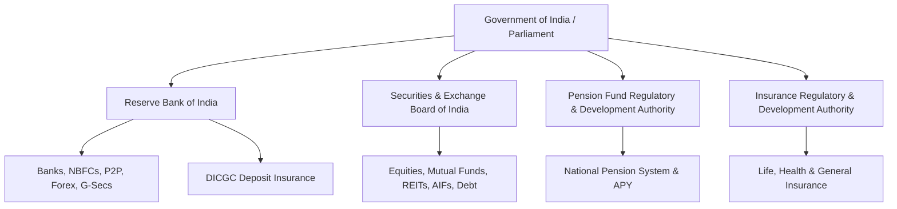

## 1. The Statutory Framework of Indian Financial Markets

In India, financial instruments do not operate in a vacuum. Every legitimate asset class is anchored to specific statutory legislation enacted by Parliament and governed by specialized regulatory bodies:

---

## 2. Regulatory Matrix & Jurisdiction

| Regulatory Body | Governing Enacted Statute | Regulated Instruments | Statutory Grievance Portal |
| :--- | :--- | :--- | :--- |
| **SEBI** | SEBI Act, 1992; SCRA, 1956 | Stocks, Mutual Funds, ETFs, REITs, InvITs, AIFs, Derivatives | **SCORES 2.0** (scores.sebi.gov.in) |
| **RBI** | RBI Act, 1934; BR Act, 1949 | Bank FDs, Savings Accounts, NBFCs, P2P Platforms, Forex, G-Secs | **RBI CMS** (cms.rbi.org.in) |
| **DICGC** | DICGC Act, 1961 | Statutory insurance on bank deposits up to ₹5,00,000 | Direct bank claim process |
| **PFRDA** | PFRDA Act, 2013 | National Pension System (Tier I & II), Atal Pension Yojana | **NPS Grievance Portal** |
| **IRDAI** | Insurance Act, 1938; IRDA Act, 1999 | Term Insurance, ULIPs, Traditional Endowment Policies | **Bima Bharosa** |

---

## 3. The Real Truth About DICGC Deposit Insurance

A common misconception among retail savers is that all bank deposits are unconditionally backed by the Government of India. The exact statutory reality under the **Deposit Insurance and Credit Guarantee Corporation Act, 1961** (as amended in 2021) is:

1. **Coverage Cap:** ₹5,00,000 across both principal and accrued interest per depositor, per bank.
2. **Account Aggregation Rule:** If an investor maintains a Savings Account with ₹3,00,000 and a Fixed Deposit of ₹7,00,000 in the *same* bank, total claimable coverage remains strictly ₹5,00,000.
3. **Different Capacity Exception:** Deposits held in different capacities (e.g. Individual Account vs Joint Account with spouse vs Sole Proprietor Account vs HUF Account) each enjoy an independent ₹5,00,000 coverage limit at the same institution.
4. **Moratorium Timeline (2021 Amendment):** In the event of an RBI moratorium on a distressed bank, DICGC is statutorily mandated to disburse up to ₹5,00,000 within **90 days**.

---

## 4. Unregulated Red Flags for Indian Investors

Investors must immediately recognize and avoid entities operating outside statutory oversight:
- **Multi-Level Marketing (MLM) Money Circulation Schemes:** Prohibited under the *Banning of Unregulated Deposit Schemes (BUDS) Act, 2019*.
- **Unregulated Digital Gold:** Entities selling digital gold through wallets without SEBI or RBI custodian frameworks.
- **Unregistered 'Guaranteed Return' Forex / Crypto Channels:** Strict violation of RBI FEMA regulations.
