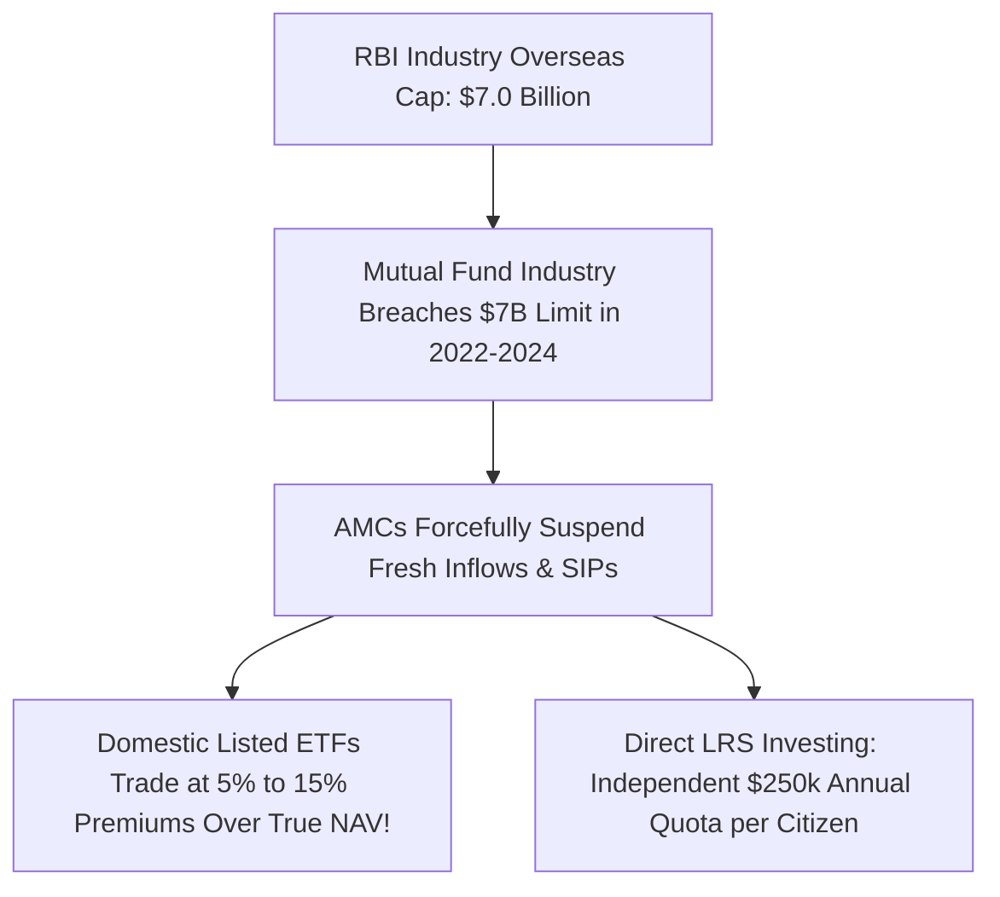

## 1. The $7 Billion Structural Ceiling

Historically, the easiest route for an Indian retail saver to invest in global giants like Apple, Google, and Amazon was through domestic **Fund of Funds (FoF)** or Indian mutual funds investing abroad (e.g. Motilal Oswal S&P 500 Index Fund, Nippon India US Equity Opportunities, Franklin India Feeder US Opportunities).

However, under RBI regulations framed under FEMA:
- The entire Indian mutual fund industry is subject to an aggregate statutory overseas investment ceiling of **USD 7,000,000,000 ($7 Billion)**.
- A separate dedicated ceiling of **USD 1,000,000,000 ($1 Billion)** exists for investing in foreign Exchange Traded Funds (ETFs).

---

## 2. Consequences of the Overseas Cap: Trading at Absurd Premiums

When AMCs were forced to freeze fresh subscriptions, the supply of new units on Indian stock exchanges was capped. 

Demand from retail investors wanting US tech exposure continued to surge. Consequently, exchange-traded funds like the **Motilal Oswal Nasdaq 100 ETF (MON100)** began trading at **distorted premiums of $5\%  to  16\%$ above their actual indicative Net Asset Value (iNAV)**!

### The Trap for Retail Buyers:
1. An investor buys MON100 on the NSE when the true underlying US tech assets are worth ₹100 per unit, but the market price on Dalal Street is ₹112 (a $12\%$ artificial scarcity premium).
2. If the RBI subsequently expands the industry limit or the AMC resumes fresh unit creation, that **$12\%$ premium evaporates instantly**, inflicting an arbitrary capital loss on the buyer even if US stock markets remained flat!

---

## 3. The Structural Alternative: Direct LRS Account

Because the mutual fund industry limit is a collective macro cap, it creates continuous regulatory uncertainty for long-term systematic SIP investors.

By contrast, the **RBI Liberalised Remittance Scheme (LRS)** grants an **individual, personal statutory entitlement of USD 250,000 (₹2.1 Crores) per financial year** to every single Indian citizen. 

Setting up a direct overseas brokerage account:
- Bypasses all domestic mutual fund industry caps completely.
- Allows buying real spot US shares and Vanguard/iShares index ETFs with **zero tracking premium**.
- Protects the investor from sudden AMC investment suspensions.
