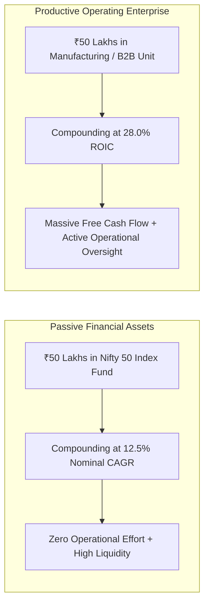

## 1. Paper Assets vs Physical Productive Engines

When an individual buys shares of an equity index fund, they are a fractional, passive co-owner in corporate India. You enjoy zero operational responsibilities, instant daily liquidity, and low administrative friction. In return, you receive the broad-market equity return: **$11.0\% - 13.5\%$ annualized nominal CAGR**.

However, when an entrepreneur or active investor commits capital to an **operating productive enterprise** (such as small-scale manufacturing, food processing, specialized B2B services, or modern distribution):
- They do not trade paper with secondary market participants.
- They purchase physical plant, machinery, raw materials, and skilled labor to produce real goods that customers consume daily.
- In return for taking operational and execution risk, the capital earns **Return on Invested Capital (ROIC) of $20.0\%  to  35.0\%+$**!

---

## 2. The Compounding Math: $12\%$ vs $28\%$ Over 15 Years

The divergence between market index compounding and high-ROIC operating business compounding is staggering:

Let us model **₹50,00,000 (₹50 Lakhs)** deployed over **15 years**:

$$
V_n = V_0 \times (1 + r)^n
$$

| Capital Allocation Route | Compounded Annual Rate ($r$) | Year 5 Terminal Value | Year 10 Terminal Value | Year 15 Terminal Value |
| :--- | :--- | :--- | :--- | :--- |
| **Bank Fixed Deposit (Post-Tax)** | $5.0\%$ | ₹63,80,000 | ₹81,45,000 | ₹1,03,95,000 |
| **Nifty 50 Passive Index Fund** | $12.5\%$ | ₹90,10,000 | ₹1,62,40,000 | **₹2,92,70,000 (₹2.93 Crores)** |
| **Productive Operating Business** | **$26.0\%$ (ROIC)** | **₹1,58,80,000** | **₹5,04,30,000** | **₹16,02,40,000 (₹16.02 Crores!)** |

Compounding at **$26\%$ ROIC produces over 5.4 times more terminal wealth (₹16 Crores vs ₹2.9 Crores)** than investing in the broad stock market index!

---

## 3. The Unsung Strategic Advantages of Direct Enterprise

Beyond raw percentage returns, owning a private operating enterprise provides structural wealth advantages unavailable to salaried retail investors:

### A. Direct Pricing Power Against Inflation
When consumer inflation accelerates by $8\%$, corporate input costs rise. A strong operating enterprise with sticky B2B clients simply raises its invoice prices, **directly passing inflation onto customers** and expanding nominal free cash flows.

### B. Pre-Tax Corporate Expense Optimization
Under **Section 37 of the Income Tax Act, 1961**, all expenditures incurred *wholly and exclusively for the purposes of the business* are deductible before computing taxable corporate profits:
- Vehicles, laptop computers, internet, client dining, travel, and research subscriptions are funded with **pre-tax corporate revenue** rather than post-tax personal salary.
- Under **Section 115BAA**, domestic corporate tax is a flat **$22\%$ plus cess**, substantially lower than the personal income tax slab ($39\%$) faced by high-earning individuals.
