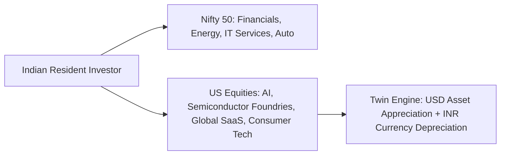
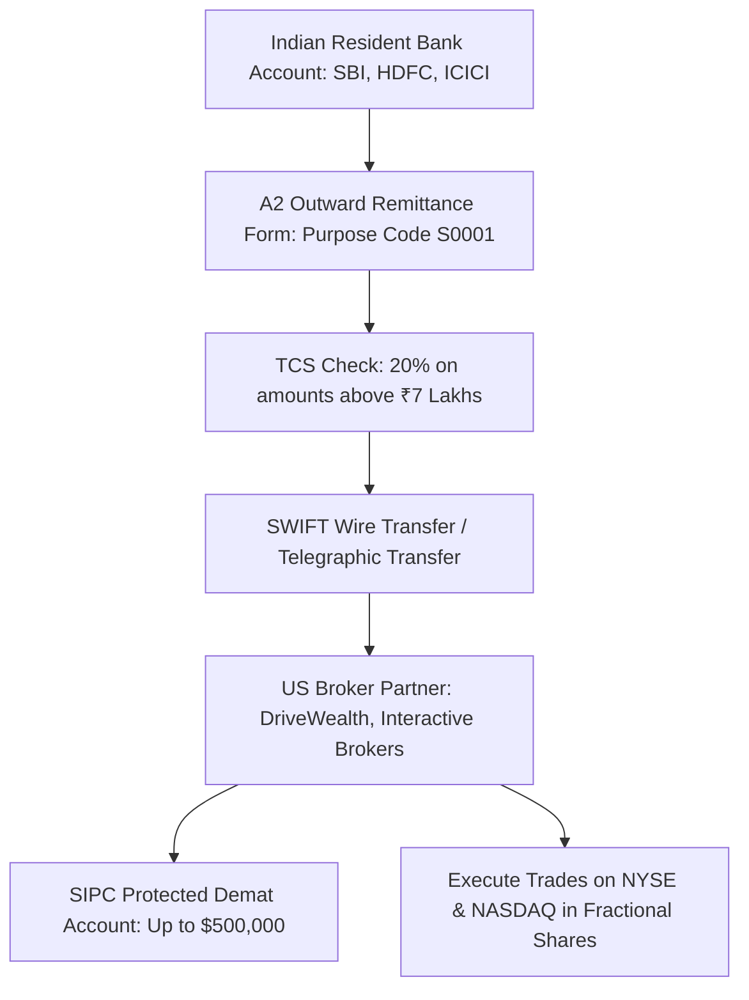

## 1. Why Indian Portfolios Need Global Geographic Diversification

Despite India's impressive domestic economic growth, the Indian stock market represents approximately **$3.8\%$ of global market capitalization**. Over $96\%$ of global economic enterprise, technological innovation, and patent intellectual property reside outside Indian borders:

### The Dual-Engine Return Driver:
When an Indian investor buys US equities, the terminal Rupee return is multiplicative:

$$
1 + R_{INR} = \left(1 + R_{USD}\right) \times \left(1 + \Delta_{\text{USD/INR}}\right)
$$

If the US S&P 500 index compounds at $10.5\%$ in USD over a decade, and the Indian Rupee depreciates against the US Dollar at its historical average of $3.2\%$ annually:

$$
1 + R_{INR} = 1.105 \times 1.032 = 1.14036 \implies \mathbf{14.04\%  annual INR return}
$$

The currency depreciation provides a **350 basis point annual tailwind** directly into the Indian investor's portfolio!

---

## 2. Regulatory Foundation: The RBI LRS Framework

Under the **Liberalised Remittance Scheme (LRS)** governed by the *Foreign Exchange Management Act, 1999 (FEMA)*:
- Every resident Indian individual (including minors) can remit abroad up to **USD 250,000 (approximately ₹2.10 Crores)** per financial year (April to March).
- **Permissible Capital Investments:** Listed equities, index ETFs, mutual funds, sovereign debt, and venture investments.
- **Prohibited Remittances:** Speculative forex margin trading, lottery, and purchasing binary options overseas.

---

## 3. The Remittance and Brokerage Mechanics

### A. Brokerage Partners and SIPC Protection
Indian investors access US markets through direct US brokerages (such as Interactive Brokers) or Indian fintechs (INDmoney, Vested, Groww) partnered with SEC-registered US clearing brokers (DriveWealth, Alpaca Securities):
- **SIPC Insurance:** Securities Investor Protection Corporation (SIPC) protects customer accounts up to **$500,000 (including $250,000 for cash)** in the event of brokerage insolvency.
- **Fractional Share Trading:** Allows buying $0.05$ shares of expensive stocks like Berkshire Hathaway or Microsoft with as little as $1.

---

## 4. Mandatory Compliance: Schedule FA in the Indian ITR

Holding foreign assets carries stringent legal disclosure obligations under the **Black Money (Undisclosed Foreign Income and Assets) and Imposition of Tax Act, 2015**:
1. You **must file ITR-2 or ITR-3** (cannot use ITR-1 Sahaj).
2. You **must report all foreign bank balances, brokerage accounts, and shareholdings in Schedule FA (Foreign Assets)**, recording the peak balance, closing balance, gross interest, and dividends received during the calendar year.
3. **Severe Penalty:** Failure to disclose a foreign asset in Schedule FA—even if fully bought with tax-paid white money under LRS—carries a statutory non-discretionary penalty of **₹10,00,000 (₹10 Lakhs)** under Section 43 of the Black Money Act!
