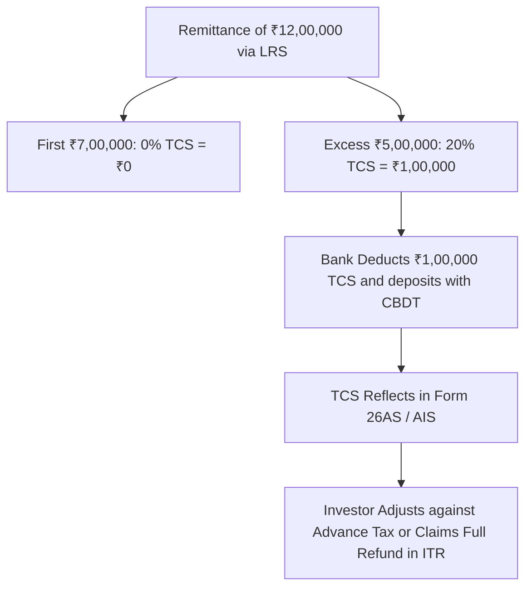

## 1. Demystifying the 20% LRS TCS: Cash Flow vs Real Tax

Under **Section 206C(1G)** of the Income Tax Act, 1961, when an Indian resident remits funds abroad for investment under the Liberalised Remittance Scheme:
- **Threshold Exemption:** Remittances up to **₹7,00,000 per financial year** attract **0% TCS**.
- **Above ₹7 Lakhs:** The remitting bank is statutorily mandated to collect **$20\%$ Tax Collected at Source (TCS)** on the incremental amount.



### The Crucial Takeaway:
**TCS is NOT an additional expense or final tax!** It is an advance payment credited directly against your PAN. When you file your annual ITR, that ₹1,00,000 TCS directly reduces your regular Indian income tax liability, or is **refunded to your bank account with interest**.

---

## 2. US Dividend Withholding Tax: Form W-8BEN and DTAA Article 10

When a US corporation (e.g. Apple, Microsoft, Procter & Gamble) distributes a cash dividend to an Indian resident:
1. Under US Internal Revenue Code (IRC), non-resident alien dividend withholding tax is standard **$30\%$**.
2. However, under the **US-India Double Tax Avoidance Agreement (DTAA) Article 10**, this withholding rate is lowered to **$25\%$**.
3. **Form W-8BEN:** When you open your US brokerage account, you electronically sign US IRS Form W-8BEN (*Certificate of Foreign Status of Beneficial Owner*), establishing Indian tax residency and activating the preferential $25\%$ DTAA treaty rate.

### Step-by-Step Numerical Example:
Suppose you own shares in Apple and receive a gross dividend of **$100.00**:
- US Broker automatically withholds **$25.00 ($25\%)** and remits it to the US Internal Revenue Service (IRS).
- Net cash deposited into your brokerage wallet: **$75.00**.

---

## 3. How to Avoid Paying Double Tax: Form 67 & Foreign Tax Credit (FTC)

Without a treaty, the Indian tax department would also tax that $100 dividend at your 31.2% Indian income slab rate, resulting in severe double taxation (25% US + 31.2% India = 56.2% tax).

Under **Section 90 of the Income Tax Act** and **Rule 128**, Indian residents can claim a **Foreign Tax Credit (FTC)** for the tax withheld in the US:

```mermaid
graph LR
    GrossDiv[Gross Foreign Dividend: $100 = ₹8,400] --> USTax[US Withholding Tax (25%): ₹2,100]
    GrossDiv --> IndiaTax[Indian Slab Tax (31.2%): ₹2,621]
    USTax --> Form67[File Form 67 on IT Portal: Claim ₹2,100 FTC Credit]
    Form67 --> NetIndiaPay[Net Tax Paid to Indian Govt: ₹2,621 - ₹2,100 = Just ₹521!]
```

### Mandatory Form 67 Filing Rules:
1. **Timing:** Form 67 must be submitted online on the Income Tax e-filing portal **on or before the due date** for filing your ITR under Section 139(1).
2. **Required Documents:** Attach the 1042-S statement or account dividend statement provided by the US broker confirming the gross dividend, exact US tax withheld, and currency conversion rate (SBI TT Buying Rate on the date of transaction).
3. If Form 67 is not filed, the Indian tax assessing officer will disallow the foreign tax credit and demand full tax in India!
