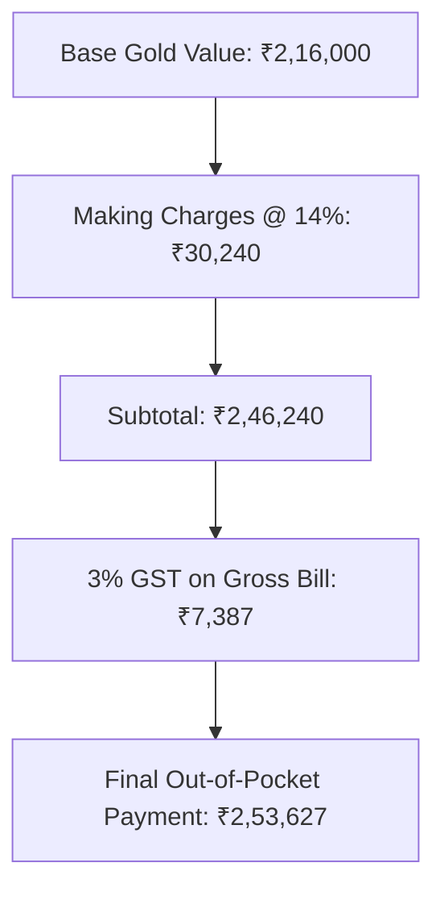

## 1. The Anatomy of a Gold Jewelry Bill

When an Indian consumer purchases gold jewelry from a retail showroom, the invoice is calculated as:

$$
Total Invoice Price = \left(Weight in Grams \times Daily Gold Rate\right) + Making Charges + 3\%  GST
$$

Let us inspect the cost breakdown of a 22-Karat (916 purity) gold necklace weighing **30 grams** with prevailing gold rate at ₹7,200 per gram:

### The Immediate Resale Trap
If the buyer walks out of the showroom and immediately turns around to sell the identical necklace back to the dealer:
1. The **3% GST (₹7,387)** is government tax and cannot be refunded by the jeweler.
2. The **Making Charges (₹30,240)** are completely wiped out (value attributed to craft, not metal).
3. The jeweler typically deducts a **$2\% - 3\%$ melting and wastage haircut** on the pure gold value.
4. **Net Cash Recovered:** ₹2,09,520
5. **Instant Financial Loss:** $-\mathbf{₹44,107 \text{ (a } 17.39\% \text{ upfront loss)}}$.

---

## 2. Deciphering the Mandatory BIS Hallmarking Standards

To prevent rampant retail purity fraud, the Government of India made **BIS Hallmarking mandatory** across all precious metal jewelry sold in the country.

A genuine BIS Hallmarked piece contains three distinct laser-engraved symbols:
1. **The BIS Triangular Logo:** Official certification mark of the Bureau of Indian Standards.
2. **Purity / Fineness Mark:**
   - `24K999` : $99.9\%$ pure gold (Bullion / Coins)
   - `22K916` : $91.6\%$ pure gold (Standard traditional jewelry)
   - `18K750` : $75.0\%$ pure gold (Diamond & studded jewelry)
   - `14K585` : $58.5\%$ pure gold
3. **6-Digit Alphanumeric HUID:** Hallmark Unique Identification code. Every single piece of jewelry possesses a unique 6-digit code traceable via the official **BIS CARE Mobile App**, verifying the exact assayer, center, and date of testing.

---

## 3. Practical Rules for Physical Precious Metal Purchases

1. **Never buy unhallmarked jewelry:** An unhallmarked piece will face heavy melting test penalties ($10\% - 20\%$) upon resale.
2. **Refuse 'Wastage + Making Charges' Double Billing:** Some unorganized jewelers charge a $5\%$ 'wastage' fee in addition to a $12\%$ making charge. This is an obsolete pre-CAD practice designed to extract extra margin.
3. **Separate Investment from Adornment:** If the objective is wealth preservation or portfolio diversification, strictly buy **SGBs or Gold ETFs**. Keep jewelry purchases categorized honestly as family lifestyle consumption.
