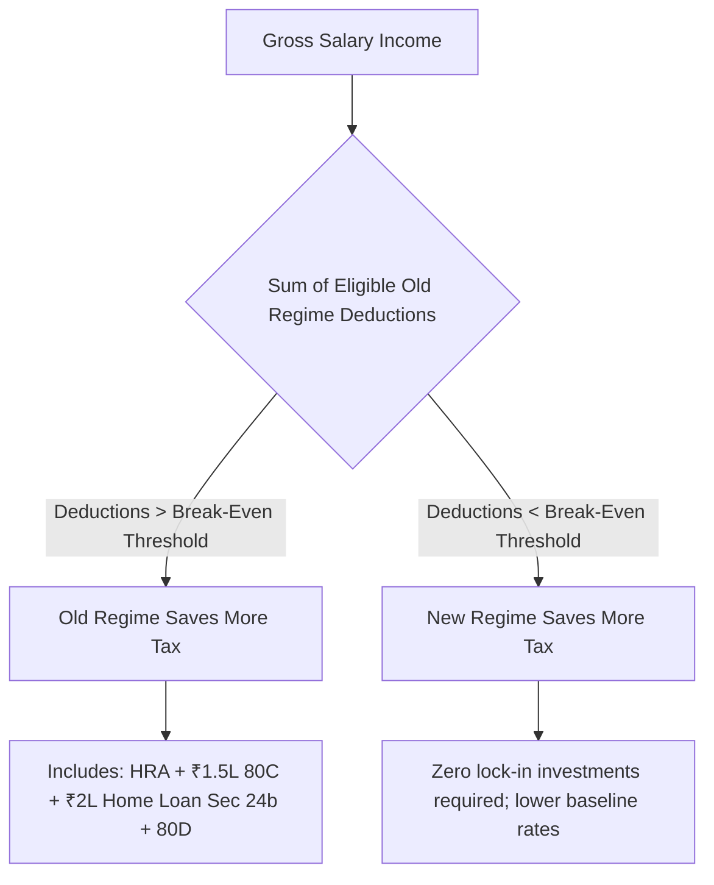

## 1. The Shifting Ground: Finance Act 2024 Slab Enhancements

With the Finance (No. 2) Act 2024, the government reinforced the **New Tax Regime (Section 115BAC)** as the statutory default option, widening slab widths and raising the salaried standard deduction from ₹50,000 to **₹75,000**.

### New Tax Regime Slabs (AY 2025-26):
- **Up to ₹3,00,000:** Nil
- **₹3,00,001 to ₹7,00,000:** $5\%$
- **₹7,00,001 to ₹10,00,000:** $10\%$
- **₹10,00,001 to ₹12,00,000:** $15\%$
- **₹12,00,001 to ₹15,00,000:** $20\%$
- **Above ₹15,00,000:** $30\%$
- *Section 87A Rebate:* 100% tax rebate for taxable income up to ₹7,00,000. Coupled with the ₹75,000 standard deduction, a salaried employee earning **₹7,75,000 pays ₹0 income tax**.

---

## 2. Mathematical Break-Even Deduction Thresholds

To identify which regime is superior, calculate your **Total Deductions ($D_{total}$)** under the Old Regime:

$$
D_{total} = \text{Standard Deduction (₹50k)} + \text{Sec 80C (max ₹1.5L)} + \text{Sec 80D (Health: ₹25k-50k)} + HRA Exemption + \text{Home Loan Interest (Sec 24b: max ₹2L)}
$$

### The Break-Even Table Across Income Levels:

| Annual Gross Income | New Regime Tax (AY 2025-26) | Break-Even Deductions Required in Old Regime | Decision Recommendation |
| :--- | :--- | :--- | :--- |
| **₹10,00,000** | ₹44,200 | **₹2,62,500** | New regime wins for most young professionals without home loans |
| **₹15,00,000** | ₹1,35,200 | **₹3,58,000** | Balanced territory; requires HRA + 80C + 80D + Home Loan |
| **₹20,00,000** | ₹2,91,200 | **₹4,10,000** | Old regime wins if paying substantial urban rent (HRA) + home loan |
| **₹30,00,000** | ₹6,03,200 | **₹4,45,000** | Old regime typically superior for senior corporate executives with high rent |

---

## 3. The Single Deduction Available in Both Regimes: Section 80CCD(2)

Many salaried investors falsely assume all deductions are lost under the New Tax Regime. **Section 80CCD(2)**—Employer contribution to the National Pension System (NPS)—remains fully deductible under **both regimes**:

- Private sector employees can deduct employer NPS contributions up to **$10\%$ of Basic Salary + DA**.
- Central and state government employees can deduct up to **$14\%$**.
- This deduction is uncapped by Section 80C and allows an executive with ₹20 Lakh basic salary to shield an extra **₹2,00,000 directly from income tax**, saving ₹62,400 in out-of-pocket tax annually under the New Regime!
