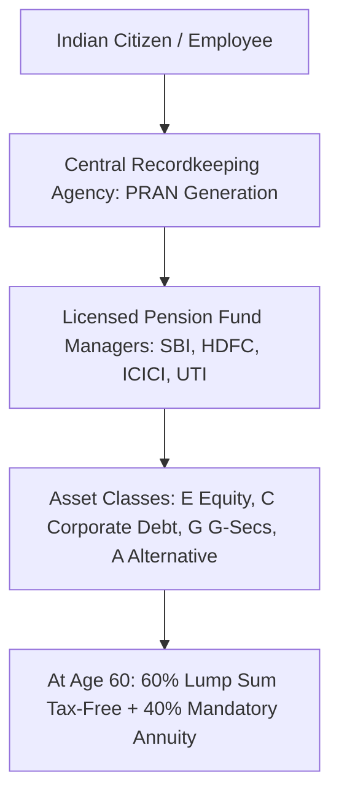

## 1. Statutory Architecture of the National Pension System

Established under the **PFRDA Act, 2013**, the **National Pension System (NPS)** is a defined-contribution pension architecture designed to provide retirement income security to all Indian citizens.

NPS is managed through a clean institutional separation of responsibilities:
- **PFRDA:** Statutory regulator governing policies, charges, and guidelines.
- **NPS Trust:** Legal owner of all underlying assets on behalf of subscribers.
- **Central Recordkeeping Agencies (CRAs):** Protean (formerly NSDL), KFintech, and CAMS handle administration, account maintenance, and statements.
- **Pension Fund Managers (PFMs):** Licensed institutional asset managers (SBI, HDFC, ICICI Prudential, UTI, Kotak, Axis, Tata, Max Life) executing portfolio investments.
- **Custodian:** Stock Holding Corporation of India holds the physical and dematerialized securities.

---

## 2. Investment Choice Framework: Active Choice vs Auto Choice

Subscribers can determine how their monthly contributions are divided across four distinct asset classes:
1. **Asset Class E (Equity):** High-quality listed Indian equities (predominantly Nifty 50 and Nifty 100).
2. **Asset Class C (Corporate Debt):** High-rated (AAA and AA) corporate bonds and PSU debentures.
3. **Asset Class G (Government Securities):** Central and state government sovereign bonds.
4. **Asset Class A (Alternative Assets):** Category I & II AIFs, REITs, InvITs, and commercial mortgage-backed securities (capped strictly at $5\%$).

### A. Active Choice
The subscriber manually sets their percentage weights. The maximum equity allocation is capped at **$75\%$** up to the age of 50. From age 51 to 60, the maximum equity ceiling tapers down by $2.5\%$ annually, reaching $50\%$ at age 60.

### B. Auto Choice (Lifecycle Funds)
For passive investors, NPS provides automated lifecycle rebalancing:
- **Aggressive Lifecycle Fund (LC75):** Begins with $75\%$ in Equity until age 35, gradually shifting into G-Secs as the subscriber nears retirement.
- **Moderate Lifecycle Fund (LC50):** Starts at $50\%$ in Equity (the default option).
- **Conservative Lifecycle Fund (LC25):** Starts at $25\%$ in Equity.

---

## 3. The Triple Tax Advantage of NPS

NPS enjoys unmatched statutory tax benefits across contribution, accumulation, and withdrawal:

| Statutory Section | Deduction Scope | Tax Regime Eligibility | Maximum Deductible Amount |
| :--- | :--- | :--- | :--- |
| **Section 80CCD(1)** | Employee / Self contribution | **Old Tax Regime Only** | Included in overall ₹1.5 Lakh Section 80C limit |
| **Section 80CCD(1B)** | Exclusive additional deduction | **Old Tax Regime Only** | **₹50,000** (over and above the 80C ceiling) |
| **Section 80CCD(2)** | Employer corporate contribution | **BOTH New & Old Regimes!** | **Up to $10\%$ of Basic Salary + DA** ($14\%$ for central govt) |

### The Section 80CCD(2) Corporate Superpower:
Under the New Tax Regime (Section 115BAC), almost all traditional deductions (80C, 80D, HRA) are eliminated. However, **Section 80CCD(2) remains fully deductible**. 

An employee with a Basic Salary of ₹18,00,000 whose employer contributes $10\%$ into NPS receives a **direct tax deduction of ₹1,80,000**, saving **₹56,160 in out-of-pocket tax** every single year!

---

## 4. Withdrawal at Age 60 and the Annuity Dilemma

When the subscriber attains the age of 60:
1. **The 60% Lump Sum:** Up to $60\%$ of the accumulated terminal corpus can be withdrawn as a lump sum. Under **Section 10(12A)**, this entire $60\%$ payout is **$100\%$ TAX-FREE**.
2. **The 40% Mandatory Annuity:** At least $40\%$ of the corpus must be deployed to purchase an immediate annuity from an IRDAI-registered life insurance company (e.g. LIC, HDFC Life, SBI Life).
3. **The Annuity Tax Reality:** The purchase of the annuity is not taxed, but the **monthly pension received from the annuity is taxed as regular salary income at marginal slab rates**.
