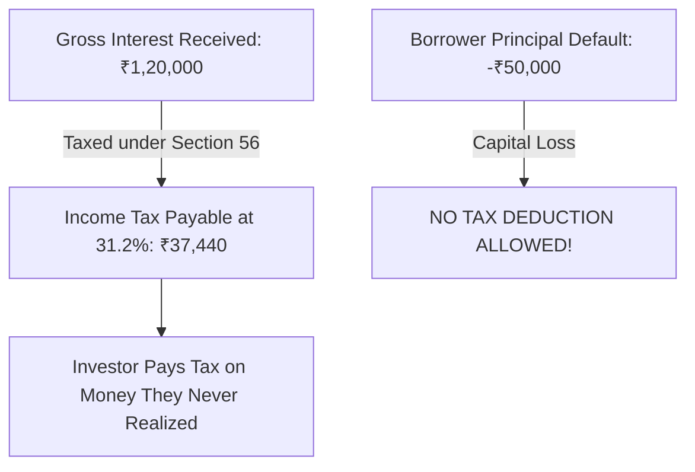

## 1. The Statutory Asymmetry in Indian Tax Law

The most critical and least understood risk in retail peer-to-peer lending is not credit risk, but **statutory tax asymmetry**.

In the Indian Income Tax Act, 1961:
1. **Interest Income:** Assessed under **Section 56(2) — Income from Other Sources**. It is added directly to total taxable income and taxed at the investor's highest marginal slab rate ($31.2\%$ or $39\%$ with surcharge).
2. **Defaulted Principal Losses:** When a borrower defaults and never repays, that loss is considered a **loss of capital**.

Under Section 57, deductions under the head 'Other Sources' are strictly limited to expenditures incurred *wholly and exclusively for the purpose of making or earning such income*. **Capital losses and bad debts cannot be deducted under Section 57!**

---

## 2. Why Section 36(1)(vii) Bad Debt Relief Does Not Apply to You

Many retail investors assume they can claim defaulted P2P loans as a 'Bad Debt' deduction in their annual Income Tax Return (ITR). 

However, **Section 36(1)(vii)** is located under Chapter IV-D: *Profits and Gains of Business or Profession*. It is available **only** if:
1. The taxpayer is officially registered as a business of banking or money lending.
2. The debt has been taken into account in computing the income of the taxpayer in the previous year.
3. The taxpayer maintains audited balance sheets and profit & loss accounts under Section 44AB.

For an ordinary salaried individual, software engineer, or retiree investing personal savings via an app:
- You are **not** an NBFC.
- You do **not** file business returns (ITR-3 / ITR-4) for money lending.
- The Income Tax Department will summarily disallow any claim of principal write-offs against your salary or interest income.

---

## 3. The Nightmare Scenario: Paying Tax on an Actual Financial Loss

Let us examine the catastrophic tax outcome of a stressed P2P portfolio:

- **Initial Investment:** ₹5,00,000
- **Gross Interest Earned:** ₹60,000 ($12\%$)
- **Borrower Defaults (Unrecovered Principal):** ₹80,000 ($16\%$ default during a credit crisis)
- **Net Actual Financial Cash Position:**
  $$ Net Cashflow = +₹60,000 - ₹80,000 = -\mathbf{₹20,000 \text{ (REAL FINANCIAL LOSS)}} $$

### What Does the Tax Department Demand?

1. Under Section 56, your gross interest is ₹60,000.
2. The ₹80,000 defaulted principal cannot be subtracted.
3. **Tax liability at $31.2\%$ slab:**
   $$ Tax Payable = ₹60,000 \times 0.312 = \mathbf{₹18,720} $$
4. **Total Out-of-Pocket Loss:**
   $$ Total Net Loss = -₹20,000 \text{ (capital loss)} - ₹18,720 \text{ (tax paid)} = -\mathbf{₹38,720} $$

The investor lost ₹20,000 in real money, yet had to pay ₹18,720 in taxes to the government. This severe tax trap makes high-risk unsecured retail P2P lending mathematically irrational for any investor in the $20\%$ or $30\%$ tax brackets.
