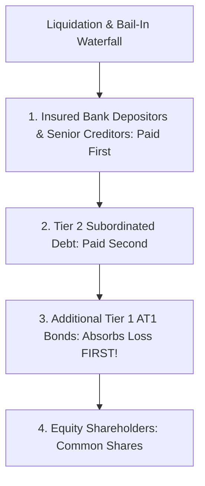

## 1. What Are Additional Tier 1 (AT1) Bonds?

Under global **Basel III banking regulations**, commercial banks must maintain adequate loss-absorbing capital to ensure that taxpayers and depositors never bail out a failing bank.

To satisfy their **Tier 1 Capital Adequacy** requirements without diluting equity shareholders, Indian banks issue **Additional Tier 1 (AT1) Bonds**.

To retail investors, relationship managers frequently marketed these instruments as:
> *"High-yield bank fixed deposits giving 9.5% to 11% interest from reputable banks like Yes Bank, State Bank of India, or ICICI."*

In reality, an AT1 bond is **quasi-equity disguised as fixed income**. It contains structural legal clauses that make it one of the most hazardous financial instruments in the world.

---

## 2. The Three Lethal Clauses in AT1 Bond Indentures

### A. Perpetual Tenure (No Maturity Date)
An AT1 bond never matures. The investor has **zero legal right** to demand repayment of their principal from the bank. The bank has a discretionary 'call option' to buy back the bond (typically after 5 or 10 years), but is under **no legal obligation** to exercise it.

### B. Full Discretionary Coupon Cancellation
Under RBI Basel III rules, the bank can cancel coupon payments at any time if its capital ratios drop below statutory minimums or if the bank reports net financial losses. Crucially:
- Cancelled coupons do **not** accumulate.
- Skipped coupon payments are permanently lost to the investor.
- Coupon cancellation **does not constitute an event of default**.

### C. The Point of Non-Viability (PONV) Principal Write-Off
If the Reserve Bank of India determines that a bank has reached the **Point of Non-Viability** (the bank would fail without a government bailout or forced reconstruction):
> *"The RBI possesses the statutory authority to write down the entire principal value of the AT1 bonds to ZERO, or convert them into common equity shares."*

---

## 3. The Yes Bank Precedent: ₹8,415 Crores Erased Overnight

In March 2020, following severe capital depletion at Yes Bank, the Reserve Bank of India announced a reconstruction scheme backed by State Bank of India.

Invoking the PONV clause:
1. Yes Bank **permanently wrote down ₹8,415 Crores of AT1 bonds to ₹0.00**.
2. Over **1,300 individual retail investors**, retirees, and family trusts who had put their life savings into these 'high-yield bank bonds' lost **$100\%$ of their capital**.
3. In a bitter legal irony, common equity shareholders (who theoretically rank below bondholders) retained partial residual value, while AT1 bondholders were wiped out entirely!

### SEBI Post-Crisis Intervention:
Following the disaster, SEBI stepped in to protect retail investors:
- Mandated that AT1 bonds can only be traded in institutional minimum lot sizes of **₹1 Crore** (later revised to ₹10 Lakhs for specialized issues).
- Banned mutual funds from holding more than $10\%$ of their net assets in perpetual AT1 instruments.
- Prohibited deceptive marketing comparing perpetual bonds to fixed deposits.
