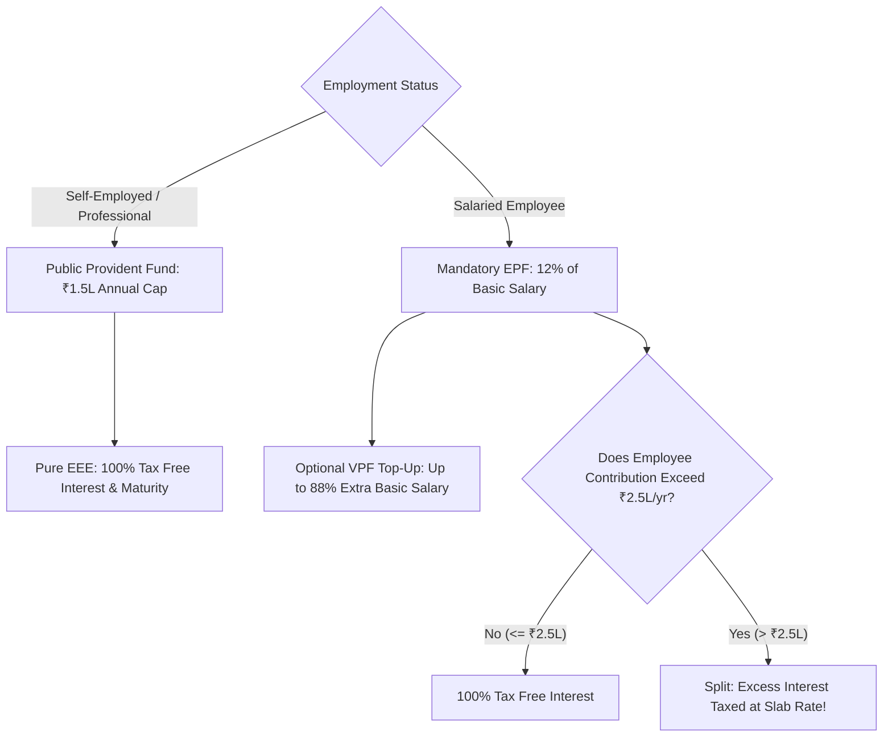

## 1. The Trinity of Indian Provident Funds

For conservative debt allocation, three instruments form the cornerstone of capital preservation in India:
1. **Public Provident Fund (PPF):** Open to all Indian citizens (salaried, self-employed, professionals, non-working spouses).
2. **Employees' Provident Fund (EPF):** Mandatory statutory retirement scheme for salaried corporate employees in establishments with $\ge 20$ workers.
3. **Voluntary Provident Fund (VPF):** An optional top-up mechanism allowing salaried employees to contribute beyond the mandatory $12\%$ EPF ceiling into their existing EPF account at the identical high interest rate.

---

## 2. Quantitative Feature-by-Feature Matrix

| Dimension | Public Provident Fund (PPF) | Employees' Provident Fund (EPF) | Voluntary Provident Fund (VPF) |
| :--- | :--- | :--- | :--- |
| **Eligibility** | All Resident Indian Citizens | Salaried employees in organized sector | Salaried employees enrolled in EPF |
| **Current Interest Rate (FY26)** | **$7.10\%$ p.a.** (notified quarterly) | **$8.25\%$ p.a.** (declared annually by CBT) | **$8.25\%$ p.a.** (identical to EPF) |
| **Annual Contribution Limits** | Minimum ₹500; Maximum **₹1,50,000** | Mandatory $12\%$ of Basic Salary + DA | Up to $100\%$ of Basic Salary + DA |
| **Lock-in Period** | **15 Years** (extendable in 5-yr blocks) | Until retirement / 2 months of unemployment | Until retirement / 2 months of unemployment |
| **Tax Status (Contribution)** | Section 80C (Old Regime) | Section 80C (Old Regime) | Section 80C (Old Regime) |
| **Tax Status (Interest)** | **$100\%$ TAX FREE** under Section 10(11) | Tax-Free up to ₹2.5 Lakh contribution | Tax-Free up to ₹2.5 Lakh aggregate EPF+VPF |
| **Tax on Maturity** | **$100\%$ TAX FREE** (EEE Status) | Tax-Free if continuous service $\ge 5$ years | Tax-Free if continuous service $\ge 5$ years |
| **Court Attachment Immunity** | **Immune** under PPF Act, 1968 | Immune under EPF Act, 1952 | Immune under EPF Act, 1952 |

---

## 3. The ₹2.5 Lakh EPF Tax Amendment Decoded

Enacted under Finance Act 2021 and codified under **Rule 9D of the Income Tax Rules**:

> *"Interest accrued during the previous year to the extent it relates to the amount or the aggregate of amounts of contribution made by a person exceeding two lakh and fifty thousand rupees in any previous year in that fund, on or after 1 April 2021, shall be treated as income from other sources."*

### How the Dual Ledger Works in Practice:
Suppose a high-earning corporate executive contributes ₹5,00,000 annually into EPF + VPF (employer contribution is separate):
1. **Non-Taxable Account:** ₹2,50,000 is credited to the non-taxable ledger. The $8.25\%$ interest on this balance remains **$100\%$ tax-free**.
2. **Taxable Account:** The remaining ₹2,50,000 is credited to a second, separate taxable ledger.
3. The $8.25\%$ interest on this second ledger ($₹20,625$) is added to the employee's annual Form 16 / AIS and **taxed at their marginal slab rate ($31.2\%$)**.
4. Even after tax, $8.25\% \times (1 - 0.312) = \mathbf{5.68\% \text{ net post-tax yield}}$—which still outpaces a bank FD yielding $7.2\% \implies 4.95\%$ post-tax!
