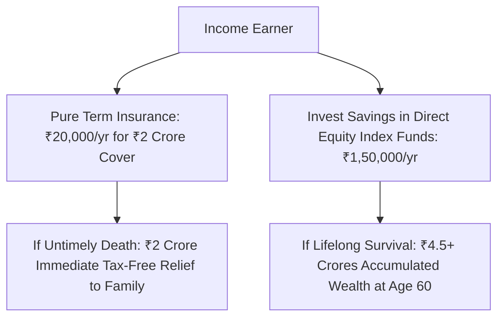

## 1. The Core Philosophy of Insurance vs Investment

The most catastrophic error in Indian personal finance is confusing **risk protection** with **investment wealth accumulation**.

An insurance policy's sole economic objective is to replace the economic value of an income earner in the event of premature death. When insurers bundle investment features into a policy (such as in ULIPs or endowment plans), the result is an inferior hybrid: **grossly inadequate insurance cover coupled with terrible investment returns**.

**Pure Term Insurance** strips away all investment gimmicks:
- You pay an annual premium (e.g. ₹15,000 to ₹25,000).
- If you pass away during the policy term, your family receives the full Sum Assured (e.g. ₹2,00,00,000 — ₹2 Crores) completely tax-free under Section 10(10D).
- If you survive the term, no money is returned.

---

## 2. Calculating Your Sum Assured: The Human Life Value (HLV) Formula

Insurance should never be purchased as an arbitrary figure (e.g. "I have a ₹50 Lakh policy"). In actuarial science, optimal coverage is determined using the **Human Life Value (HLV) Equation**:

$$
HLV = \sum_{t=1}^{n} \frac{E_t - C_t}{(1 + d)^t} + L_{debt} + G_{future goals} - A_{existing assets}
$$

Where:
- $E_t$: Projected annual gross earnings in year $t$.
- $C_t$: Personal consumption expenses of the earner.
- $d$: Real discount rate.
- $L_{debt}$: Total outstanding debt (Home loan, car loan, business liabilities).
- $G_{future goals}$: Present value of critical milestones (Children's higher education, marriage).
- $A_{existing assets}$: Existing financial assets (excluding the primary residence).

### Simplified Rule of Thumb:
For an earner below age 40:
$$
Minimum Term Cover = \left(Annual Gross Income \times 15  to  20\right) + Total Outstanding Home Loans
$$
A professional earning ₹20 Lakhs per year with a ₹60 Lakh home loan requires a **minimum term cover of ₹3.50 Crores to ₹4.00 Crores**.

---

## 3. Section 6 of the MWP Act: The Ironclad Creditor Shield

If an entrepreneur, business founder, or corporate director passes away with outstanding debts, creditors and banks can obtain a court order to attach bank accounts, mutual funds, and standard life insurance payouts to settle outstanding corporate loans.

To eliminate this catastrophe, an Indian male can purchase his term policy under **Section 6 of the Married Women's Property (MWP) Act, 1874**:

> *"A policy of insurance effected by any married man on his own life, and expressed on the face of it to be for the benefit of his wife, or of his wife and children, shall ensue and be deemed to be a trust for the benefit of his wife, or of his wife and children... and shall not be subject to the control of the husband, or to his creditors, or form part of his estate."*

### Key Legal Protections of an MWP Policy:
1. **Immunity from Creditors:** Neither commercial banks, tax authorities, nor business partners can attach the death benefit under any court decree.
2. **Nominee Protection:** The proceeds bypass general inheritance disputes and probate court proceedings, transferring directly to the wife and children as statutory beneficiaries of an irrevocable trust.
3. **Zero Additional Cost:** Opting for the MWP Act endorsement is **100% free** during policy application. (Note: It must be selected during initial purchase; it cannot be added retrospectively).
