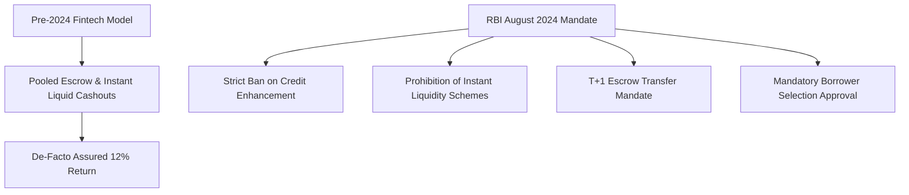

## 1. Background: Why the RBI Intervened in the P2P Sector

Between 2020 and 2024, several Indian fintech platforms began packaging high-risk peer-to-peer loans as liquid deposit substitutes. By utilizing proprietary algorithms to pool lender funds and promise "anytime instant withdrawals" or "guaranteed 12% returns," platforms functioned as shadow banks without meeting the regulatory capital adequacy and cash reserve requirements applicable to commercial banks.

On **August 16, 2024**, the Reserve Bank of India issued sweeping amendments to the **NBFC-P2P Master Directions**, closing these regulatory loopholes with immediate effect.

---

## 2. Key Pillars of the RBI August 2024 Regulations

### A. Total Prohibition of Credit Enhancement & Assured Returns
Under amended Section 6(1)(vi):
> *"NBFC-P2P shall not provide or arrange any credit enhancement, first-loss default guarantee (FLDG), or assured return structure either directly or indirectly."*

Platforms are legally prohibited from absorbing borrower defaults or paying lenders out of platform balance sheets to create the illusion of zero-default performance.

### B. Dismantling of 'Instant Liquidity' Products
Fintech platforms previously operated internal secondary loan-assignment mechanisms where an exiting lender was immediately paid out by transferring their outstanding loans to new incoming lenders. The RBI banned this practice, directing that:
1. Funds can only be repaid to a lender as and when the underlying borrower actually deposits the EMI.
2. Loan tenure cannot be arbitrarily truncated or transferred to simulate an on-demand deposit.

### C. Direct Lending Escrow Mechanism
All fund transfers must flow through two separate bank-operated escrow accounts:
- **Disbursement Escrow:** Funds from lenders to verified borrowers.
- **Repayment Escrow:** EMIs from borrowers to lenders.
- Crucially, funds cannot remain in the escrow account for more than **T+1 days**, preventing platforms from sitting on lender float.

### D. Exposure Caps & Net Worth Certification
- **Aggregate Lending Limit:** ₹50,00,000 maximum across all P2P platforms in India per investor.
- **Single Borrower Cap:** Maximum ₹50,000 to any individual borrower.
- **Mandatory CA Certification:** If an investor deploys more than ₹10,00,000 across P2P platforms, they must produce a practicing Chartered Accountant net-worth certificate confirming minimum net assets of ₹50 Lakhs.
