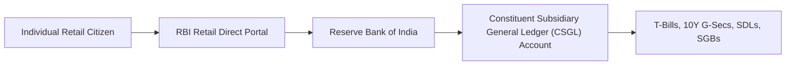

## 1. What Is the RBI Retail Direct Scheme?

Historically, the multi-trillion Rupee Indian Government Securities (G-Sec) market was exclusively accessible to institutional entities—commercial banks, insurance companies, primary dealers, and provident funds.

Launched by the Prime Minister and the RBI Governor, the **RBI Retail Direct Scheme** democratized this institutional market by allowing individual retail investors to open a **Retail Direct Gilt (RDG) Account** directly with the Reserve Bank of India.

---

## 2. Supported Sovereign Debt Instruments

Through the online portal (`rbiretaildirect.org.in`), investors can participate in non-competitive primary auctions as well as the secondary **NDS-OM (Negotiated Dealing System - Order Matching)** market:

| Sovereign Instrument | Issuer | Standard Tenures | Coupon / Return Structure | Minimum Investment |
| :--- | :--- | :--- | :--- | :--- |
| **Treasury Bills (T-Bills)** | Government of India | 91 Days, 182 Days, 364 Days | Zero-coupon (Issued at discount, redeemed at par) | ₹10,000 |
| **Dated Government Securities** | Government of India | 2 Years to 40 Years | Fixed semi-annual coupon (e.g. $7.10\%$ p.a.) | ₹10,000 |
| **State Development Loans (SDLs)** | Individual State Governments | 5 Years to 15 Years | Fixed semi-annual coupon (25-50  bps higher than G-Sec) | ₹10,000 |
| **Floating Rate Savings Bonds** | Government of India | 7 Years | Semi-annual coupon linked to National Savings Certificate ($+0.35\%$) | ₹1,000 |
| **Sovereign Gold Bonds (SGB)** | Government of India | 8 Years | $2.50\%$ annual coupon + Gold price at maturity | 1 Gram of Gold |

---

## 3. Step-by-Step Account Opening and Primary Auction Bidding

### Prerequisites:
- Valid Indian PAN card.
- Rupee bank account in India (with Net Banking / UPI enabled).
- Valid email address and Aadhaar-linked mobile number.

### The Non-Competitive Bidding Process:
1. Every week, the RBI announces primary debt auctions on the portal (Treasury Bills on Wednesdays; Dated G-Secs on Fridays).
2. Retail investors participate under the **Non-Competitive Bidding Facility** ($5\%$ of the notified auction amount is reserved exclusively for retail participants).
3. The investor does not need to submit complex yield quotes. You simply enter the amount (e.g. ₹1,00,000). The RBI automatically allocates bonds at the **weighted average cutoff yield** determined by institutional bidders.
4. Funds are debited via ASBA/UPI, and the bonds are credited directly into your RDG account.
5. All semi-annual coupon payments and terminal maturity proceeds are **credited automatically into your registered bank account** on the scheduled date with zero delay.
