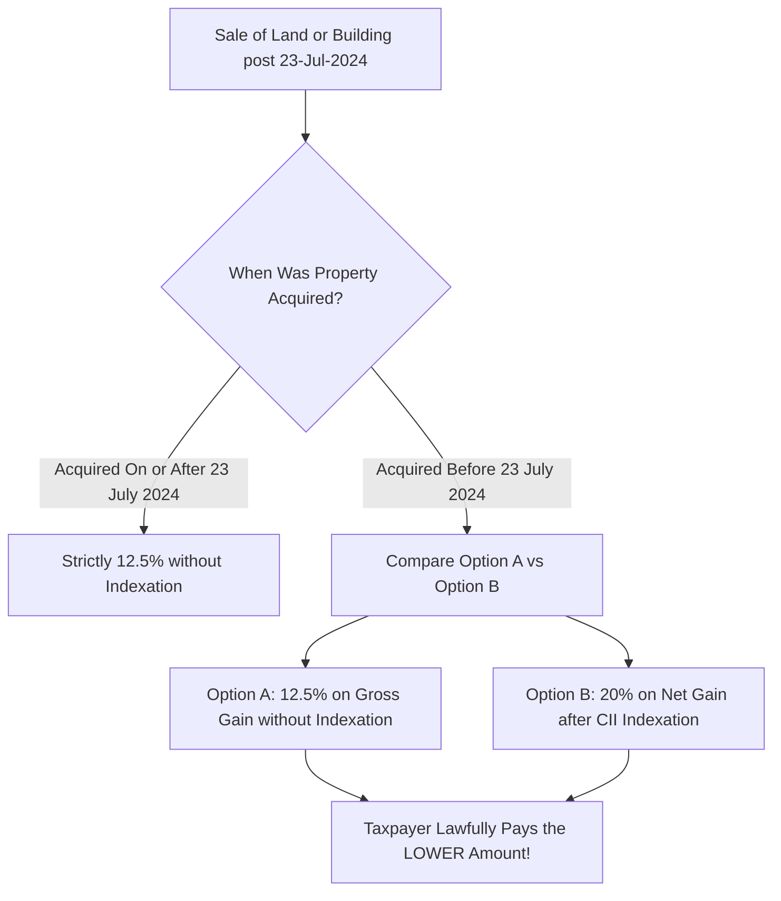

## 1. The Parliamentary Amendment of August 2024

When the Union Budget was initially presented on July 23, 2024, the government proposed completely eliminating indexation for all real estate sales and applying a flat $12.5\%$ LTCG rate. 

Following widespread public representation regarding legacy properties bought decades ago with modest price appreciation, Parliament amended the bill before passage, inserting a **statutory grandfathering clause** in Section 112:

> *"For an individual or Hindu Undivided Family (HUF) who transfers a long-term capital asset, being land or building or both, acquired before the 23rd day of July, 2024, the tax payable shall not exceed the tax computed at the rate of twenty per cent with indexation."*

---

## 2. Mathematical Decision Rule: Which Option Should You Choose?

Whether an individual should elect **Option A ($12.5\%$ flat)** or **Option B ($20\%$ with CII indexation)** depends mathematically on the **Compound Annual Growth Rate (CAGR)** of the property relative to the official **Cost Inflation Index (CII)** growth:

### The Mathematical Inflection Threshold
Let the property purchase price be $P_0$, sale price be $P_t$, and indexation factor over $t$ years be $I_t = \frac{CII_t}{CII_0}$.

The break-even condition where both tax options produce identical tax liabilities is:

$$
0.125 \times (P_t - P_0) = 0.20 \times (P_t - P_0 \cdot I_t)
$$

Solving for the terminal price ratio:

$$
\frac{P_t}{P_0} = \frac{0.20 \cdot I_t - 0.125}{0.075}
$$

### Rule of Thumb:
- **Low Appreciation Property (CAGR $\le 6.5\%$):** Option B ($20\%$ with indexation) is almost always superior, frequently resulting in **zero or minimal taxable gain**.
- **High Multi-Bagger Property (CAGR $> 11.0\%$):** Option A ($12.5\%$ without indexation) produces substantially lower tax.

---

## 3. Comprehensive Worked Numerical Example

Consider an apartment in Pune acquired in **April 2012** (FY 2012-13, $CII = 200$) and sold in **August 2025** (FY 2025-26, estimated $CII = 377$):
- **Purchase Price (2012):** ₹50,00,000
- **Sale Price (2025):** ₹1,10,000,000 (₹1.10 Crores)
- **Holding Duration:** 13 Years (CAGR $\approx 6.25\%$)

### Option A: Flat 12.5% Without Indexation
1. **Gross Capital Gain:**
   $$ Gain = ₹1,10,00,000 - ₹50,00,000 = ₹60,00,000 $$
2. **Tax at $12.5\%$:**
   $$ Base Tax = ₹60,00,000 \times 0.125 = ₹7,50,000 $$
3. **With $4\%$ Cess:**
   $$ \text{Total Tax (Option A)} = ₹7,50,000 \times 1.04 = \mathbf{₹7,80,000} $$

### Option B: 20% With CII Inflation Indexation
1. **Indexed Cost of Acquisition (ICOA):**
   $$ ICOA = ₹50,00,000 \times \frac{377}{200} = ₹94,25,000 $$
2. **Indexed Capital Gain:**
   $$ Taxable Gain = ₹1,10,00,000 - ₹94,25,000 = ₹15,75,000 $$
3. **Tax at $20\%$:**
   $$ Base Tax = ₹15,75,000 \times 0.20 = ₹3,15,000 $$
4. **With $4\%$ Cess:**
   $$ \text{Total Tax (Option B)} = ₹3,15,000 \times 1.04 = \mathbf{₹3,27,600} $$

### The Outcome:
By exercising the parliamentary grandfathering option under Option B, the taxpayer **legitimately saves ₹4,52,400 in direct tax** (a massive $58\%$ reduction)!
