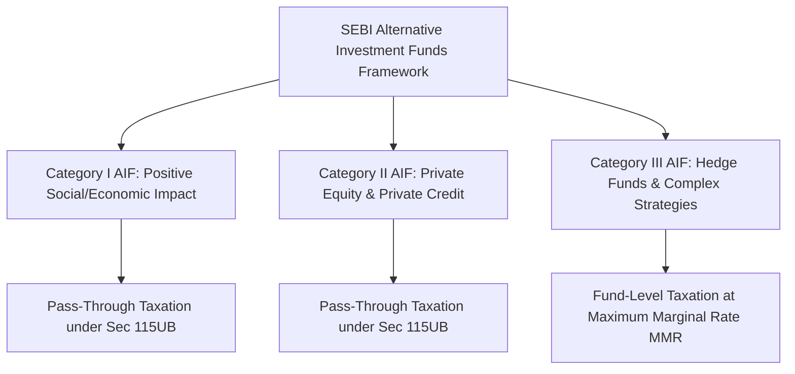

## 1. What Is an Alternative Investment Fund (AIF)?

Governed by the **SEBI (AIF) Regulations, 2012**, an Alternative Investment Fund is a privately pooled investment vehicle established or incorporated in India (as a trust, company, or LLP) that collects funds from sophisticated Indian and foreign investors for deployment under a defined investment policy.

To protect retail investors from complex, illiquid, and leveraged strategies, SEBI enforces strict eligibility barriers:
- **Minimum Investment Ticket:** **₹1,00,00,000 (₹1 Crore)** per investor (lowered to ₹25 Lakhs for employees or directors of the AIF manager).
- **Accredited Investor Framework:** High-Net-Worth Individuals with annual income $\ge ₹2$ Crores or liquid financial net worth $\ge ₹7.5$ Crores can qualify for relaxed minimum ticket sizes.

---

## 2. Categorization and Strategy Spectrum

| AIF Category | Permitted Investment Strategies | Leverage Allowed? | Statutory Tax Treatment |
| :--- | :--- | :--- | :--- |
| **Category I** | Venture Capital Funds (VCF), Angel Funds, Infrastructure Funds, SME Funds | No leverage (except for temporary operational needs) | **Pass-Through Status** under Section 115UB |
| **Category II** | Private Equity (PE) Funds, Real Estate Funds, Private Credit / Distressed Debt Funds | No leverage (cannot borrow to invest) | **Pass-Through Status** under Section 115UB |
| **Category III** | Long-Short Equity Funds, Quant Hedge Funds, Commodity & Complex Derivative Strategies | **Yes (Leverage up to 2x net asset value permitted)** | **Taxed at Fund Level** at Maximum Marginal Rate ($39\% - 42.7\%$) |

---

## 3. The Private Equity Distribution Waterfall (Hurdle Rate & Carry)

Unlike mutual funds that charge an annual flat percentage fee (TER), AIF managers operate on a **Two-and-Twenty ($2/20$)** fee structure governed by a strict **Distribution Waterfall**:

1. **Management Fee:** $1.5\%  to  2.0\%$ annually on committed or drawn-down capital to fund fund-manager operations.
2. **Return of Capital First:** All proceeds generated from selling portfolio companies must first go toward returning $100\%$ of the investor's initial principal capital.
3. **The Preferred Return (Hurdle Rate):** The investor must receive an annualized compounded return (typically **$8.0\%  to  10.0\%$ IRR**) before the fund manager receives a single Rupee of profit share.
4. **Performance Carry (Carried Interest):** Once the hurdle rate is cleared, remaining profits are split—typically **$80\%$ to the investor and $20\%$ to the fund manager**.
