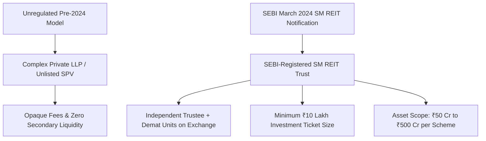

## 1. The Pre-2024 Wild West of Fractional Real Estate

Between 2017 and 2023, several online fintech platforms proliferated across India offering 'fractional commercial real estate'. Under these arrangements, retail investors could buy "shares" in Grade-A commercial office floors, retail shops, or warehouses starting at ₹25 Lakhs.

However, these platforms operated in an unregulated grey zone using convoluted legal mechanisms:
- Investors were made partners in a **Limited Liability Partnership (LLP)** or shareholders in a private unlisted **Special Purpose Vehicle (SPV)**.
- Platforms charged heavy undisclosed upfront acquisition commissions ($3\% - 6\%$) and management fees.
- **Secondary liquidity was virtually non-existent:** If an investor needed to exit, they had to wait for the platform to find another retail buyer, or face steep discounts.
- There was no independent statutory trustee oversight.

---

## 2. Key Provisions of the SEBI SM REIT Framework

On **March 8, 2024**, SEBI officially notified the **SEBI (Real Estate Investment Trusts) (Amendment) Regulations, 2024**, creating a dedicated chapter for **Small and Medium REITs (SM REITs)**:

### A. Asset Size Boundaries
- **Minimum Asset Value:** ₹50 Crores per scheme.
- **Maximum Asset Value:** ₹500 Crores per scheme.
- (Properties larger than ₹500 Crores continue to fall under the mainboard REIT framework).

### B. Mandatory Dematerialization and Stock Exchange Listing
- All units issued by an SM REIT must be issued in **dematerialized form** through NSDL / CDSL.
- Units must be listed on a recognized stock exchange (NSE / BSE), creating a **formal, transparent secondary trading market** for fractional property owners.

### C. Investor Ticket Size
- The minimum subscription amount for retail investors in an SM REIT is statutorily set at **₹10,00,000 (₹10 Lakhs)**.
- While significantly lower than buying an entire commercial office (₹10 Cr+), this barrier ensures that only financially resilient investors participate.

### D. Revenue Generating Mandate
- Minimum **$95\%$ of SM REIT assets** must be fully completed and rent-generating properties.
- Under-construction assets are strictly restricted to a maximum of $5\%$, shielding retail investors from project execution delays.

### E. Mandatory Cash Distribution
- At least **$95\%$ of Net Distributable Cash Flows (NDCF)** generated by each SPV must be remitted quarterly to unit holders.
