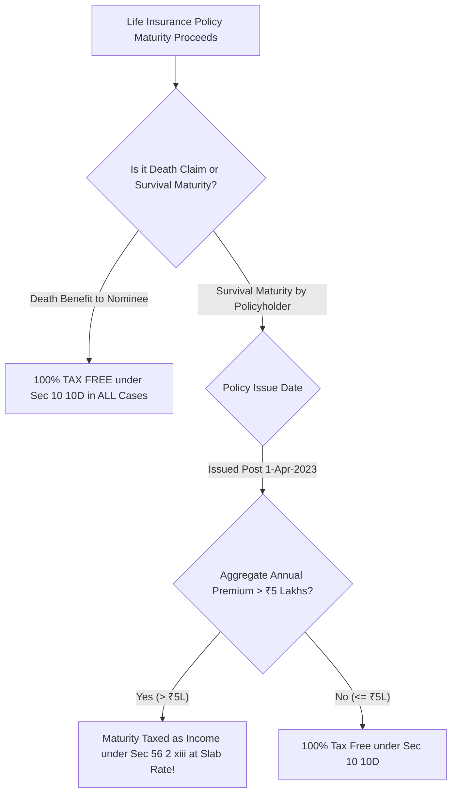

## 1. The Historical Loophole: Millionaire Tax Havens

Prior to recent legislative reforms, high-net-worth individuals (HNIs) routinely used life insurance companies as private tax-exempt fixed deposit havens. Wealthy savers would deposit ₹50 Lakhs or ₹1 Crore annually into non-unit-linked 'Guaranteed Return' insurance policies, earning risk-free, completely tax-free interest under the blanket umbrella of **Section 10(10D)**.

The government systematically shut down these loopholes in two successive Finance Acts:
1. **Finance Act 2021:** Capped **ULIPs** at an aggregate annual premium of **₹2,50,000 (₹2.5 Lakhs)**.
2. **Finance Act 2023:** Capped **Traditional Life Policies** (non-ULIPs, endowments, guaranteed savings plans) at an aggregate annual premium of **₹5,00,000 (₹5 Lakhs)**.

---

## 2. Statutory Taxation Mechanism under Section 56(2)(xiii)

If an individual holds multiple traditional policies issued on or after April 1, 2023, where total annual premiums exceed ₹5,00,000:
- The taxpayer can selectively choose which policies (totaling up to ₹5 Lakhs annual premium) remain tax-free under Section 10(10D).
- The remaining policies lose statutory exemption.
- Under **Section 56(2)(xiii)**, the maturity gain is computed as:

$$
Taxable Income = Maturity Proceeds Received - \sum Total Premiums Paid across Policy Tenure
$$

This net income is classified under **Income from Other Sources** and taxed at the individual's **marginal slab rate ($31.2\%  or  39\%$)**.

### Crucial Exception: Death Benefit Remains Untouched
The ₹5 Lakh and ₹2.5 Lakh restrictions apply **exclusively to survival maturity payouts**. 

Under the first proviso to Section 10(10D):
> *"Any sum received under a life insurance policy on the death of a person shall remain completely exempt from income tax, regardless of the premium amount paid!"*
