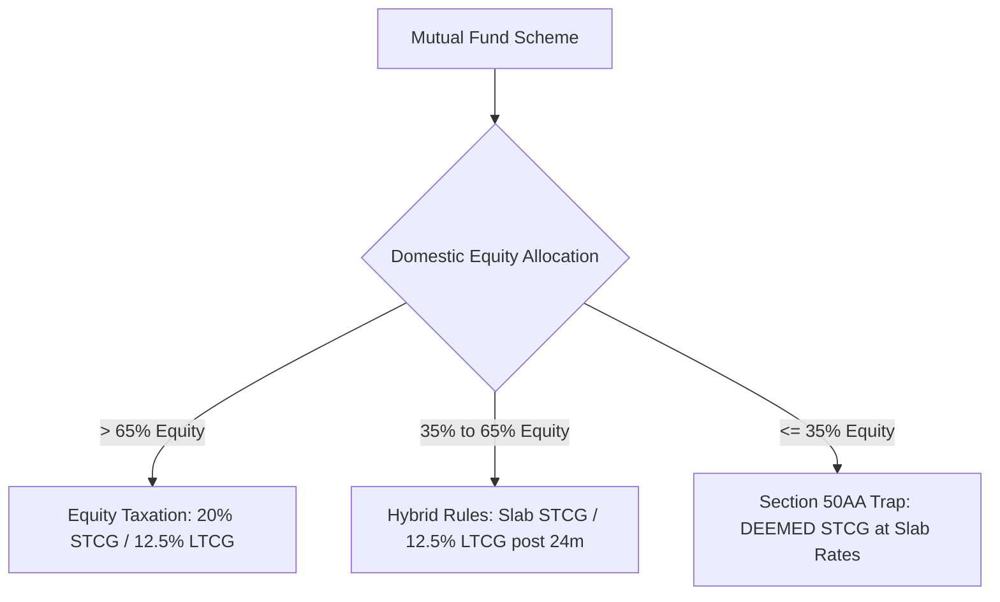

## 1. Statutory Genesis: Why Section 50AA Was Enacted

Prior to April 1, 2023, debt mutual funds enjoyed a substantial tax advantage over bank fixed deposits:
- If held for over 36 months, gains were taxed at **$20\%$ with inflation indexation**.
- In high-inflation regimes, the indexed cost of acquisition frequently matched or exceeded the sale price, resulting in **near-zero effective tax** for wealthy investors.

To establish tax parity between bank deposits and debt market investments, the Parliament enacted **Section 50AA** via the *Finance Act, 2023*, effective from assessment year 2024-25 onwards.

---

## 2. Statutory Language of Section 50AA

Under Section 50AA of the Income Tax Act:

> *"Notwithstanding anything contained in clause (42A) of section 2, where the capital asset is an unit of a Specified Mutual Fund acquired on or after the 1st day of April, 2023, any capital gain arising from transfer or redemption or maturity of such unit shall be deemed to be capital gains arising from the transfer of a short-term capital asset."*

### Key Legal Implications:
1. **Deemed STCG:** The gain is legally deemed to be short-term, whether held for 3 days, 3 years, or 10 years.
2. **No Indexation Benefit:** Inflation indexation under the second proviso to Section 48 is expressly disabled.
3. **No Preferential Capital Gains Rate:** Gains are added to gross total income and taxed at the investor's marginal slab rate (up to $31.2\%$ under regular slabs, or up to $39\%$ with maximum surcharge).

---

## 3. How Smart Investors Optimize Around Section 50AA

Understanding the precise mathematical boundary conditions of Section 50AA allows astute portfolio allocators to legitimately optimize post-tax fixed income returns:

### A. Arbitrage Funds for Ultra-Short Horizons ($<$ 2 Years)
Arbitrage mutual funds maintain **$>65\%$ gross allocation in domestic equities** (simultaneously hedged by short equity futures positions). Because statutory equity exposure exceeds $65\%$:
- They are **exempt from Section 50AA**.
- Short-term gains ($<12$m) are taxed at **$20\%$ flat** under Section 111A.
- Long-term gains ($>12$m) are taxed at **$12.5\%$** under Section 112A (with ₹1.25L annual exemption).
- For an investor in the $31.2\%$ tax bracket, an arbitrage fund yielding $7.2\%$ delivers **$6.30\%$ post-tax**, compared to only **$4.95\%$** from a bank FD.

### B. Multi-Asset Allocation Funds for Medium Horizons ($>$ 2 Years)
Funds that allocate between **$35\%  and  65\%$** in domestic equities (with the remainder in debt, gold, and international equities) fall outside Section 50AA. Under Finance Act 2024:
- Holding period for long-term status: **24 Months**.
- Long-term tax rate: **$12.5\%$ without indexation** under Section 112.
- This creates an attractive tax-efficient alternative for conservative investors.
