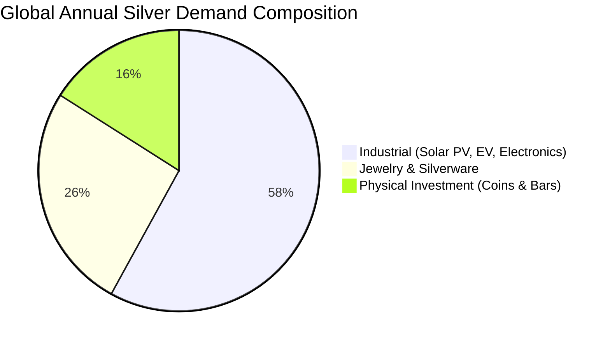

## 1. Silver's Dual Economic Identity

Unlike gold, which functions primarily as a monetary store of value and central bank reserve asset ($>85\%$ investment and jewelry demand), **silver is fundamentally an industrial commodity**.

### The Green Energy Secular Tailwind
The global transition toward renewable energy has fundamentally transformed the structural supply-demand balance of physical silver:
1. **Photovoltaic (PV) Solar Cells:** Modern N-type TOPCon and HJT solar cells require between 15 to 22  milligrams of silver paste per watt of capacity.
2. **Electric Vehicles (EVs):** Contain approximately 25-50  grams of silver per vehicle across electrical contacts, battery management systems, and charging infrastructure (roughly double the silver content of internal combustion vehicles).

---

## 2. Silver vs Gold: Volatility and Drawdown Profile

Because the global silver market is physically smaller and more industrially exposed than the gold market, silver behaves like high-beta gold:

| Quantitative Metric | Gold (Historical INR) | Silver (Historical INR) | Key Strategic Implication |
| :--- | :--- | :--- | :--- |
| **Annualized Volatility ($\sigma$)** | $14.2\%$ | **$25.8\%$** | Silver has nearly double the annual price swing of gold. |
| **Maximum Drawdown (10Y)** | $-24.5\%$ | **$-42.0\%$** | Prolonged, brutal multi-year cyclical winter periods. |
| **Beta to Industrial Production** | $0.15$ (Uncorrelated) | **$0.72$ (High Sensitivity)** | Silver prices plunge during global manufacturing recessions. |
| **Long-Term Real Return** | $+3.2\%$ | **$+1.8\%$** | High volatility does not automatically guarantee higher terminal CAGR. |

---

## 3. SEBI Silver ETF Regulations & Storage Mechanics

Prior to SEBI's introduction of regulated **Silver ETFs in 2021**, retail silver investment in India was plagued by:
- Severe physical storage bulk (₹5 Lakhs of silver weighs over 5 kilograms, compared to just 65 grams of gold).
- High dealer melting discounts ($5\% - 10\%$) upon resale.
- Widespread purity adulteration in unorganized silver shops.

Under SEBI regulations:
- Every Silver ETF unit is backed $100\%$ by physical silver bars of **$99.9\%$ purity (999 fineness)** accredited by LBMA (London Bullion Market Association).
- Independent physical verification and vault audits are conducted semi-annually.
- Under Finance (No. 2) Act 2024, gains on Silver ETFs held for over **24 months** are taxed at **$12.5\%$ without indexation**.
