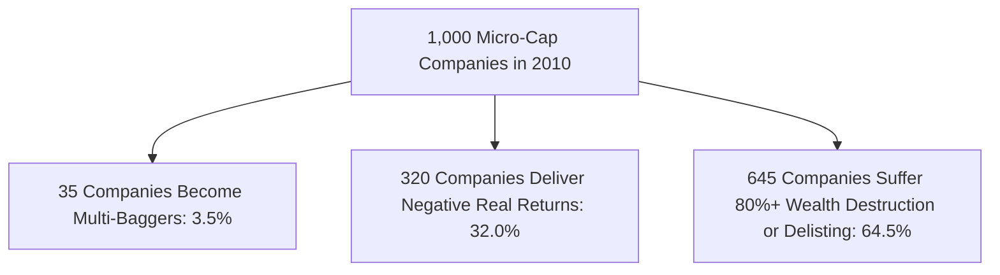

## 1. The Multi-Bagger Siren Song

Financial media and social platforms constantly promote the allure of small-cap investing:

> *"If you had invested ₹1 Lakh in Titan, Bajaj Finance, or Astral Poly in their early days, you would have ₹50 Crores today!"*

While mathematically accurate for those specific winning companies, this narrative illustrates the classic **Survivorship Bias Fallacy**. 

Investors look backward at the few small companies that survived, grew exponentially, and entered the Nifty 50, while remaining entirely blind to the hundreds of small-cap companies that collapsed into insolvency, were delisted, or destroyed $95\%$ of their equity value.

---

## 2. The Cyclical Winter: Prolonged Small-Cap Underperformance

Retail investors frequently extrapolate trailing 3-year bull market returns into the permanent future. In reality, Indian small caps operate in extreme, decade-long feast-or-famine cycles:

| Cycle Phase | Calendar Period | Nifty Smallcap 250 Performance | Investor Experience |
| :--- | :--- | :--- | :--- |
| **GFC Collapse** | Jan 2008 – Mar 2009 | **$-76.5\%$ Peak-to-Trough Drawdown** | Total panic; widespread retail capitulation |
| **The 6-Year Winter** | 2008 – 2014 | **Zero Net Return across 6 Years** | Complete retail disillusionment with equities |
| **The Midcap Euphoria** | 2014 – Dec 2017 | **$+210\%$ Massive Bull Surge** | Euphoria; retail inflows surge at the peak |
| **The Midcap Correction** | Jan 2018 – Mar 2020 | **$-52.0\%$ Prolonged Bear Grind** | 2.5 years of continuous capital erosion |
| **The Post-Covid Supercycle** | Apr 2020 – 2024 | **$+380\%$ Massive Rally** | High inflows into active small-cap funds |

An investor who entered small caps in January 2008 did not break even on a real purchasing-power basis until **late 2016**—an excruciating 8-year psychological holding period!

---

## 3. The Illiquidity and Impact Cost Trap

During raging bull markets, small-cap stocks appear liquid. Daily trading volumes are high, and buyers are plentiful.

However, when a macroeconomic shock hits or corporate governance red flags emerge:
1. **Bids Evaporate Overnight:** The stock hits lower circuits ($5\%$ or $10\%$) for days or weeks consecutively with **zero buying bids**.
2. **Impact Cost Spikes:** A retail investor wishing to sell ₹10 Lakhs of shares pushes the market price down by $4\% - 8\%$ simply by entering the market order.
3. **Institutional Fund Freezes:** Mutual fund managers managing ₹30,000 Crore small-cap funds face a mathematical impossibility: liquidating a $3\%$ position in an illiquid company would take 120 days of total market volume, forcing AMCs to suspend fresh lump-sum inflows.
