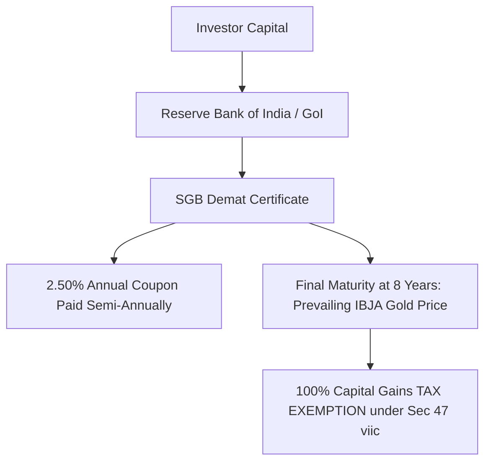

## 1. Statutory Architecture of Sovereign Gold Bonds

Introduced by the Government of India in November 2015 under the *Government Securities Act, 2006*, **Sovereign Gold Bonds (SGB)** represent government securities denominated in grams of gold ($999$ purity).

Unlike gold ETFs or physical bullion, SGBs are not backed by physical vaulted gold. They are a direct **sovereign obligation of the Republic of India**, where the central government guarantees:
1. Payout of the prevailing market price of gold (published by the India Bullion and Jewellers Association - IBJA) at redemption.
2. An additional cash coupon of **$2.50\%$ per annum** payable semi-annually on the initial nominal issue price.

---

## 2. The Unrivaled Tax Advantage: Section 47(viic)

The defining advantage of SGB over every other form of gold investment is found in **Section 47(viic)** of the Income Tax Act, 1961:

> *"Any transfer of a capital asset, being Sovereign Gold Bond issued by the Reserve Bank of India, by way of redemption, by an assessee being an individual shall not be regarded as a transfer."*

Because redemption with the RBI is statutorily excluded from the definition of a 'transfer', **no Capital Gains Tax (LTCG) is levied**, regardless of how much gold prices appreciate over the 8-year holding period.

### Comparative Tax Summary (Post-Finance Act 2024):

| Gold Vehicle | Holding Period for LTCG | Statutory Tax Rate | Indexation Benefit | Annual Cash Coupon |
| :--- | :--- | :--- | :--- | :--- |
| **SGB (RBI Redemption at Maturity)** | 8 Years (or 5th/6th/7th Year Exit) | **0.0% (100% TAX FREE)** | Not needed | **$+2.50\%$ p.a.** |
| **SGB (Sold on Stock Exchange)** | $> 12$ Months | $12.5\%$ (Listed security) | No | $+2.50\%$ p.a. |
| **Gold ETFs / Gold Mutual Funds** | $> 24$ Months | $12.5\%$ without indexation | No | Zero |
| **Physical Gold Bullion / Jewelry** | $> 24$ Months | $12.5\%$ without indexation | No | Zero |

---

## 3. The Secondary Market Discount Strategy

When the Government pauses fresh primary issuances of SGBs, investors can purchase existing tranches directly on the **NSE and BSE** via any standard demat trading account.

Due to retail illiquidity and seller urgency, secondary market SGB tranches frequently trade at a **$2.0\%  to  6.0\%$ discount** below the prevailing physical spot gold price.

### Calculating the Secondary Purchase Edge:
Suppose spot gold is ₹7,500 per gram:
- An SGB tranche maturing in 2 years trades on NSE at ₹7,150 ($4.67\%$ discount).
- The buyer acquires gold at an effective discount of ₹350 per gram.
- The buyer earns $2.5\%$ coupon on the original issue price (e.g. ₹4,800 $= ₹120$/yr).
- At maturity in 2 years, the RBI redeems the bond at full prevailing spot gold price **100% tax-free**.

This secondary arbitrage generates an effective **internal rate of return (IRR) that is $250 - 350$ basis points higher** than buying a spot Gold ETF!
