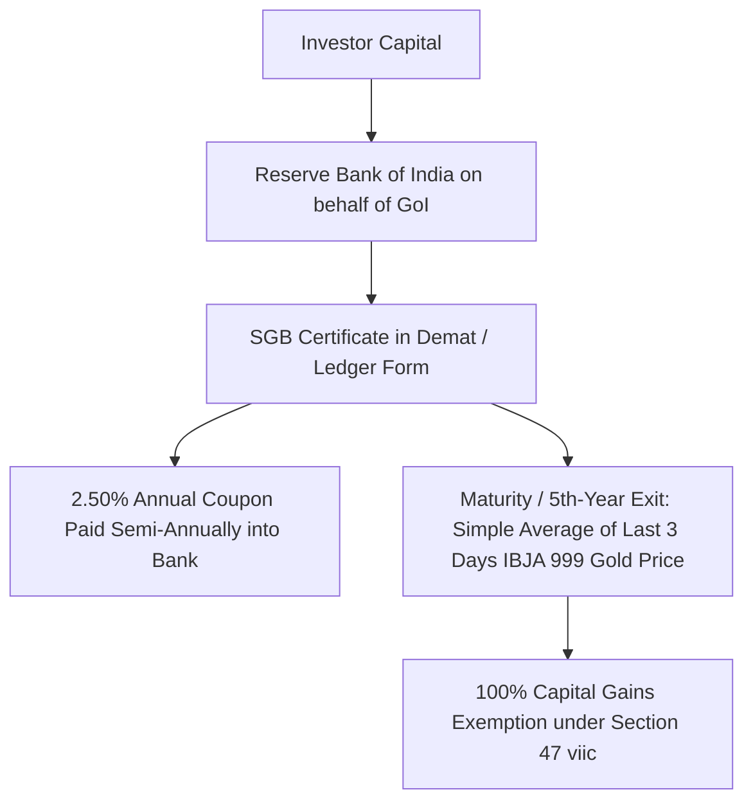
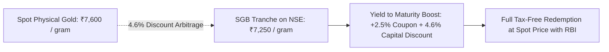

## 1. Statutory Architecture of Sovereign Gold Bonds

Introduced in November 2015 under the *Government Securities Act, 2006*, **Sovereign Gold Bonds (SGB)** are government debt obligations denominated in grams of gold ($999$ fine purity). 

Unlike Gold Exchange Traded Funds (ETFs) or physical bars, SGBs are not backed by physical bullion deposited in bank vaults. They represent an unhedged, direct **sovereign obligation of the Republic of India**:

### Statutory Terms of Issue
1. **Denomination:** Multiples of 1 gram of gold (minimum 1 gram, maximum 4 kg per individual / HUF per financial year).
2. **Tenure:** 8 Years, with early redemption exit windows granted by the RBI at the end of the **5th, 6th, and 7th years**.
3. **Interest Coupon:** Fixed **$2.50\%$ per annum** payable semi-annually on the nominal issue price.
4. **Redemption Price:** Simple average closing price of 999 purity gold published by the **India Bullion and Jewellers Association (IBJA)** for the previous three business days.

---

## 2. The Unrivaled Tax Advantage: Section 47(viic)

The defining edge of SGB over physical gold and gold ETFs is codified under **Section 47(viic)** of the Income Tax Act, 1961:

> *"Any transfer of a capital asset, being Sovereign Gold Bond issued by the Reserve Bank of India, by way of redemption, by an assessee being an individual shall not be regarded as a transfer."*

Because redemption with the RBI is statutorily excluded from the legal definition of a 'transfer' under Section 2(47), **zero Capital Gains Tax is payable**, irrespective of whether gold doubles, triples, or quadruples over the holding period.

### Tax Treatment Across Holding & Exit Scenarios:

| Transaction Route | Governing Section | Holding Period | Applicable Tax Rate | Indexation Benefit |
| :--- | :--- | :--- | :--- | :--- |
| **RBI Maturity Redemption (8 Years)** | Section 47(viic) | 8 Years | **0.0% (100% Tax-Exempt)** | Not applicable |
| **RBI Early Exit (5th, 6th, 7th Year Window)** | Section 47(viic) | 5 to 7 Years | **0.0% (100% Tax-Exempt)** | Not applicable |
| **Secondary Market Sale on NSE/BSE** | Section 112 | $> 12$ Months (LTCG) | **12.5%** (Finance Act 2024) | No |
| **Secondary Market Sale on NSE/BSE** | Section 111A / Slab | $< 12$ Months (STCG) | **Marginal Slab Rate** | No |
| **Semi-Annual 2.50% Coupon Interest** | Section 56(2) | Ongoing | **Marginal Slab Rate** | No TDS (Sec 193) |

> **Critical Legal Nuance:** Does the Section 47(viic) exemption apply if you purchase an existing SGB tranche on the secondary stock exchange (NSE/BSE) at a discount and hold it until RBI maturity?  
> **Yes.** The statutory text of Section 47(viic) requires only that the asset is redeemed with the RBI by an individual. It does not mandate that the individual was the original primary subscriber.

---

## 3. The Secondary Market Discount Arbitrage

Because retail liquidity on the NSE and BSE is thin, many retail bondholders who need emergency cash dump their SGB holdings at market-order bids. This creates a persistent **secondary market discount of 2% to 6% below spot gold**.

### Numerical Worked Example: SGB 2028 Tranche
Suppose spot physical gold trades at **₹7,600 per gram**:

- **Tranche:** `SGBSEP28` (maturing in 2.5 years, original issue price ₹4,800).
- **Secondary Trading Price on NSE:** **₹7,250 per gram** ($4.6\%$ discount).
- **Semi-Annual Cash Coupon:** $2.50\% \times ₹4,800 = \mathbf{₹120\text{/year}}$.
- **Total Cash Inflow Over 2.5 Years:**
  - Coupon: $2.5 \times ₹120 = ₹300$
  - Redemption Price: Projected spot at maturity (say ₹8,500)
- **Net Inflow:** $₹8,500 + ₹300 - ₹7,250 = \mathbf{₹1,550}$ gain on ₹7,250 outlay.
- **Pre-Tax IRR:** $\approx \mathbf{9.85\%}$ annual compound return compared to $\approx 6.80\%$ on spot gold alone!
- **Post-Tax Reality:** Capital gain of ₹1,250 is **100% tax-free** under Section 47(viic).

---

## 4. Total Cost of Ownership: SGB vs Physical Gold vs Gold ETFs

| Cost Dimension | Physical Gold Jewellery | Gold ETF / Mutual Fund | Sovereign Gold Bond (SGB) |
| :--- | :--- | :--- | :--- |
| **Upfront Friction (Making/GST)** | **$11.0\% - 21.0\%$** ($3\%$ GST + $8\%-18\%$ making) | **0%** (zero GST; standard brokerage) | **0%** (zero GST; standard brokerage) |
| **Annual Holding Drag** | Bank locker fee (₹2,000–₹8,000/yr) | **$0.40\% - 0.75\%$ TER** (expense ratio) | **Zero** (free demat custody) |
| **Annual Cash Yield** | **Zero** (negative carrying cost) | **Zero** | **$+2.50\%$ cash coupon** paid semi-annually |
| **Resale / Exit Haircut** | $2.0\% - 5.0\%$ melting / karatage deduction | Minor bid-ask spread ($0.1\% - 0.2\%$) | Minor discount on exchange; $0\%$ with RBI |
| **Long-Term Capital Gains Tax** | $12.5\%$ without indexation (Finance Act 2024) | $12.5\%$ without indexation | **$0.0\%$ (100% Tax-Free)** at RBI maturity |
| **Counterparty Security** | Physical theft / burglary risk | Vault custodian insolvency (SEBI regulated) | **Direct Sovereign Republic of India Guarantee** |

---

## 5. Execution Protocol: How to Claim RBI Early Exit

If you wish to redeem your SGB at the 5th, 6th, or 7th year mark rather than waiting the full 8 years:

1. **Submission Window:** The RBI opens redemption windows 30 days prior to the coupon payment date.
2. **Channel:**
   - **Demat Holding:** Submit a redemption request via your depository participant (Zerodha, Groww, ICICI Direct).
   - **Physical Certificate / RBI Retail Direct:** Submit Form A to your bank or the RBI Retail Direct portal.
3. **Disbursement:** The RBI credits redemption proceeds calculated at the simple average of the closing gold price published by IBJA for the previous three business days directly to your primary bank account via NEFT/RTGS.
