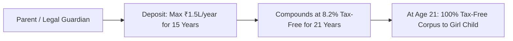

## 1. Sukanya Samriddhi Yojana (SSY): The Peak of Tax-Free Compounding

Launched under the *Beti Bachao Beti Padhao* campaign, the **Sukanya Samriddhi Account** is an exclusive sovereign savings scheme designed to build an education and marriage corpus for a resident Indian girl child.

### Core Financial Mechanics of SSY:
- **Eligibility:** Can be opened by parents for a girl child from birth up to the age of **10 years** (maximum two daughters per family).
- **Current Interest Rate:** **$8.20\%$ per annum**, compounded annually (notified quarterly by MoF).
- **Contribution Horizon:** Deposits must be made for **15 years** from the account opening date.
- **Maturity Horizon:** Account matures **21 years** from opening date (or upon her marriage after attaining age 18).
- **Tax Status:** **Pure EEE**. Contributions deductible under Section 80C, interest is $100\%$ tax-exempt under Section 10(11A), and terminal maturity is $100\%$ tax-free.

### Compounding Simulation:
Depositing ₹1,50,000 annually for 15 years (total invested capital ₹22,50,000) at an $8.2\%$ sovereign rate yields a **tax-free terminal corpus of over ₹69,80,000 (nearly ₹70 Lakhs)** upon maturity at Year 21!

---

## 2. Senior Citizens Savings Scheme (SCSS): The Retiree Lifeline

For retirees aged 60 and above, the **Senior Citizens Savings Scheme (SCSS)** is the premier cashflow instrument in India.

### Enhanced Features Following the 2023 Amendment:
1. **Investment Ceiling Doubled:** The maximum investment limit was permanently increased from ₹15 Lakhs to **₹30,00,000 (₹30 Lakhs)** per senior citizen.
2. **Spousal Doubling:** A retired couple (both aged 60+) can invest **₹60,00,000 (₹60 Lakhs)** across two separate accounts.
3. **Current Sovereign Interest Rate:** **$8.20\%$ per annum**.
4. **Predictable Quarterly Payouts:** Interest is paid out systematically on the first working day of **April, July, October, and January** directly into the retiree's savings account.
5. **Tenure & Extension:** Initial tenure of **5 years**, extendable in blocks of 3 years indefinitely.

### Quarterly Cashflow from ₹60 Lakh Max Allocation:
$$
Annual Income = ₹60,00,000 \times 0.082 = ₹4,92,000
$$
$$
Guaranteed Quarterly Cashflow = \frac{₹4,92,000}{4} = \mathbf{₹1,23,000 \text{ every 3 months}}
$$

### Tax Note:
SCSS interest is fully taxable at slab rates under Section 56(2). However, under **Section 80TTB**, senior citizens enjoy an exclusive statutory deduction of **up to ₹50,000** on bank and post office interest income.
