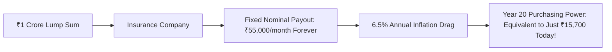

## 1. What Is a Commercial Annuity?

In a commercial life insurance annuity, a retiree deposits a lump-sum corpus (e.g. ₹1,00,00,000) with an insurance company (such as LIC, HDFC Life, or SBI Life) in exchange for a contractual promise:
> *"We will pay you ₹55,000 every month for the rest of your natural life."*

In products with *Return of Purchase Price (ROP)*, the insurer additionally promises that upon the retiree's death, the original nominal ₹1 Crore will be returned to their nominee.

To an emotionally vulnerable 60-year-old retiree terrified of market volatility, this sounds like the ultimate guarantee of lifelong security.

However, in quantitative retirement mathematics, **the fixed nominal annuity is one of the most destructive capital traps in existence**.

---

## 2. The Mathematical Proof of Inflation Degradation

The future purchasing power of a fixed nominal annuity payout ($P_0$) over $t$ years under an inflation rate $\pi$ is governed by:

$$
P_{real}(t) = \frac{P_0}{(1 + \pi)^t}
$$

Let us track a retiree who purchases an immediate annuity at age 60 paying **₹50,000 per month (₹6,00,000 per year, a $6.0\%$ nominal yield)** under standard Indian inflation ($\pi = 6.5\%$):

| Age | Retirement Year | Nominal Monthly Payout | Real Purchasing Power (in Today's ₹) | Loss of Real Living Standard |
| :--- | :--- | :--- | :--- | :--- |
| **60** | Year 1 (Start) | ₹50,000 | **₹50,000** | $0.0\%$ |
| **65** | Year 5 | ₹50,000 | **₹36,494** | $-27.0\%$ |
| **70** | Year 10 | ₹50,000 | **₹26,636** | $-46.7\%$ |
| **75** | Year 15 | ₹50,000 | **₹19,441** | $-61.1\%$ |
| **80** | Year 20 | ₹50,000 | **₹14,190** | **$-71.6\%$** |
| **85** | Year 25 | ₹50,000 | **₹10,357** | **$-79.3\%$** |

By the time the retiree reaches age 80—when private nursing, prescription medicines, and healthcare costs are at their absolute peak—the annuity's real monthly purchasing power has **collapsed from ₹50,000 to just ₹14,190**!

---

## 3. The Structural Solution: The 3-Bucket SWP Strategy

To defeat longevity risk and inflation simultaneously, modern quantitative financial planners avoid putting the entire retirement nest egg into annuities:

1. **Bucket 1 (Cash / Liquid / SCSS):** Funds the first **3 years of living expenses** in guaranteed sovereign instruments.
2. **Bucket 2 (Short-Duration G-Secs & Corporate Bonds):** Generates steady accrual income to replenish Bucket 1 for **Years 4 to 8**.
3. **Bucket 3 (Low-Cost Equity Index Funds & REITs):** The remaining corpus compounds at $11\% - 12\%$ over a **10+ year horizon**. 

By letting Bucket 3 compound uninterrupted, the retiree can systematically increase their annual withdrawal by $6\%$ every year, maintaining constant real purchasing power throughout retirement.
