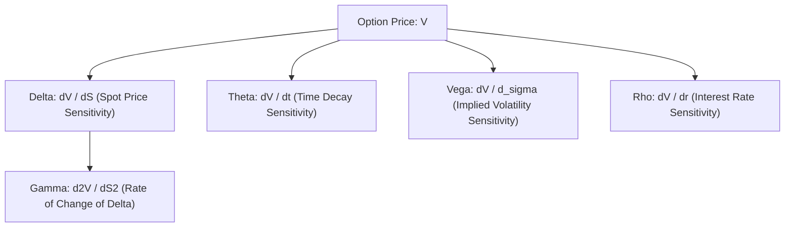

## 1. The Mathematical Engine of Options Pricing

Under the **Black-Scholes-Merton (BSM) differential equation**, the theoretical value of a European option ($V$) is a function of five observable variables:
1. Underlying Spot Price ($S$)
2. Strike Price ($K$)
3. Time to Expiration ($t$)
4. Risk-Free Interest Rate ($r$)
5. Implied Volatility ($\sigma$)

The **Greeks** are simply the **first and second-order partial derivatives** of the pricing function with respect to these underlying market variables:

---

## 2. The Four Core Greeks in Action on Dalal Street

### A. Delta ($\Delta$): Directional Exposure
$$
\Delta = \frac{\partial V}{\partial S}
$$
- For Call Options: Ranges from 0.0 to +1.0 (At-the-Money Call $\approx +0.50$).
- For Put Options: Ranges from -1.0 to 0.0 (At-the-Money Put $\approx -0.50$).
- If a Nifty 24,000 Call has a Delta of **$0.40$**, and the Nifty 50 spot index moves up by **100  points**, the theoretical option premium will rise by approximately:
  $$ \Delta V \approx 0.40 \times 100 = \mathbf{₹40.00} $$

### B. Gamma ($\Gamma$): The Acceleration Risk
$$
\Gamma = \frac{\partial^2 V}{\partial S^2} = \frac{\partial \Delta}{\partial S}
$$
Gamma measures the stability of your Delta. Gamma is highest for At-the-Money options nearing expiration. This is what causes violent, erratic option price spikes on Thursday/Friday weekly contract expiry days.

### C. Theta ($\Theta$): The Relentless Time Bleed
$$
\Theta = \frac{\partial V}{\partial t}
$$
Theta is strictly negative for net option buyers. It represents the Rupee amount an option premium will lose with each passing calendar day, even if the underlying index does not move by a single millimeter. 

Crucially, **Theta decay is non-linear**: it trickles slowly 30 days before expiry, but accelerates violently into a vertical cliff during the final 72 hours before expiration.

### D. Vega ($\nu$): The India VIX Sensitivity
$$
\nu = \frac{\partial V}{\partial \sigma}
$$
Vega measures how much the option price changes for a $1\%$ change in the **India VIX (Implied Volatility)**. 

### The Post-Event IV Crush Trap:
Before major macro events (Union Budget announcements, General Election results), market anxiety drives India VIX up to $22 - 30\%$, dramatically inflating option prices. 

The moment the event concludes:
- Uncertainty is resolved; India VIX instantly collapses from $26\%$ down to $13\%$.
- Even if the trader correctly guessed the direction of the market, the massive collapse in Vega (**IV Crush**) causes the option premium to plunge, inflicting severe net losses on option buyers!
