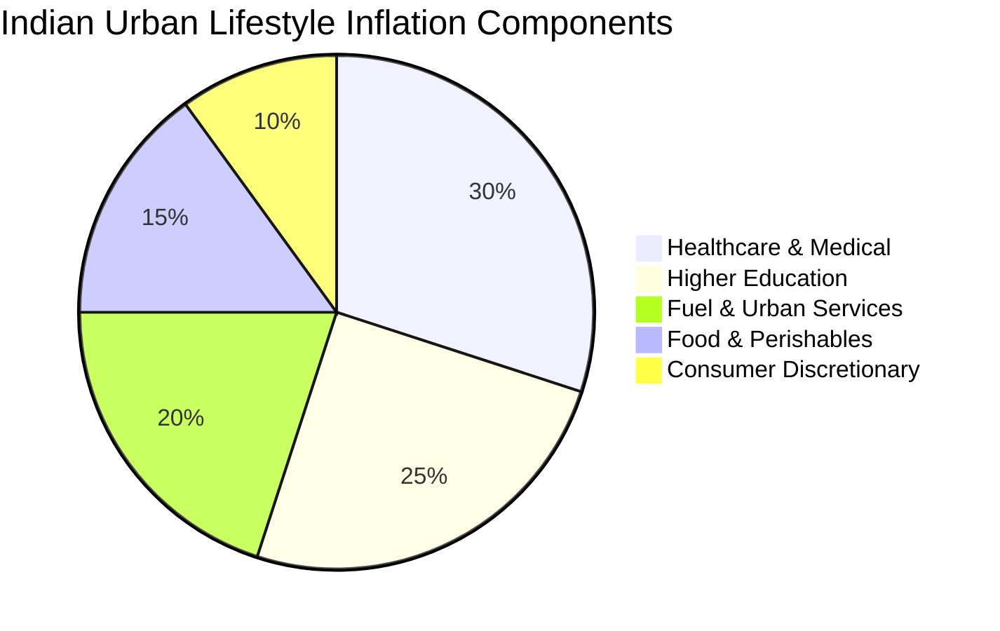

## 1. The Real Indian Hurdle Rate

In corporate finance, the hurdle rate represents the minimum acceptable rate of return on a project. For an Indian household, the hurdle rate is the minimum return required to ensure that family purchasing power does not degrade over a generational investment horizon.

The hurdle rate equation is defined as:

$$
R_{hurdle} = \frac{\pi_{lifestyle} + T_{drag}}{1 - T_{marginal}}
$$

Where:
- $\pi_{lifestyle}$ is real urban household inflation (historically $7.0\% - 8.5\%$ in India, driven by healthcare at $11\%$ and private university education at $10-12\%$).
- $T_{drag}$ is frictional transaction and custodial costs.
- $T_{marginal}$ is the investor's effective statutory tax rate.

---

## 2. Mathematical Doubling Time: Nominal vs Real

The classic **Rule of 72** provides an approximation of the time required to double capital:

$$
t_{double} \approx \frac{72}{r}
$$

Let us analyze how ₹25,00,000 behaves across different Indian asset classes over a 20-year career:

| Asset Allocation Strategy | Nominal Return ($r_{nom}$) | Nominal Doubling Time | Effective Real Return ($r_{real}$ at $6.5\%$ inflation) | Real Purchasing Power Doubling Time | 20-Year Real Purchasing Power (in Today's ₹) |
| :--- | :--- | :--- | :--- | :--- | :--- |
| **Traditional Bank FD (30% slab)** | $5.0\%$ post-tax | 14.4 Years | $-1.41\%$ | **Never (Shrinks)** | ₹18,75,000 ($-25.0\%$) |
| **PPF / Sovereign Debt (Tax-Free)** | $7.1\%$ | 10.1 Years | $+0.56\%$ | 128.5 Years | ₹27,95,000 ($+11.8\%$) |
| **Balanced Portfolio (60/40)** | $10.5\%$ post-tax | 6.8 Years | $+3.75\%$ | 19.2 Years | ₹52,10,000 ($+108.4\%$) |
| **Diversified Indian Equities** | $12.5\%$ post-tax | 5.8 Years | $+5.63\%$ | 12.8 Years | ₹74,80,000 ($+199.2\%$) |

---

## 3. The Power Law of Compounding Years

In the mathematical equation for compound interest:

$$
A = P \left(1 + \frac{r}{n}\right)^{nt}
$$

The exponent $t$ (time) dominates all other variables. In a 30-year Indian equity SIP:
- **Years 1 to 10:** $78\%$ of total portfolio value consists of direct investor capital contributions; compounding accounts for only $22\%$.
- **Years 11 to 20:** Compounding generated returns overtake direct contributions ($58\%$ of total wealth).
- **Years 21 to 30:** Compounding generates over **$84\%$ of final terminal wealth**.

Interrupting compounding during cyclical corrections by panic-selling or moving into low-yielding cash destroys this terminal exponential expansion permanently.
