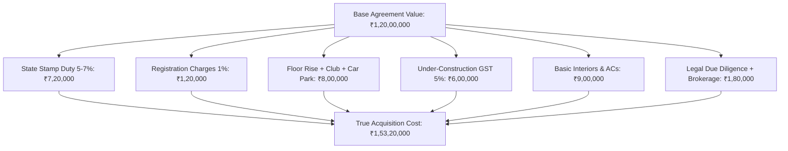

## 1. The Anatomy of Real Estate Acquisition Friction

When retail buyers evaluate real estate, they look at the builder's quoted base price: *"₹1.20 Crores for a 3BHK"*.

In practice, acquiring a physical residential property in urban India incurs immediate non-recoverable frictional capital outlays:

### The $27.6\%$ Frictional Hurdle
The buyer has spent **₹1.53 Crores** to acquire an asset whose paper market value is ₹1.20 Crores. Before the investor breaks even on capital, the underlying property must appreciate by **$27.6\%$ nominal** simply to cover upfront friction!

---

## 2. Deriving the Real Net Rental Yield Equation

Gross rental yield published on real estate portals is simply:

$$
Y_{gross} = \frac{Monthly Rent \times 12}{Agreement Value}
$$

The true institutional measure is the **Net Capitalized Yield ($Y_{net}$)**:

$$
Y_{net} = \frac{\left(R_{monthly} \times 12 \times (1 - v)\right) - T_{property} - M_{society} - R_{repairs} - B_{brokerage}}{C_{total acquisition}}
$$

Where:
- $v$ is the annualized vacancy rate (typically $1  month per  18  months = 5.5\%$).
- $T_{property}$ is municipal property tax.
- $M_{society}$ is mandatory monthly resident welfare association (RWA) maintenance fees.
- $R_{repairs}$ is painting, plumbing, appliance servicing, and deep cleaning between tenants.
- $B_{brokerage}$ is 1 month rent paid to leasing brokers every renewal.

### The Real Yield Breakdown on a ₹1.50 Crore Flat:
- Monthly Rent: ₹40,000
- Annual Gross Rent (12 m): ₹4,80,000 ($3.20\%$ gross on ₹1.5Cr)
- Vacancy (1 m): $-₹40,000$
- RWA Maintenance (₹4,500/mo): $-₹54,000$
- Municipal Property Tax: $-₹18,000$
- Inter-tenancy Maintenance & Painting: $-₹25,000$
- Brokerage (split over 2 years): $-₹20,000$
- **True Annual Net Operating Income (NOI):** ₹3,23,000
- **Actual Net Realized Yield:**
  $$ Y_{net} = \frac{₹3,23,000}{₹1,53,20,000} = \mathbf{2.108\%} $$

---

## 3. The Structural Drag: Aging Buildings vs Appreciating Land

Every physical real estate property consists of two distinct components:
1. **Undivided Share of Land (UDS):** Appreciates over decades as urban density expands.
2. **Superstructure (The Concrete Building):** **Depreciates steadily** due to structural weathering, plumbing leaks, outdated elevator technology, and architectural obsolescence.

After 20 to 25 years, older apartment complexes in Indian metros trade at steep discounts to adjacent modern gated developments. The building superstructure requires costly structural retrofitting, while high-earning tenants migrate to newer complexes with modern amenities, depressing rental yields further.
