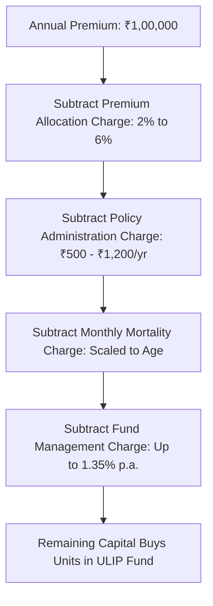

## 1. How a Unit-Linked Insurance Plan (ULIP) Actually Works

Unit-Linked Insurance Plans (ULIPs) are marketed by banks as a seamless fusion of investment growth and life insurance protection:
> *"Invest ₹1,00,000 every year for 10 years, get ₹10 Lakhs life cover, switch between equity and debt for free, and enjoy tax-free returns at maturity."*

To understand why ULIPs underperform, one must look at how an insurer processes that ₹1,00,000 annual premium:

---

## 2. The Hidden Cannibal: The Escalating Mortality Charge

The single most destructive feature inside a ULIP is the **Mortality Charge**. This is the fee deducted every month by cancelling mutual fund units to pay for the life cover.

In actuarial science, the probability of death ($q_x$) escalates exponentially with age according to the **Gompertz-Makeham Law of Mortality**:

$$
q_x = \alpha + \beta \cdot c^x
$$

### Mortality Charge Progression per ₹1,000 Sum Assured:
- **At Age 30:** $\approx ₹1.10$ per ₹1,000 cover
- **At Age 45:** $\approx ₹3.20$ per ₹1,000 cover
- **At Age 55:** $\approx ₹9.50$ per ₹1,000 cover
- **At Age 65:** $\approx ₹24.80$ per ₹1,000 cover

As the policyholder ages into their 50s and 60s, **the mortality charge becomes astronomical**. In older policy years, the insurer is forced to cancel substantial quantities of accumulated equity units every month simply to service the insurance charge, severely crippling final maturity compounding!

---

## 3. Head-to-Head 20-Year Simulation: ULIP vs BTID

Consider an investor aged 30 with **₹1,50,000 annual surplus** over a **20-year period**:

### Strategy 1: The 'All-in-One' ULIP
- Premium: ₹1,50,000 per year for 10 years (locked until Year 20).
- Life Cover: ₹15,00,000 (10x annual premium, the mandatory IRDAI minimum).
- Underlying Equity Return: $12.0\%$ gross.
- Net of mortality charges, admin fees, and $1.35\%$ FMC: Effective Net IRR $\approx \mathbf{8.85\%}$.
- **Terminal Value at Year 20:** **₹48,20,000**
- Life Cover provided during tenure: **Only ₹15 Lakhs (Pathetically inadequate!)**

### Strategy 2: Buy Term and Invest the Difference (BTID)
- **Step A:** Buy a Pure Term Insurance policy for **₹1,50,00,000 (₹1.5 Crores cover — 10x higher protection!)** at age 30 $\implies$ Annual premium: **₹14,000**.
- **Step B:** Invest the remaining **₹1,36,000** into a Direct Nifty 50 Index Fund ($0.10\%$ TER) at the identical $12.0\%$ return.
- After 10 years, stop contributions and let the accumulated corpus compound until Year 20.
- **Terminal Value at Year 20:** **₹71,45,000**
- After paying $12.5\%$ LTCG tax on mutual fund gains: **₹64,30,000 Net Cash**.

### The Verdict:
The BTID strategy delivers:
1. **₹16,10,000 MORE net cash in hand** at Year 20.
2. **10 times higher life insurance protection (₹1.5 Crores vs ₹15 Lakhs)** every day of the journey!
