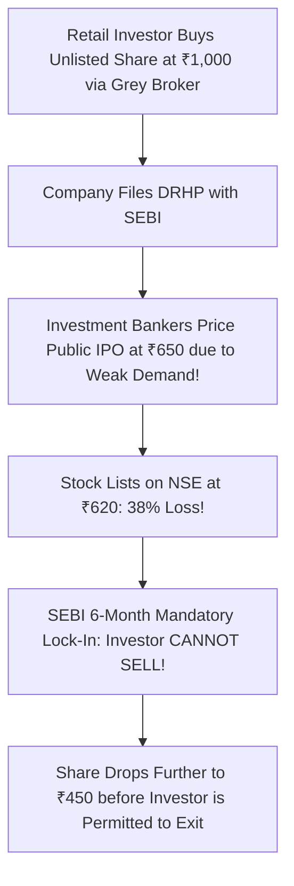

## 1. The Pre-IPO Hype Machine in India

Over the past five years, an informal off-market industry has boomed in India, peddling "Pre-IPO Shares" of late-stage startups and unlisted subsidiaries to retail investors:
> *"Buy unlisted shares of HDB Financial, Reliance Retail, boAt, or NSE before their mega-IPO and make 300% on listing day!"*

Fintech platforms facilitate these transactions through **Off-Market Demat Transfers (DIS slips)**, connecting early employees or angel investors looking to cash out with hopeful retail buyers.

However, behind the glittering marketing lies an asset class fraught with **extreme information asymmetry, inflated valuations, and severe statutory lock-ins**.

---

## 2. The Structural Pitfalls of Unlisted Equities

### A. Non-Existent True Price Discovery
On the NSE and BSE, millions of institutional and retail participants continuously adjust stock prices based on real-time news, quarterly earnings, and order books. 

In the unlisted grey market:
- Prices are quoted arbitrarily by small syndicates of dealers who hold physical inventories of shares.
- Spreads between the 'Buy' and 'Sell' quotes frequently range from **$15\%  to  30\%$**.
- There is zero short-selling mechanism to discipline irrational pricing.

### B. SEBI's Mandatory 6-Month Post-Listing Lock-In
Under **Regulation 17 of the SEBI (ICDR) Regulations, 2018**:
> *"The entire pre-issue capital held by persons other than promoters shall be locked in for a period of six months from the date of allotment in the public issue."*

If you buy unlisted pre-IPO shares and the company subsequently goes public:
- Your demat depository (NSDL/CDSL) **freezes your shares with a statutory lock-in**.
- You **cannot sell on listing day**, even if the stock surges $100\%$ on listing.
- You are forced to watch the stock trade for **six full months**. By the time your lock-in expires, post-IPO euphoria has typically cooled, anchor investors have dumped their allocations, and retail pre-IPO buyers are left holding steep paper losses (as demonstrated by Paytm, Nykaa, and LIC).

---

## 3. Statutory Taxation on Unlisted Shares

Following the Finance (No. 2) Act 2024:
1. **Holding Period for LTCG:** **24 Months** (unlike listed shares which require only 12 months).
2. **Long-Term Capital Gains Rate:** **$12.5\%$ flat without indexation** under Section 112.
3. **Short-Term Capital Gains Rate ($< 24$ months):** **Taxed at your marginal income slab rate ($31.2\%  or  39\%$)**!
4. **Section 56(2)(x) Tax Trap:** If you purchase unlisted shares below their statutory **Fair Market Value (FMV)** calculated under Rule 11UA, the difference is treated as deemed income and taxed immediately in your hands as a perquisite!
